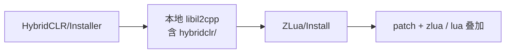

# HybridCLR 集成

ZLua 与 [HybridCLR](https://github.com/focus-creative-games/hybridclr) **v9.0.0+** 原生兼容：Il2Cpp Player 上可同时使用 HybridCLR 热更新与 ZLua 的 Lua↔C# 互操作。本篇约定 **双 Package** 集成时的安装顺序、运行时加载与配置边界。

未使用 HybridCLR 时，请走 [安装与 Lua 版本](/docs/guides/install/) 的常规路径即可。

## 你要完成的事

1. 同时引入 HybridCLR 与 ZLua 两个 UPM 包（版本下限见下）
2. **先** `HybridCLR/Installer`，**再** `ZLua/Install`（顺序强制）
3. 在 Lua 访问热更类型 **之前** `Assembly.Load`（或 HybridCLR 等价加载）热更程序集
4. 热更程序集上的 `[LuaAlias]` / `[LuaMarshalAs]` / `[LuaExtension]` **只**用代码 Attribute；XML **无效**

## 1. 安装 Package

在 `Packages/manifest.json` 中同时依赖：

| Package | 最低版本 | 说明 |
|---------|----------|------|
| `com.code-philosophy.hybridclr` | **v9.0.0+** | HybridCLR 热更新运行时与 Editor 工具 |
| `com.code-philosophy.zlua` | **1.0.0+** | ZLua（含对本地 `libil2cpp` 的 patch / overlay） |

示例（版本号按你实际选用的标签或 Git 引用替换）：

```json
{
  "dependencies": {
    "com.code-philosophy.hybridclr": "9.0.0",
    "com.code-philosophy.zlua": "1.0.0"
  }
}
```

也可使用各自仓库的 Git URL / 版本标签。HybridCLR 安装与热更工程约定以 [HybridCLR 官方文档](https://www.hybridclr.cn/) 为准；ZLua 通用步骤见 [安装与 Lua 版本](/docs/guides/install/)。

:::tip 版本要求
低于 HybridCLR **v9.0.0** 或 ZLua **1.0.0** 的组合 **不在** 本集成文档保证范围内。升级任一包后建议重新按 §2 跑一遍 Installer。
:::

## 2. Installer 顺序（必须）

本地 Il2Cpp 树由两步叠加而成，**顺序不可颠倒**：



| 步骤 | 菜单 | 作用 |
|------|------|------|
| 1 | **`HybridCLR/Installer`** | 将 HybridCLR 的 C++ runtime（`il2cpp_plus` + `hybridclr/` 等）安装到工程本地 `libil2cpp` |
| 2 | **`ZLua/Install`**（或 `ZLua/Install...`） | 在 **已存在** 的本地树上打 ZLua patch，并叠加 `zlua` / 选定 Lua 源码等 |

**原因：** ZLua Install 会 **patch 本地 `libil2cpp` 代码**。该本地树须先由 HybridCLR Installer 落盘；若先跑 ZLua、或根本没有 HybridCLR 本地树，patch 目标不存在或版本不匹配，集成会失败。

:::danger 顺序错误
先 `ZLua/Install` 再 `HybridCLR/Installer`，或只装其中一个，都可能导致 Player 构建失败、热更与 Lua 桥接行为异常。换 Unity 版本 / 重装本地 Il2Cpp 后，仍须按 **HybridCLR → ZLua** 重跑。
:::

### 建议检查

1. HybridCLR Installer 日志成功，本地存在含 `hybridclr/` 的 `libil2cpp`
2. 再执行 `ZLua/Install`，日志成功；Settings 中 Lua 版本正确
3. 发布前按 [构建流程](/docs/guides/build/) 执行 **`ZLua/Generate/All`**（以及 HybridCLR 侧所需的 Generate / 补充元数据步骤）

## 3. 代码中使用：先加载热更程序集

Lua 通过 `CSharp[...]` / 类型表访问的类型，必须已存在于当前 AppDomain。对 HybridCLR 热更 DLL，须在 **首次从 Lua（或会触发 `EnsureBinding` 的 C#）触达这些类型之前** 完成加载：

```csharp
using System.Reflection;

// 按项目约定读取 dll 字节（StreamingAssets / 热更目录等）
byte[] dllBytes = LoadHotUpdateDllBytes("HotUpdate.dll");
Assembly.Load(dllBytes);

// 此后方可：
// - Lua: local T = CSharp['HotUpdate']['MyGame.HotType']
// - 或 C# 侧触发对该程序集类型的绑定
```

也可使用 HybridCLR 提供的加载封装（若工程已统一走 `RuntimeApi.LoadMetadataForAOTAssembly` / 自定义 `Assembly.Load` 包装）；**语义相同**：程序集未 Load 完成前，不要从 Lua 访问其中的类型。

典型启动顺序：

1. HybridCLR 补充 AOT 元数据（若项目需要）
2. `Assembly.Load` 热更程序集
3. `LuaAppDomain.Initialize`（若尚未初始化；也可 Initialize 在前，但 **访问热更类型必须在 Load 之后**）
4. 再执行会碰到热更类型的 Lua / `GetFunction` 逻辑

## 4. 注意事项：热更程序集上的 Alias / MarshalAs / Extension

| 机制 | 热更新程序集 | 非热更新（AOT / 预编译）程序集 |
|------|--------------|--------------------------------|
| `[LuaAlias]` | ✅ 仅代码 Attribute | Attribute 或 Alias XML |
| `[LuaMarshalAs]` | ✅ 仅代码 Attribute | Attribute 或 MarshalAs XML |
| `[LuaExtension]` | ✅ 仅代码 Attribute | Attribute 或 Extension XML |

对 **热更新程序集**：

- **只支持**在 C# 源码中添加对应 CustomAttribute
- Settings 里的 `luaAliasXmlPaths` / `marshalAsXmlPaths` / `luaExtensionXmlPaths` **不要**指望覆盖热更 DLL
- 即便配置了指向热更类型的 XML，**也不会生效**

```csharp
using ZLua;

// 热更程序集内：必须用 Attribute
public class HotService
{
    [LuaAlias("tick_i32")]
    public void Tick(int frame) { }

    public void Send(
        [LuaMarshalAs(LuaMarshalType.Bytes)] byte[] payload) { }
}

[LuaExtension(typeof(HotTransformExt))]
public class HotView { }
```

细则：

- [LuaAlias](/docs/guides/lua-alias/)
- [LuaMarshalAs](/docs/guides/lua-marshal-as/)
- [Extension 方法](/docs/guides/extension-methods/)

## 5. 常见问题

| 现象 | 处理 |
|------|------|
| ZLua Install 找不到 / 无法 patch 本地 `libil2cpp` | 是否已先跑 **`HybridCLR/Installer`** |
| Player 能热更，Lua 访问热更类型失败 | 是否在访问前 **`Assembly.Load`**；程序集名 / 类型全名是否与 `CSharp[...]` 一致 |
| 热更类型上的 XML 别名 / Marshal 不生效 | 预期行为；改为代码中的 `[LuaAlias]` / `[LuaMarshalAs]` / `[LuaExtension]` |
| 换 Unity 或重装本地 Il2Cpp 后异常 | 按 §2 **重新** HybridCLR Installer → ZLua Install → Generate |

## 学习路径

| | |
|---|---|
| **上一篇** | [安装与 Lua 版本](/docs/guides/install/) |
| **下一篇** | [初始化与最小互调](/docs/guides/hello-interop/) |

## 相关文档

- [安装与 Lua 版本](/docs/guides/install/)
- [构建流程](/docs/guides/build/)
- [LuaAlias](/docs/guides/lua-alias/)
- [LuaMarshalAs](/docs/guides/lua-marshal-as/)
- [Extension 方法](/docs/guides/extension-methods/)
- [多版本管理 · HybridCLR 底座](/docs/spec/11-MULTI-VERSION/)
- [介绍](/docs/intro/) — HybridCLR 兼容性说明
