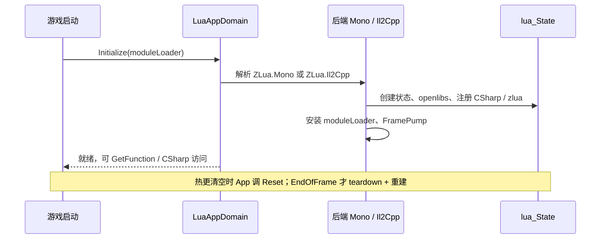

# LuaAppDomain

`LuaAppDomain` 是 ZLua 的 **唯一公开宿主入口**：初始化 / 整域重置 Lua，以及用 **`GetFunction`** 从模块按名取得 Lua 函数对应的 Delegate。宿主面 **不** 暴露 `Shutdown`；清空脚本世界只走 `Reset`。

Canonical 示例：[zlua-demo Bootstrap.cs](https://github.com/focus-creative-games/zlua-demo/blob/main/Assets/Bootstrap.cs)

## API

```csharp
namespace ZLua
{
    public static class LuaAppDomain
    {
        public static void Initialize(Func<string, object> moduleLoader);
        public static void Reset(Func<string, object> moduleLoader);

        public static T GetFunction<T>(string luaModule, string luaMethodName)
            where T : MulticastDelegate;
    }
}
```

权威细则：[spec/01-HOST-API.md](/docs/spec/01-HOST-API/)、[spec/10-LIFETIME.md](/docs/spec/10-LIFETIME/) §7。

---

### `Initialize(moduleLoader)`

| 参数 | 说明 |
|------|------|
| `moduleLoader` | `Func<string, object>`，按模块名返回 Lua 源码 **string** 或 **byte[]** |

仅首次（或进程内尚无主 `lua_State`）创建状态并安装 loader。**已初始化**时再次调用 → **抛异常**（须 `Reset`；**不**再支持「只换 loader」）。

```csharp
[RuntimeInitializeOnLoadMethod(RuntimeInitializeLoadType.BeforeSceneLoad)]
private static void InitZLuaOnStartup()
{
    LuaAppDomain.Initialize(LoadLuaModule);
}
```

`LoadLuaModule` 负责 Editor（`LuaScripts/*.lua`）与 Player（`StreamingAssets/*.lua.txt`）路径差异，见 [安装指南](/docs/getting-started/installation/)。

---

### `Reset(moduleLoader)`

热更或清空脚本世界：拆掉当前唯一主 `lua_State`，再以给定 loader 重建。

| 行为 | 说明 |
|------|------|
| 调用当下 | **仅预约**：保存 loader；多次预约以最后一次为准。**不**立刻 `lua_close` |
| 真正执行 | 本帧 **EndOfFrame**（`LuaFramePump` / `WaitForEndOfFrame`）：排空 pending ref → 关闭 Registry / 模块缓存 → `lua_close` → 按 Initialize 路径重建并安装 loader |
| 旧委托 | EndOfFrame 应用之后，对旧 `GetFunction` 委托的调用 → 抛 C# 异常；宿主须重新 `GetFunction` 并丢弃字段缓存 |
| Il2Cpp | 进程级 Bridge / XML 表 / InternalCall **保留**，仅重建 state 级资源 |

```csharp
// 热更后清空脚本世界（可在 C#↔Lua 调用中途调用；只排队）
LuaAppDomain.Reset(LoadLuaModule);
// 下一帧起：丢弃旧 Action/Func，重新 GetFunction
```

---

### `GetFunction<T>(luaModule, luaMethodName)`

按模块名与方法名解析 Lua `function`，绑定为委托类型 `T` 并返回。

```csharp
var add = LuaAppDomain.GetFunction<Func<int, int, int>>("app", "add");
int sum = add(10, 20);

var onTick = LuaAppDomain.GetFunction<Action<float>>("game", "OnTick");
onTick(0.016f);
```

| 规则 | 说明 |
|------|------|
| `T` | 必须是具体 `MulticastDelegate` 类型（如 `Action<>` / `Func<>`） |
| `luaModule` / `luaMethodName` | 与 `LoadLuaModule` 模块名、Lua `return { ... }` 键名一致 |
| 缓存 | **由调用方负责**（热路径请存到字段 / 局部变量后再调）；`Reset` 生效后旧委托一律作废，须重新绑定 |
| Marshal | 对返回的 delegate `Invoke` 时遵循 [Marshal 速查表](/docs/reference/marshal-cheatsheet/)；可用 `[LuaMarshalAs]` |

模块缺失、键不是 function、或无法绑定为 `T` → 抛 C# 异常。

---

## 初始化流程



## 双运行时转发

`LuaAppDomain` 本身在 `ZLua.Common`；实际逻辑由后端程序集实现：

| 环境 | 程序集 | 实现类型 |
|------|--------|----------|
| Unity Editor | `ZLua.Mono` | `LuaMonoAppDomain` |
| Il2Cpp Player | `ZLua.Il2Cpp` | `LuaIl2CppAppDomain` |

`Application.isEditor` 决定加载哪个后端；**对外 API 不变**。

## 生命周期与 FramePump

初始化后会注册 `LuaFramePump`，在 Unity 帧循环中处理：

- `LateUpdate`：ref / userdata 延迟释放（`ProcessPendingRefReleases`）
- `WaitForEndOfFrame`：执行已预约的 `Reset`（整域 teardown + 重建）

一般 **无需** 手动调用帧泵。

## 与 `LuaEnv` 的关系

| 类型 | 可见性 | 说明 |
|------|--------|------|
| `LuaAppDomain` | **public** | 游戏代码唯一入口（`Initialize` / `Reset` / `GetFunction`） |
| `LuaEnv` | public（Mono 模块） | 底层 `lua_State` 包装；由后端内部创建，**不建议**业务代码自行 `new LuaEnv()` |

标准集成路径：`LuaAppDomain.Initialize` → `GetFunction` / `CSharp` 访问；热更清空用 `Reset`。

## 模块加载约定

`moduleLoader("app")` 的返回值会被 `require` 语义加载。与 `GetFunction(..., "app", ...)` 的 **module** 参数必须一致。

| 环境 | 路径 |
|------|------|
| Editor | `{ProjectRoot}/LuaScripts/app.lua` |
| Player | `StreamingAssets/LuaScripts/app.lua.txt` |

## 常见错误

| 现象 | 处理 |
|------|------|
| `Lua module loader is not configured` | 未调用 `Initialize` 或 loader 为 null |
| 再次 `Initialize` 抛异常 | 已有主 state；改用 `Reset(loader)` |
| `require` / GetFunction 失败 | 检查模块名、文件路径、`.lua.txt` 后缀、`return` 表键名 |
| Reset 后旧委托抛异常 | 丢弃缓存的 `Action`/`Func`，重新 `GetFunction` |
| Player 无 Lua 脚本 | 确认 Sync 脚本已执行，StreamingAssets 含目标文件 |
| Marshal / 绑定失败 | 对照 [Marshal 速查表](/docs/reference/marshal-cheatsheet/) 与 `T` 签名 |

## 相关文档

- [C# 调用 Lua 指南](/docs/guides/csharp-calling-lua/)
- [Function 与 Delegate](/docs/guides/functions/)
- [Lua 模块加载](/docs/guides/csharp-calling-lua/)
- [设计规范](/docs/spec/00-OVERVIEW/)
- [源码 LuaAppDomain.cs](https://github.com/focus-creative-games/zlua/blob/main/Runtime/Common/LuaAppDomain.cs)
