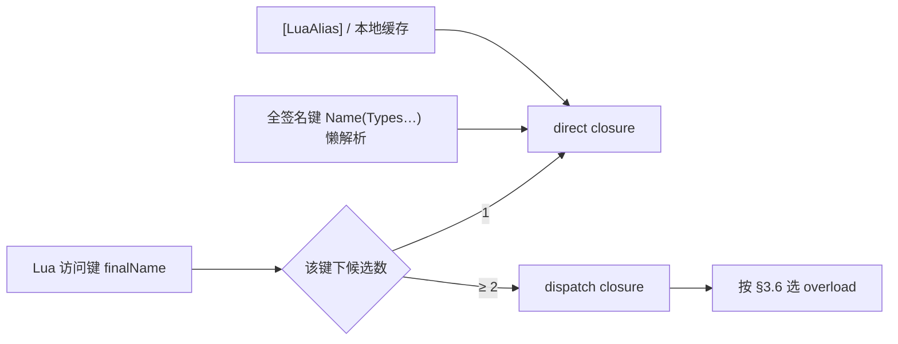

---
sidebar_position: 4
title: "方法重载"
---

# 04 — 方法重载

> C# 方法重载在 Lua 侧的解析与调用策略。适用于 **Il2Cpp（Player）** 与 **Mono（Editor）**。
> 继承与 Bind 规则见 [02-TYPE-SYSTEM.md](/docs/spec/02-TYPE-SYSTEM/) §5；`zlua` API 见 [05-LIB.md](/docs/spec/05-LIB/)。

---

## 1. 问题与目标

C# 允许同名方法因参数类型/个数不同而重载；Lua 无静态类型，无法仅凭 `obj:Run(x)` 在编译期选定重载。

| 目标 | 说明 |
|------|------|
| 易用 | `obj:Run(10)` 在常见场景下应能工作 |
| 精确 | 需要点名某一重载时用 **全签名键**（miss 时懒解析，见 §3.7）；亦可 `[LuaAlias]` 挂短名 |
| 性能 | 热路径优先单候选 direct（别名、或本地缓存 closure），避免反复走 dispatch |
| 一致 | Mono 与 Il2Cpp 选中同一重载，错误信息一致 |

---

## 2. 三层机制（优先级）



1. **按最终名字分组**（§3、§5）：绑定时每个方法以其 **最终 Lua 名**（C# 默认名、`[LuaAlias]` / XML 别名）进入分组；**同名允许多个候选**（仅 Bind 期别名机制）。
2. **单候选 → direct；多候选 → dispatch**（§3.6）。
3. **全签名键按需懒解析**（§3.7）：Bind **不**预挂 `MethodName(ParamTypeFullNames…)`；`__index` miss 且键含 `(` 时再按签名在类型层次上查找、缓存。
4. **元表短名冻结**：Bind 完成后 **不**提供运行时挂名 API；需要短名冒号调用时用 Bind 期 `[LuaAlias]` / XML。全签名键缓存是 miss 路径的惰性写入，不改变短名 overload 组。

---

## 3. 默认名与 dispatch

### 3.1 注册规则（按最终名字分组）

在同一类型、同一 `is_static` 域、同一实例形态（ByVal / ByObj）内，先收集每个方法的 **最终 Lua 名集合**（见 §5），再按名字聚合：

| 该最终名下的候选方法数 | 元表键绑定 |
|------------------------|------------|
| 1 | 该候选的 **direct method closure** |
| ≥ 2 | **dispatch closure**（调用时按 §3.6 选具体重载） |

来源可以是：

- 多个 C# 同名重载（默认名相同）；或
- `[LuaAlias]` / XML 把不同方法挂到 **同一最终名**（与默认名或其他别名重复均允许）；或
- **C# extension**（经 [13-EXTENSION-METHODS](/docs/spec/13-EXTENSION-METHODS/) 配置注入 IMT）与真实例方法 **同一最终名** → **合并竞争**（无「实例优先于扩展」）；全签名键与匹配均按去掉 `this` 后的形参计算。

静态与实例分表存放（`staticMap` vs `byvalInstanceMap` / `byobjInstanceMap`）。C# 允许 `static void Foo()` 与 `void Foo()` 同名，二者互不影响。

### 3.2 重载候选顺序

分派时遍历候选列表，在 **applicable** 重载中按 **§3.6 better function member** 选优；**不得**因 metadata 声明顺序靠前就选中 `ImplicitBoxing` 而跳过更优的 `Identity` 重载。

候选遍历顺序（仅用于 **同分 tie-break**）：

1. **Codegen 声明顺序**（Il2Cpp / Mono 生成元数据中的顺序）
2. 反射兜底：确定性排序（如完整签名字典序）

### 3.3 参数匹配规则

在 **Lua 栈槽个数**可接受的前提下，按栈光标逐 **CLR 形参**判断是否可绑定（`UnpackedValues` 等可占用多槽，见下表与 [marshal/02-MARSHAL-AS.md](/docs/spec/marshal/02-MARSHAL-AS/) §5.6）。规则与 [marshal/](/docs/spec/marshal/) 的 `ReadValue` / `TryPop` 一致，包括但不限于：

| Lua 实参 | C# 形参 | 规则 |
|----------|---------|------|
| `integer` | `int` / `long` 等 | 在目标类型范围内 |
| `number`（非整数） | `int` | **不匹配** |
| `number` | `float` / `double` | 允许 |
| `string` | `string` | 允许 |
| `nil` | 引用类型 / `Nullable<T>` | 允许 |
| `nil` | 值类型（非 Nullable） | 不匹配 |
| userdata | 引用类型 | 运行时类型可赋值 |
| 基元 / `string` | **`object`** | 允许；`ImplicitBoxing` 或 `ImplicitReference` |
| ByVal 值类型 | **`object` / 其实现的 interface** | 可隐式装箱时 `ImplicitBoxing` |
| 基元 | **`class` / `interface`（非 `object`）** | **不匹配** |
| 多参 + `params T[]` | `params` | **可展开**：定参前缀之后的 **0～N** 个 Lua 槽逐个按元素类型 `T` 匹配并打包为 `T[]`；或 **单个** 匹配的 `T[]` ByObjUserData 整段传入。详见下文与 [marshal/02-MARSHAL-AS.md](/docs/spec/marshal/02-MARSHAL-AS/) §7 |
| `UnpackedValues` 形参 | 连续 N 槽 | 该 CLR 形参占用 **N** 个 Lua 实参槽（`N = Members.Length`）；匹配时按栈槽累加，见 [marshal/02-MARSHAL-AS.md](/docs/spec/marshal/02-MARSHAL-AS/) §5.6 |
| **`out A`** | **0** 槽 | **不计入** `luaArity` / `minLuaArity`；匹配时跳过该 CLR 形参；Invoke 后按 [marshal/03-BYREF.md](/docs/spec/marshal/03-BYREF/) §5 以多返回值 Push（`return, out1, …`） |
| **`ref A` / `in A`** | 按 **A** 的 by-val / Opaque 规则占槽 | 见 [marshal/03-BYREF.md](/docs/spec/marshal/03-BYREF/) §3–§4（仍占实参，与 `out` 不同） |

**可选 / 默认参数（C# optional）：**

| 规则 | 说明 |
|------|------|
| 适用范围 | 方法与构造；形参带 CLR `HasDefault`（及可物化的默认值）的 **尾部连续** 可选段 |
| 实参个数 | 允许 `minLuaArity ≤ argCount ≤ luaArity`（`minLuaArity` = 全参 Lua 槽数 − 可省略尾部槽数之和；含可省略的 `params` 位时一并计入） |
| 匹配 | 栈上已有槽按 §3.3 / §3.6 正常打分；不足的尾部形参记为「使用默认」，不消耗 Lua 槽 |
| 填充时机 | Bind 期物化并缓存默认值；**invoke** 时写入未提供的形参（热路径不解析 metadata） |
| 选优 | 转换 kind / score 相同时，**`optionalUsed` 更小**的候选更优（少用默认），再同分 → 见 §3.6.3（含 `params` 展开惩罚） |
| 不支持 | 非尾部「跳过」必选形参；无 `HasDefault` 却依赖 C# 编译器其它糖 |

```csharp
void Foo(int x, int y = 5);
void G(int x);
void G(int x, int y = 5);
```

| Lua | 结果 |
|-----|------|
| `Foo(1)` | 适用；`y` 用默认 |
| `Foo()` | 不适用（`x` 无默认） |
| `G(1)` | 选 `G(int)`（`optionalUsed=0` ≻ 展开默认的 `G(int,int)`） |
| `G(1, 4)` | 选 `G(int, int)` |

**`params T[]`（C# 可变参数）：**

对齐 C#：既可 **展开** 传入 0～N 个 `T`，也可传入 **已有 `T[]`**。Lua 侧规则如下（Marshal 细节见 [marshal/02-MARSHAL-AS.md](/docs/spec/marshal/02-MARSHAL-AS/) §7）。

| 规则 | 说明 |
|------|------|
| 适用范围 | 方法与构造上带 CLR `ParamArrayAttribute` 的 **尾部** 一维 `T[]` 形参 |
| 实参个数 | `minLuaArity ≤ argCount`（`params` 可省略 → 空数组 `T[0]`）；**无** 固定上界（实现可对 overload arity 桶设有限上限，超出走 params overflow 路径） |
| 展开 | 定参前缀匹配后，**剩余全部** Lua 槽按元素类型 `T` 逐个匹配，打包为新 `T[]` |
| 整段传入 | **仅** 当 `params` 位对应 **恰好 1** 个实参，且该实参为 **可赋值给 `T[]` 的 ByObjUserData**（已有托管数组）时，直接传入该引用（对齐 C# `Foo(existingArray)`） |
| **禁止** | **table** 当作整个 `T[]`；**`nil` 当作整个 `null` 的 `T[]`** |
| `nil` 语义 | 展开路径中，`nil` 按元素规则绑定（引用类型 / `Nullable` → **null 元素**；值类型非 Nullable → 不匹配）。省略 `params` 实参 → **`T[0]`**，**不是** `null` 数组 |
| 选优 | 转换分数与 `optionalUsed` 相同后：**未展开**（整段 userdata）优于 **展开**；再相同则 **非 `params` 形参** 的候选优于带 `params` 的候选（对齐 C# 定参优先） |
| 不支持 | **GetFunction / delegate bridge** 上的 `params`（见 [marshal/09-FUNCTION.md](/docs/spec/marshal/09-FUNCTION/)） |

```csharp
static int Sum(params int[] values);
static string Pick(int x);
static string Pick(params int[] values);
static int Add(int a, int b);
static int Add(params int[] values);
static int CountNulls(params string[] values);
```

| Lua | 结果 |
|-----|------|
| `Sum(1, 2, 3)` | 展开 → `int[]{1,2,3}` |
| `Sum()` | 空数组 `int[0]` |
| `Sum(arr)`（`arr` 为 `int[]` userdata） | 整段传入该数组 |
| `Sum({1,2,3})` | **不匹配**（table 不当整段 `T[]`；且 table 不是 `int`） |
| `CountNulls(nil)` | 展开 → `string[]{ null }`（**不是** `null` 数组） |
| `Pick(7)` | 选 `Pick(int)`（定参优先于 params 展开） |
| `Pick(1, 2)` | 选 `Pick(params int[])` |
| `Add(3, 4)` | 选 `Add(int,int)` |
| `Add(1, 2, 3)` | 选 `Add(params int[])` |

**构造函数：** `Type(...)` / `SMT.__call` 使用与实例方法相同的分派逻辑（含默认参数与 `params`）。

### 3.4 性能说明

dispatch 每次调用需遍历候选并重算匹配，为**低效路径**。热点若只需固定重载，应使用：

- **只含单候选** 的最终名（例如独立 `[LuaAlias("run_i32")]`）；或
- **全签名键**（§3.7，首次 miss 后缓存为 direct）；或
- 在脚本内 **本地缓存** 已取得的 direct closure。

### 3.5 失败错误

无匹配重载时 `luaL_error`，并列出候选签名，例如：

```
no overload for Demo.Run matching (number); candidates: Run(System.Int32), Run(System.String)
```

错误文案中的候选名格式与 §3.7 全签名键一致，便于脚本对照改写。

### 3.6 隐式转换分类与最优重载选择

重载分派须与 **C# better function member** 一致。

#### 3.6.1 设计原则

1. **`ConversionKind` 只描述 C# 隐式转换类别**，不描述 Lua userdata 载荷形态。
2. **选优规则与 C# 一致**。
3. **Mono / Il2Cpp** 对同一组 Lua 实参须选中同一 C# 重载。

#### 3.6.2 `ConversionKind`

| Kind | C# 对应 | 含义 |
|------|---------|------|
| `Identity` | 恒等转换 | 类型相同 |
| `ImplicitNumeric` | 隐式数值转换 | 仅拓宽 |
| `ImplicitEnum` | 隐式枚举转换 | integer → enum |
| `NullLiteral` | null 字面量 | `nil` → 引用 / Nullable |
| `ImplicitReference` | 隐式引用转换 | 子类→父类；`string`→`object` |
| `ImplicitBoxing` | 隐式装箱 | 值类型→`object` / interface |
| `None` | — | 不匹配 |

Kind 优劣链：

`Identity` ≻ `ImplicitNumeric` ≻ `ImplicitEnum` ≻ `NullLiteral` ≻ `ImplicitReference` ≻ `ImplicitBoxing`

#### 3.6.3 Better function member

1. 逐形参计算 `GetConversionKind`；任一 `None` → 不适用。
2. M 优于 N：存在形参 i 使 M 更优，且不存在 j 使 N 更优。
3. 转换分数仍相同：比较本次匹配使用的 **默认参数个数**（`optionalUsed`），更少者更优（见 §3.3）。
4. 仍相同：比较 **`paramsExpanded`**（本次是否对 `params` 做了多槽展开），**未展开**（0，含整段 `T[]` userdata 或省略为空数组）优于 **展开**（1）。
5. 仍相同：比较 **`paramsKind`**（候选是否带 `params` 形参），**非 params**（0）优于 **params**（1）（定参重载优先）。
6. 仍无 strictly better → Ambiguous 或声明顺序 tie-break（实现以 Ambiguous 为准时须一致）。

**示例：**

| Lua 调用 | 结论 |
|----------|------|
| `Run(10)`，`Run(int)` vs `Run(object)` | 选 `Run(int)`（Identity ≻ Boxing） |
| `SetValue(10, 0)`，`SetValue(object,int)` vs `SetValue(object,long)` | 选 `(object,int)`（p1 Identity ≻ Numeric） |
| `Pick(7)`，`Pick(int)` vs `Pick(params int[])` | 选 `Pick(int)`（定参；`paramsKind` / 未展开优先） |
| `Add(3, 4)`，`Add(int,int)` vs `Add(params int[])` | 选 `Add(int,int)` |

#### 3.6.4 invoke 期隐式 Box

仅当 Kind 为 `ImplicitBoxing` 时，在 **已选定重载** 的 `TryPop` 内 `Object::Box`。**禁止**在 `GetConversionKind` 循环内 Box。

### 3.7 全签名键（懒解析）

**不**在 Bind 期向 `methodTable` / method map 预挂全签名键（避免绝大多数脚本永不访问的浪费，也避免「仅当存在重载才挂键」导致去掉重载后签名访问突然失败）。

#### 3.7.1 键格式

```text
<MethodName>(<Type0.FullName>,<Type1.FullName>,…)
```

| 规则 | 说明 |
|------|------|
| 方法名 | C# **`MethodInfo.Name`**（CLR 名；**不是** `[LuaAlias]` 短名） |
| 参数列表 | 与 §4.1 相同：括号 + 逗号分隔的类型全名；**不含** 返回类型；byref / 数组 / 开放泛型形参名与元数据一致 |
| 扩展方法 | 签名 **不含** `this` 形参（与调用侧 Lua 实参一致） |
| 适用范围 | **任意** public 实例/静态 **方法**（含单候选；已被 `[LuaAlias]` 换名的方法仍可用 CLR 名拼键） |
| **排除** | **类实例构造函数**、**类静态构造函数（`.cctor`）** —— 二者 **不** 参与全签名键懒解析；构造仍只走类型表 `__call` / 既有构造分派 |

#### 3.7.2 `__index` miss 路径

访问类型/实例元表成员时，若 `methodTable`（及 field 表）均未命中，且键为字符串且 **含 `(`**：

1. 在当前类型及其 **基类链** 上遍历 public 方法（静/实例与当前元表域一致；跳过 property `get_`/`set_` 访问器；**跳过** 实例构造与静态构造）。
2. 将每个方法的 §3.7.1 键与请求键比较；**返回第一个匹配**。
3. 生成该候选的 **direct**（或开放泛型的 GTAP）closure，写入对应 `methodTable` **与** method map（缓存），再返回。
4. 无匹配 → 与其它 miss 相同，`member not found`。

| 项 | 说明 |
|----|------|
| ByVal / ByObj | 在触发 miss 的那一侧表缓存；`isByVal` 与该侧一致 |
| 与短名 | 不改变已有 short-name direct/dispatch；仅新增签名键条目 |

```lua
local demo = CSharp.AC.Foo()

demo:Run(5)                              -- 短名 dispatch（若仍挂 Run）
-- 全签名键：首次 miss → 懒解析并缓存
demo['Run(System.Int32)'](demo, 5)
demo['Run(System.String)'](demo, "hi")
-- 单候选亦可：demo['GetValue()'](demo)
```

> **冒号语法：** 键名含 `(` / `)`，不能写 `demo:Run(System.Int32)(...)`；须用括号键 + 点号调用。短名冒号用 Bind 期 `[LuaAlias]` / XML（§5）。

### 3.8 开放泛型方法调用前缀（GTAP）

开放泛型方法（方法自身带泛型形参）除 [05-LIB.md](/docs/spec/05-LIB/) §9 的 `inflate` 外，可在 **调用时刻** 用 **类型前缀** 隐式闭合（**GTAP** = Generic Type Argument Prefix）。

#### 3.8.1 形态

```text
实例：obj:Method(type1, …, typeN, arg1, …)
静态：Type.Method(type1, …, typeN, arg1, …)
```

| 项 | 规则 |
|----|------|
| `type1…typeN` | 连续 **N** 个 **`System.Type` ByObj userdata**（`zlua.typeof`）；**N** = 该开放泛型方法的泛型形参个数 |
| `arg…` | 闭合后签名的普通实参（可为 0 个） |
| 禁止作前缀 | 类型表、类型名字符串、`zlua.types.*`（须 `typeof` 或改用 `inflate`） |

#### 3.8.2 与普通重载的优先级

当短名下同时存在 **开放泛型** 候选与 **非泛型** 候选（例如 `GetComponent<T>()` 与 `GetComponent(Type)`）时：

1. 若实参前缀满足 §3.8.1，且余参对 **该开放泛型闭合后** 的形参 applicable → **优先选开放泛型路径**（inflate + 调用），**不再**把前缀 `System.Type` 当成普通 `Type` 形参送给非泛型重载。
2. 否则按 §3.6 对非泛型（及已闭合）候选正常选优。

#### 3.8.3 实现要点

- direct 开放泛型 closure 与含开放泛型候选的 dispatch 均须支持 GTAP。
- 隐式 inflate 与 `zlua.inflate` **共用 intern**；键至少含 `(closedMethod, isStatic, isByVal)`（`isByVal` 取自触发调用的元表侧）。
- **不**改变 §3.6 的 `ConversionKind` 定义；GTAP 是在 better-member 之前的 **前缀剥离 + 候选过滤** 步骤。

---

## 4. 签名字符串规范

### 4.1 `zlua.signature`

```lua
local sig = __zlua_create_signature(zlua.types.int32)
-- sig == "(System.Int32)"

local sig0 = __zlua_create_signature()
-- sig0 == "()"
```

**约定：**

- 参数为 C# 类型：类型表、`zlua.types.*` 或 mscorlib 字符串（与 [05-LIB.md](/docs/spec/05-LIB/) typeArg 相同）
- **不包含** 方法名（方法名由调用方拼接，见 §3.7）
- 格式：括号包裹、逗号分隔的 **`Type.FullName`** 列表
- 泛型、数组格式与 Codegen 元数据一致

Native 回调：`__zlua_create_signature`（`ZLuaLib.cpp`）。建议在项目 `zlualib` 扩展中封装为 `zlua.signature(...)`。

### 4.2 全签名键 = 方法名 + §4.1

```
"Run" + "(System.Int32)"  →  Lua 元表键 "Run(System.Int32)"
```

该键经 §3.7 miss 路径解析后缓存为 `methodTable` 字符串键。
**禁止** 把 **仅** 参数括号（如 `"(System.Int32)"`）当作方法键；必须带方法名。

---

## 5. 别名机制（`[LuaAlias]`）

### 5.1 模型：换名注册 + 按最终名分组

`[LuaAlias]` / XML 为该方法指定 **唯一最终 Lua 名**，**替换**（而非追加）C# 默认名 `MethodInfo.Name`。有别名时 **不再** 以默认名注册该方法。

对每个 public 方法，其 **最终 Lua 名** 为（优先级由高到低）：

| 来源 | 条件 |
|------|------|
| `[LuaAlias("…")]` | Attribute 存在且非空 → 用该字符串 |
| XML `Method/@alias` | 无 Attribute 时，若 XML 有规则 → 用该字符串 |
| C# 默认名 `MethodInfo.Name` | 以上皆无 |

随后在同一绑定域内：

```
按 finalName 聚合候选方法 → 候选数 1 → direct；≥ 2 → dispatch（§3.6）
```

因此：

- **允许**别名与其它方法的默认名或其它别名重复（撞名则并入同一 overload 组）；
- **不允许**「既挂别名又保留本方法默认名」——别名即换名；
- 调用该重名键时，与普通 C# 重载相同，走 **函数重载规则** 选合适候选。

### 5.2 允许重复（示例）

```csharp
public class Demo
{
    public void Run(int value) { }
    public void Run(string value) { }   // 默认名相同 → "Run" 自然成组

    public void Foo(int x) { }

    [LuaAlias("Foo")]                   // 允许：与已有方法名 Foo 重复 → 并入 "Foo"；本方法不再挂 "Bar"
    public void Bar(string s) { }

    [LuaAlias("print")]
    public void LogA(int x) { }

    [LuaAlias("print")]                 // 允许：别名彼此重复 → "print" 成组
    public void LogB(string s) { }

    [LuaAlias("run_i32")]               // 仅该最终名下多一个候选 → 通常为 direct；不再挂默认名 "Run"
    public void Run(long value) { }
}
```

```lua
local d = CSharp.AC.Demo()

d:Run(10)         -- "Run" 组（int/string；不含 long）→ dispatch
d:Foo("hi")       -- "Foo" 组含 Foo(int) 与 Bar(string) → dispatch → Bar(string)
d:print(1)        -- "print" 组 → dispatch
d:run_i32(10)     -- "run_i32" 单候选 → direct → Run(long)
-- d:Bar("x")     -- 不可用：Bar 已换名为 Foo
```

### 5.3 C# Attribute

```csharp
[LuaAlias("run_i32")]
public void Run(int value) { ... }
```

- 定义于 `ZLua.Common`。
- 与 XML：同一方法上 **Attribute 优先于 XML**（有 Attribute 则用 Attribute 作为最终名，忽略该槽位 XML；无 Attribute 才用 XML）。二者都是 **换名**，不是「默认名 + 别名」双挂。

### 5.4 XML 配置（独立于 MarshalAs）

`[LuaAlias]` 与 `[LuaMarshalAs]` **目标不同**（最终 Lua 名 vs 形参/返回值/成员 Marshal），绝大多数场景无交集。XML 可 **共享类似的 `Assembly` / `Type` / `Method` 定位风格**，但必须：

> **适用范围：** XML **仅**用于 **非热更新** 程序集（预编译 / AOT DLL）。**热更新程序集**（含 HybridCLR 热更 DLL）**只支持**在代码中配置 `[LuaAlias]`，**不支持**用 XML 为其配置别名规则。

| 约束 | 说明 |
|------|------|
| **独立路径列表** | Editor Settings 字段 **`luaAliasXmlPaths`**（与 `marshalAsXmlPaths` **并列、分开配置**） |
| **独立根元素** | **`ZLuaAlias`**；**不得**使用 `ZLuaMarshalAs` |
| **独立文件** | Alias 与 MarshalAs **分文件**书写（可共享 `Assembly`/`Type`/`Method` 定位风格） |

```xml
<?xml version="1.0" encoding="utf-8"?>
<ZLuaAlias version="1">
  <Assembly name="Assembly-CSharp">
    <Type fullName="Demo">
      <Method name="Run" signature="(System.Int32)" alias="run_i32"/>
    </Type>
  </Assembly>
</ZLuaAlias>
```

| 元素 / 属性 | 含义 |
|-------------|------|
| `version` | 必填；当前仅 `"1"`。未知 version → **失败** |
| `Assembly/@name` | `Assembly.GetName().Name`（与 MarshalAs XML 相同约定） |
| `Type/@fullName` | CLR 全名（嵌套 `Outer+Inner`；开放泛型写 ``Foo`1`` 作挂载容器） |
| `Method/@name` | CLR `MethodInfo.Name` |
| `Method/@signature` | 参数类型列表，圆括号包裹：`()` / `(T1,T2)`；byref 后缀 `&`；数组 `T[]`；**不含**返回类型（与 MarshalAs 的 Method 定位约定一致） |
| `Method/@alias` | **必填**；非空；作为该方法的 **唯一最终 Lua 名**（§5.1，替换默认名） |

**本文件允许的内容：** 仅 `Assembly` → `Type` → 带 `@alias` 的 `Method`。
**禁止：** `MarshalAs` / `Param` / `Return` / `Field` / `Property` 子元素，或 Method 缺少 `@alias` → **失败**。

| 其它约束 | 说明 |
|----------|------|
| 换名 | 有 `@alias` 时 **不**再以 `MethodInfo.Name` 注册该方法 |
| 与 Attribute | 同一方法若有 Attribute，以 Attribute 为准（§5.3）；XML 该条可记录为未使用（可选诊断） |
| 平台 | Mono 运行时按 `luaAliasXmlPaths` 解析；Il2Cpp **Generate** 成静态 alias 表，Player **不**读 XML（加载/Generate 模式对齐 [marshal/02-MARSHAL-AS.md](/docs/spec/marshal/02-MARSHAL-AS/) §9.6–§9.7，但是 **独立** registry / 生成物） |
| 重复 | 合并全部 alias XML 后，同一 `(assembly, type, methodName, signature)` 出现多条 `@alias` → **失败**（不得后文件覆盖）。不同方法撞同一最终名 **允许**（并入 overload 组，§5.1） |
### 5.5 静态 / 实例

- 实例最终名 → `byvalInstanceMap` / `byobjInstanceMap`（与 closure 域一致）
- 静态最终名 → `staticMap`

分组 **不得**跨静/实例或跨 ByVal/ByObj。

### 5.6 与 field / property 同名

若最终方法名与 field / 无参 property 同名，`__index` 仍 **methodTable 优先**（见 [metatable/02-INDEX.md](/docs/spec/metatable/02-INDEX/)）。这与「方法—方法」重名进 overload 组是不同层规则。

---

## 6. 辅助 API

显式点名某一重载时，优先顺序：

1. Bind 期 **`[LuaAlias]`** / XML 短名
2. **全签名键**（§3.7，懒解析）
3. 脚本内 **本地缓存** 已取得的 direct closure

`zlua.signature(...)`（§4.1）用于拼出 / 对照参数括号部分，**不是**单独的元表键。

**不提供**运行时 `zlua.register_method`：元表在 Bind 后冻结；同一 CLR 方法在 ByVal / ByObj 下对应不同 bridge，「取出再挂名」易丢失上下文。短名冒号调用只靠 Bind 期别名。

开放泛型方法的闭合见 [05-LIB.md](/docs/spec/05-LIB/) §9（`inflate` / GTAP）。

### 6.1 `zlua.types`

预置 mscorlib 类型名字符串，见 [05-LIB.md](/docs/spec/05-LIB/) §4.2。

---

## 7. 调用约定摘要

| 场景 | 写法 |
|------|------|
| 默认分派 | `demo:Run(10)` |
| 精确重载（全签名键，§3.7） | `demo['Run(System.Int32)'](demo, 10)` |
| `[LuaAlias]` 短名 | `demo:run_i32(20)` |
| 本地缓存 direct | `local run = demo['Run(System.Int32)']; run(demo, 20)` |
| 静态 | `Demo.Add(3, 5)` / `Demo['Add(System.Int32,System.Int32)'](3, 5)` |
| ~~仅参数括号当键~~ | ~~`demo['(System.Int32)'](...)`~~ **禁止** |

实例方法：全签名键用 **点号** 并显式传 `self`；短别名（`[LuaAlias]`）可用 **冒号**。

---

## 8. Mono / Il2Cpp 一致性

| 项 | 要求 |
|----|------|
| 按最终名分组 + dispatch §3 / §5 | 一致 |
| 同名多候选时全签名键 §3.7 | 一致 |
| 别名允许与默认名 / 其它别名重复 | 一致 |
| 签名格式 §4.1 | 一致 |
| dispatch §3.3、§3.6 | 一致 |
| GTAP §3.8（前缀 + 相对非泛型重载优先级） | 一致 |
| 全签名键懒解析 §3.7 | 一致 |
| `inflate` / GTAP intern 键含 `isStatic` / `isByVal` | 一致 |
| 选中重载 | 相同实参 → 相同 C# 重载 |
| 元表短名 Bind 后冻结（无运行时挂短名） | 一致 |
| 错误文案 | 一致或等价 |

---

## 9. 完整示例

```csharp
public class Demo
{
    public void Run(int value) { }

    [LuaAlias("run_str")]   // 换名为 "run_str"；不再挂默认名 "Run"
    public void Run(string value) { }

    public void Foo(int x) { }

    [LuaAlias("Foo")]       // 与默认名 Foo 重复 → "Foo" 组含 Foo(int)+Bar(string)；Bar 不再挂 "Bar"
    public void Bar(string s) { }

    public static int Add(int a, int b) => a + b;

    [LuaAlias("add_i32")]
    public static int Add(int x) => x;
}
```

```lua
local demo = CSharp.AC.Demo()

demo:Run(10)        -- "Run" 多候选 → dispatch → Run(int)
demo:Run("ab")      -- dispatch → Run(string)
demo['Run(System.Int32)'](demo, 10)   -- 全签名键 → direct
demo:run_str("x")   -- 单候选别名 → direct

demo:Foo("hi")      -- "Foo" 含 Foo(int) 与 Bar(string) → dispatch → Bar(string)

local run_i32 = demo['Run(System.Int32)']
run_i32(demo, 20)                             -- 本地缓存 direct

assert.equal(CSharp.AC.Demo.add_i32(7), 7)    -- [LuaAlias] 短名
```

---

## 10. 实现落点（参考）

| 模块 | 职责 |
|------|------|
| `ValueMarshaling` / Mono 等价 | `ConversionKind`、`GetConversionKind`、`TryPop` |
| `FindMatchingMethod` | applicable + better member |
| `MetaBinding` | dispatch、direct closure、`inflate` 查找 |
| `ZLuaLib.cpp` | `__zlua_create_signature`、`__zlua_inflate` |
| Codegen | `[LuaAlias]` 写入元数据 |

C# Extension 注入 IMT 与合并竞争见 [13-EXTENSION-METHODS](/docs/spec/13-EXTENSION-METHODS/)。
