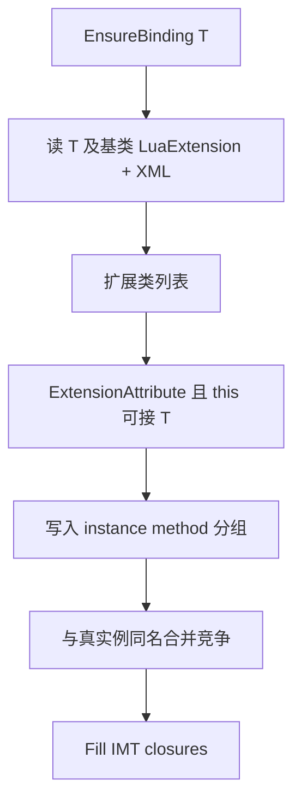

# 13 — C# Extension 方法

> 约定如何把 C# **extension methods** 暴露到被扩展类型的 Lua **实例** methodTable（冒号调用）。
> 适用于 **Il2Cpp（Player）** 与 **Mono（Editor）**。
> 成员 Bind → [metatable/03-BINDING](/docs/spec/metatable/03-BINDING/)；重载 → [04-METHOD-OVERLOAD](/docs/spec/04-METHOD-OVERLOAD/)；别名 → 同文 §5。
> 使用指南：[Extension 方法](/docs/guides/extension-methods/)。

---

## 1. 目标与非目标

### 1.1 目标

| 项 | 约定 |
|----|------|
| Lua 体验 | `obj:ExtFoo(...)` 调用已配置可见的 C# extension |
| 发现模型 | **被扩展类型 → 扩展类列表**；Bind 该类型时只反射这些扩展类 |
| Attribute | **`[LuaExtension]` 标在被扩展类型上**（可列多个扩展类） |
| 调用语义 | **static-as-instance**：进 IMT；`self` → CLR 第 0 参 |
| 同名 | 与真实例方法 **合并竞争**（无「实例优先」） |

### 1.2 非目标

| 项 | 态度 |
|----|------|
| 全局扫描所有 `ExtensionAttribute` | **不做** |
| 把 `[LuaExtension]` 标在扩展类上再反查被扩展类型 | **不做**（为发现而扫全程序集） |
| 仅在扩展类 SMT 上当静态方法调用当作「已支持 extension」 | **不足**；必须 IMT + 冒号 |
| Il2Cpp Player 运行时读 XML | **不做**（与 LuaAlias / MarshalAs 一致） |
| 为热更新程序集配置 Extension XML | **不做**（热更程序集仅支持代码中 `[LuaExtension]`） |
| 开放泛型扩展方法（未闭合） | **不支持** |

### 1.3 锁定决策摘要

| 项 | 决策 |
|----|------|
| 配置键 | 被扩展类型；值为扩展类列表（非散落 method 列表） |
| 方法筛选 | `ExtensionAttribute` + `public static` + 首参可从目标类型赋入（含继承） |
| Attribute 位置 | **仅**被扩展类型 |
| 重载 | **合并竞争** |

---

## 2. 配置源（发现扩展类列表）

Bind 类型 **T** 时，扩展类列表 = **Attribute 并集 ∪ XML 并集**（见 §2.3）。

### 2.1 `[LuaExtension]`（标在被扩展类型上）

```csharp
using ZLua;

[LuaExtension(typeof(TransformExt), typeof(TransformTweenExt))]
public class MyBehaviour : MonoBehaviour { }

// 无法改第三方类型源码时：不要试图标在扩展类上；改用 §2.2 XML
```

| 项 | 约定 |
|----|------|
| 目标 | **Type**（class / struct / interface 等可 Bind 类型） |
| 参数 | 一个或多个 `System.Type`，每个为 **扩展类**（通常为 `static` 类） |
| `AllowMultiple` | **允许**；多条 Attribute 的类型列表取 **并集** |
| 继承元数据 | Bind **T** 时 **walk `BaseType` 链**，收集 T 及基类上的 `[LuaExtension]`（不要求扫无关类型） |
| 接口 | 仅当为接口类型 **U** 配置了扩展类、且正在 Bind 的 T 能匹配 `this U` 时，这些方法才会进入 **T** 的实例表（见 §3）；**不**因「T 实现了某接口」就自动注入未配置在 T/基类上的扩展类列表 |

**禁止**将 `[LuaExtension]` 标在扩展类上作为发现手段。

### 2.2 XML（`luaExtensionXmlPaths` / `ZLuaExtensions`）

> **适用范围：** XML **仅**用于 **非热更新** 程序集上的被扩展类型（预编译 / AOT DLL，如引擎 / 第三方包）。**热更新程序集**（含 HybridCLR 热更 DLL）内的类型 **只支持**在代码中配置 `[LuaExtension]`，**不支持**用 XML 为其配置扩展类列表。

与 LuaAlias **分文件、分 Settings 字段**：

| | Extension | Alias |
|--|-----------|-------|
| Settings | **`luaExtensionXmlPaths`** | `luaAliasXmlPaths` |
| 根元素 | **`ZLuaExtensions`** | `ZLuaAlias` |

```xml
<?xml version="1.0" encoding="utf-8"?>
<ZLuaExtensions version="1">
  <Assembly name="UnityEngine.CoreModule">
    <Type fullName="UnityEngine.Transform">
      <Extension assembly="Assembly-CSharp" fullName="MyGame.TransformExt"/>
      <Extension assembly="Assembly-CSharp" fullName="MyGame.TransformTweenExt"/>
    </Type>
  </Assembly>
</ZLuaExtensions>
```

| 属性 | 说明 |
|------|------|
| `Assembly/@name` | **被扩展类型**所在程序集短名 |
| `Type/@fullName` | 被扩展类型 CLR 全名 |
| `Extension/@assembly` | 扩展类所在程序集短名 |
| `Extension/@fullName` | 扩展类 CLR 全名 |

本文件 **只**允许上述结构；不要写入 `Method` / `MarshalAs` / `alias` 等。

### 2.3 合并与平台

| 项 | 约定 |
|----|------|
| 同一被扩展类型 | Attribute 列表 ∪ XML 列表（**并集**；与 Alias「单方法换名覆盖」不同） |
| Mono | `Initialize` 加载 `luaExtensionXmlPaths`；Bind 时解析 |
| Il2Cpp | **Generate** 写入静态表（仿 AliasCodegen）；**Player 不读 XML**；改 XML 后须重新 Generate |
| 扩展类无法解析 | Generate **硬失败**；Mono Initialize/Bind **报错**（**不**静默丢） |

---

## 3. Bind 期收集扩展方法

在 `EnsureBinding(T)` 中，于类型自身（及继承扁平化后的）真实例方法收集之后：

1. 按 §2 得到扩展类列表（去重）。
2. 对每个扩展类取 `public static` 方法，**同时**满足：
   - 带 `System.Runtime.CompilerServices.ExtensionAttribute`；
   - 至少 1 个参数；记首参类型为 `P0`，须 **`P0` 可从 `T` 赋入**（`P0.IsAssignableFrom(T)` 或 Il2Cpp 等价规则），从而 `this Base` 可用于 `Derived`；
   - **不是**开放泛型方法（未闭合的泛型扩展 **不支持**）。
3. 通过筛选的方法以 **实例域** 候选并入 `byobjInstanceMap`；若 `T` 为 struct，**同步**写入 `byvalInstanceMap`（与 [03-BINDING](/docs/spec/metatable/03-BINDING/) §5 双形态一致）。
4. 最终 Lua 名仍走 `[LuaAlias]` / Alias XML / `MethodInfo.Name`（扩展方法也可换名）。
5. 与真实例方法按最终名分组 → §5 合并竞争。



扩展类上无任何匹配 `this` 的方法：允许（空贡献）；实现可打 Warning。
无 `ExtensionAttribute` 或非 static：忽略。
已 `EnsureBinding` 的 T **不**因后加载程序集自动重绑（与 Alias 相同）。

---

## 4. static-as-instance

CLR 上 extension 为 **static**，Lua 侧必须表现为 **实例方法**。

| 项 | 规定 |
|----|------|
| 表 | **仅**实例 `methodTable`（IMT）；**不**因本机制把扩展方法挂到被扩展类型的 SMT |
| 调用 | **静态** `Call` / 等价 Invoke；栈槽 **1** = receiver → CLR 参数 **0**；其余实参从槽 **2** 起对齐 `this` 之后的形参 |
| `luaArity` | = CLR 形参个数 **减 1**（去掉 `this`） |
| 全签名键 | `MethodName(ParamTypeFullNames…)` **只含** `this` 之后的形参类型全名，与真实例方法键对齐（见 [04](/docs/spec/04-METHOD-OVERLOAD/) §3.7） |
| Mono / Il2Cpp | Emit 与 MethodBridge 均须识别「extension 候选」标志 |

**禁止：**

- 按普通 **static** 路径生成（无 receiver / 要求脚本显式传 `this`）；
- 按普通 **instance** 路径生成（对扩展方法的 declaring type 做虚/实例 `this` 解析）。

---

## 5. 重载：合并竞争

- 扩展方法与真实例方法若 **最终 Lua 名相同**，进入 **同一** overload 组（同一 `is_static=false` 域、同一 ByVal/ByObj 形态）。
- 单候选 → direct；多候选 → dispatch；冲突时额外挂全签名键——规则同 [04-METHOD-OVERLOAD](/docs/spec/04-METHOD-OVERLOAD/) §3。
- **不**插入「实例方法优先于扩展方法」的 tie-break。
- 同分 tie-break 仍用 §3.2（codegen / 声明序等）。
- 同有效 Lua 签名导致 ambiguous 或选错时：用全签名键或 `[LuaAlias]` 消歧。

匹配时：extension 候选的 CLR 形参序列在评分中为 **去掉 `this` 后** 的序列，与 Lua 实参槽对齐方式与真实例一致。

---

## 6. 脚本可见行为（示例）

```csharp
public static class TransformExt
{
    public static void ResetLocal(this Transform t)
    {
        t.localPosition = Vector3.zero;
    }
}

// 能改源码时：
[LuaExtension(typeof(TransformExt))]
public class /* 某包装类型或业务类型 */ { }

// 或 XML：Type=UnityEngine.Transform → Extension=TransformExt
```

```lua
local t = go.transform
t:ResetLocal()   -- IMT；等价 TransformExt.ResetLocal(t)
```

扩展方法 **不会**仅因存在于工程中就自动出现；未配置到该被扩展类型（或基类 Attribute / XML）则 Lua 侧 **`__index` miss → error**（`zlua: member not found: …`），与其它未注册成员相同。

---

## 7. 实现提示（非规范性强制文件名）

| 侧 | 提示 |
|----|------|
| 公共 | `LuaExtensionAttribute`；`LuaExtensionXmlLoader` / `Registry`；Settings `luaExtensionXmlPaths` |
| Mono | `MetaBinding` 收集扩展并入 instance 分组；`MethodEmitter` static-as-instance |
| Il2Cpp | `MetaBinding` + `Invoke*` extension 路径；`ExtensionCodegen` → 生成表（仿 `AliasCodegen`） |

---

## 8. 相关文档

- [成员绑定](/docs/spec/metatable/03-BINDING/)
- [方法重载](/docs/spec/04-METHOD-OVERLOAD/)
- [LuaAlias](/docs/guides/lua-alias/) · [重载规范 §5](/docs/spec/04-METHOD-OVERLOAD/)
- [Extension 方法指南](/docs/guides/extension-methods/)
