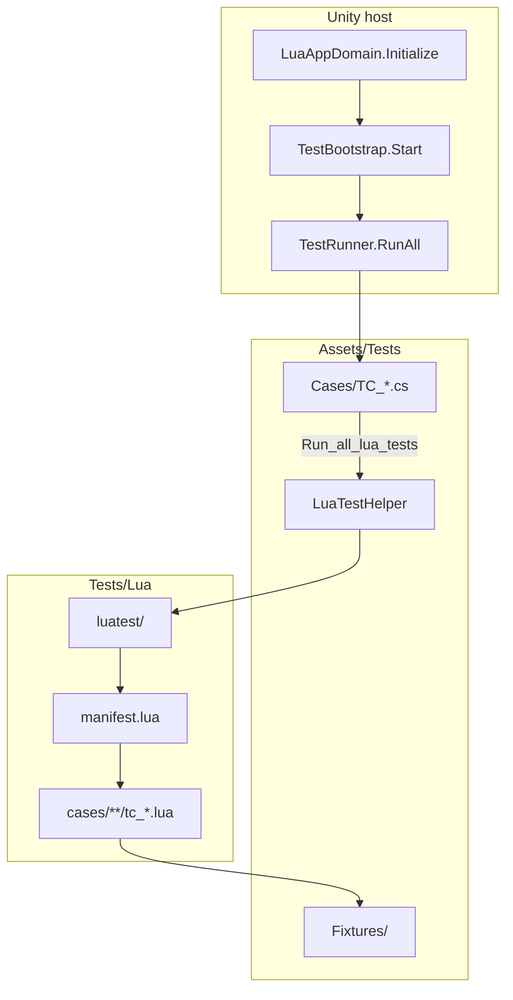

# Testing framework

> Directory layout, C# Runner, Lua case organization, and how to run ZLua **correctness tests**.
> **Principle:** does not depend on Unity Test Framework; **does not include benchmarks** (perf: [compare/PERFORMANCE.md](/docs/compare/PERFORMANCE/)).

---

## 1. Design goals

| Goal | Notes |
|------|------|
| **Correctness** | Verify Lua↔C# interop semantics match each `spec/**` |
| **Dual-end consistency** | Mono (Editor) and Il2Cpp (Player) share the same assemblies, same Lua scripts, same pass/fail criteria |
| **Regression-ready** | One-click full run via scene Play or batchmode Player |
| **Debuggable** | Failures print case id and exception info |
| **Implementation-agnostic** | Runner depends only on public APIs such as `LuaAppDomain` |

C# test infrastructure aligns with LeanCLR test Common patterns: `Assert`, `UnitTestAttribute`, `TestRunner`.

**Platform principle:** the same suite runs once under **Editor** and once under **Player**; the framework does **not** branch on implementation — no `skip` / `xfail` / `mono_only` runtime forks — **any backend failure fails**.

---

## 2. Directories & assemblies

```
ZLuaTest/                          # Unity project root
├── Tests/                            # Lua cases (not under Assets) ★ edit Lua only here
│   └── Lua/
│       ├── luatest/                  # Lua test framework
│       ├── bootstrap.lua
│       ├── manifest.lua              # suite / module registry
│       └── cases/                    # tc_*.lua case modules
│
├── Assets/
│   ├── Tests/                        # C# test assembly ZLua.Tests
│   │   ├── Common/
│   │   ├── Fixtures/
│   │   ├── Cases/
│   │   └── TestBootstrap.cs
│   ├── Scenes/TestScene.unity
│   └── Editor/
│       └── SyncTestsLuaToStreamingAssets.cs   # auto-sync at build; do not hand-edit StreamingAssets
│
Packages/com.code-philosophy.zlua/
└── Runtime/ ...
```

| Location | Content |
|------|------|
| `Tests/Lua/` | **Only** place to edit Lua tests |
| `Assets/Tests/` | All C# tests (`ZLua.Tests`) |
| `Assets/StreamingAssets/Tests/` | **Build artifact**; generated by `SyncTestsLuaToStreamingAssets` |

### ⚠️ Lua script editing rules

- **Only edit** `Tests/Lua/**`.
- **Do not** manually copy, sync, or edit `Assets/StreamingAssets/Tests/**` or `build-win64/**/StreamingAssets/Tests/**`.
- At build / preprocess, Editor scripts sync `Tests/Lua` to StreamingAssets; Player loads `.lua.txt`.

Fixture types live in `ZLua.Tests` with the Runner; Lua accesses Fixtures via `CSharp['ZLua.Tests']`.

---

## 3. Overall architecture



**Three layers:**

1. **Fixture layer** (C#): construct boundary types for Lua to call.
2. **Lua case layer** (`cases/`): `test_*` + `luatest.assert`.
3. **C# Runner layer**: reflectively run `[UnitTest]`; interop tests delegate to Lua Runner via **`TC_LuaTestHost.Run_all_lua_tests`**.

---

## 4. C# framework highlights

### 4.1 `Assert` / `[UnitTest]` / `TestRunner`

- `[UnitTest]`: marks `void` parameterless test methods.
- `[IgnoreTest]`: skip class or method (**not** for Mono/Il2Cpp branching).
- `TestRunner.RunAll()`: scans `ZLua.Tests`, prints `[PASS]`/`[FAIL]`/`[SUMMARY]`; Player batchmode failures call `Application.Quit(1)`.
- Call `LuaTestHelper.EnsureInitialized()` before RunAll.

### 4.2 `LuaTestHelper`

| API | Notes |
|-----|------|
| `EnsureInitialized()` | Idempotent init + load `bootstrap.lua` |
| `RunModule(module)` | Run `Tests/Lua/{module}.lua` |
| `RunChunk(lua)` | Run a snippet |
| `Call<T>(…)` | C# calls Lua (with `GetFunction`) |

---

## 5. Lua module loading

| Environment | Path |
|------|------|
| Editor | `{ProjectRoot}/Tests/Lua/{module}.lua` |
| Player | `StreamingAssets/Tests/Lua/{module}.lua.txt` |

`bootstrap.lua` example:

```lua
CSharp.T = CSharp['ZLua.Tests']
local luatest = require("luatest/init")
_G.luatest = luatest
```

---

## 6. Lua test framework (luatest)

### 6.1 Case conventions

Each `cases/{suite}/tc_*.lua` **returns a module table**; functions with **`test_` prefix** are one case each:

```lua
local M = {}

function M.test_example()
    luatest.assert.equal(1 + 1, 2)
end

return M
```

- Case id: `{suite}/{tc_basename}.{test_name}`
- Ignore: rename to `ignore_test_*`, or remove from `manifest.lua`

### 6.2 `luatest.assert`

| API | Notes |
|-----|------|
| `fail(msg?)` | Explicit failure |
| `is_true` / `is_false` | Booleans |
| `equal` / `not_equal` | Equality |
| `not_nil` / `is_nil` | Null checks |
| `expect_error(fn, pattern?)` | Expect failure |

**Do not** write cases with Lua’s native `assert()`.

### 6.3 `manifest.lua`

Explicitly registers suites and modules; **does not scan the filesystem** (Editor / Player consistent).

Current project example: repo `Tests/Lua/manifest.lua` (`type_system`, `marshal`, `method_overload`, etc.).

### 6.4 C# entry

```csharp
[UnitTest]
public void Run_all_lua_tests()
{
    LuaTestHelper.RunModule("luatest/run_all");
}
```

---

## 7. Case writing patterns

| Pattern | Use when |
|------|------|
| **A: pure C#** | `GetFunction` probes, logic verifiable in C# alone |
| **B: Lua interop (main path)** | New `tc_*.lua` + `test_*` + manifest registration |
| **C: C# embedded snippet** | `LuaTestHelper.RunChunk` for temporary debugging |

**Convention:** interop semantic tests **prefer pattern B**.

---

## 8. Clause → test mapping

Spec clauses should be traceable in tests. New features: **write cases first, then implement** (or ship together in the same PR).

### 8.1 Spec doc → suite

| Spec doc | manifest suite | Typical `tc_*.lua` |
|-----------|---------------|-----------------|
| [spec/02-TYPE-SYSTEM.md](/docs/spec/02-TYPE-SYSTEM/) | `type_system` | `tc_csharp_path`, `tc_generic_type`, `tc_array_type`, `tc_field_access`, `tc_property_access`, `tc_box_unbox` |
| [spec/metatable/](/docs/spec/metatable/) | `type_system` (index/bind) | `tc_field_*`, `tc_property_*`, `tc_event_access` |
| [spec/04-METHOD-OVERLOAD.md](/docs/spec/04-METHOD-OVERLOAD/) | `method_overload` | `tc_method_call`, `tc_register_method` |
| [spec/marshal/](/docs/spec/marshal/) | `marshal` | `tc_default_marshal`, `tc_marshal_struct`, `tc_marshal_enum`, `tc_marshal_delegate`, etc. |
| [spec/marshal/09-FUNCTION.md](/docs/spec/marshal/09-FUNCTION/) | `function_marshal` | `tc_delegate_marshal` |
| [spec/01-HOST-API.md](/docs/spec/01-HOST-API/) | `getfunction` | `tc_getfunction_marshal`, `tc_getfunction_unity_vector` |
| [spec/05-LIB.md](/docs/spec/05-LIB/) | `zlualib` | `tc_typeof`, `tc_make_generic_type`, `tc_box`, `tc_to_delegate`, etc. |
| [spec/10-LIFETIME.md](/docs/spec/10-LIFETIME/) | scattered in marshal / delegate | Opaque, ref-related `tc_*` |

### 8.2 Clause → case id examples

| Spec clause (summary) | Case id |
|------------------|---------|
| Namespaced types need bracket keys | `type_system/tc_csharp_path.test_namespaced_type_bracket` |
| `__index` miss → error | `type_system` / `method_overload` etc. `member not found` cases; default parameters in `method_overload/tc_default_parameters` |
| `zlua.make_generic_type` | `zlualib/tc_make_generic_type.test_list_int32` |
| Lua→C# default marshal | `marshal/tc_default_marshal.test_*` |
| Opaque get/set | `zlualib/tc_get_opaquevalue.test_*` |
| Delegate implicit marshal | `function_marshal/tc_delegate_marshal.test_*` |

When writing new Spec clauses, sync in the PR:

1. Add `test_*` in `Tests/Lua/cases/{suite}/tc_*.lua`
2. Register in `manifest.lua` (if new file)
3. Note the **test case id** at the end of the Spec doc or in a table

### 8.3 Fixtures vs Spec

| Fixture (examples) | Spec |
|-----------------|------|
| `BasicTypes` | marshal primitives |
| `StructBox` | [marshal/05-STRUCT.md](/docs/spec/marshal/05-STRUCT/) |
| `ClassHierarchy` | [02-TYPE-SYSTEM.md](/docs/spec/02-TYPE-SYSTEM/) inheritance |
| `OverloadDemo` | [04-METHOD-OVERLOAD.md](/docs/spec/04-METHOD-OVERLOAD/) |
| `DelegateFixtures` | [marshal/09-FUNCTION.md](/docs/spec/marshal/09-FUNCTION/) |

Fixtures must be public and go through ZLua Codegen (Il2Cpp stubs) so bridge tables are complete.

---

## 9. How to run

| Scenario | Action |
|------|------|
| Day-to-day (Mono) | Open `TestScene` → Play → check Console `[SUMMARY]` |
| Local Il2Cpp validation | Build Player (`TestScene` as first scene) → run |
| CI | Player `-batchmode -nographics` → check exit code |

Runner may print the current backend read-only next to `[SUMMARY]`; it does **not** affect pass/fail.

---

## 10. Relation to Demo

| Existing | Testing framework |
|------|----------|
| `SampleScene` + `Bootstrap.cs` | Keep as smoke demo |
| `LuaScripts/app.lua` | Not part of Runner |

`ZLua.Tests` does **not** reference Unity Test Framework.

---

## 11. Related

| Doc | Content |
|------|------|
| [CONTRIBUTING.md](/docs/community/contributing/) | Spec vs code change process |
| [spec/00-OVERVIEW.md](/docs/spec/00-OVERVIEW/) | Dual runtime |
| [compare/PERFORMANCE.md](/docs/compare/PERFORMANCE/) | Perf benchmarks (not this framework) |

---

*Testing framework follows repo `Tests/Lua/manifest.lua` and `Assets/Tests/`.*
