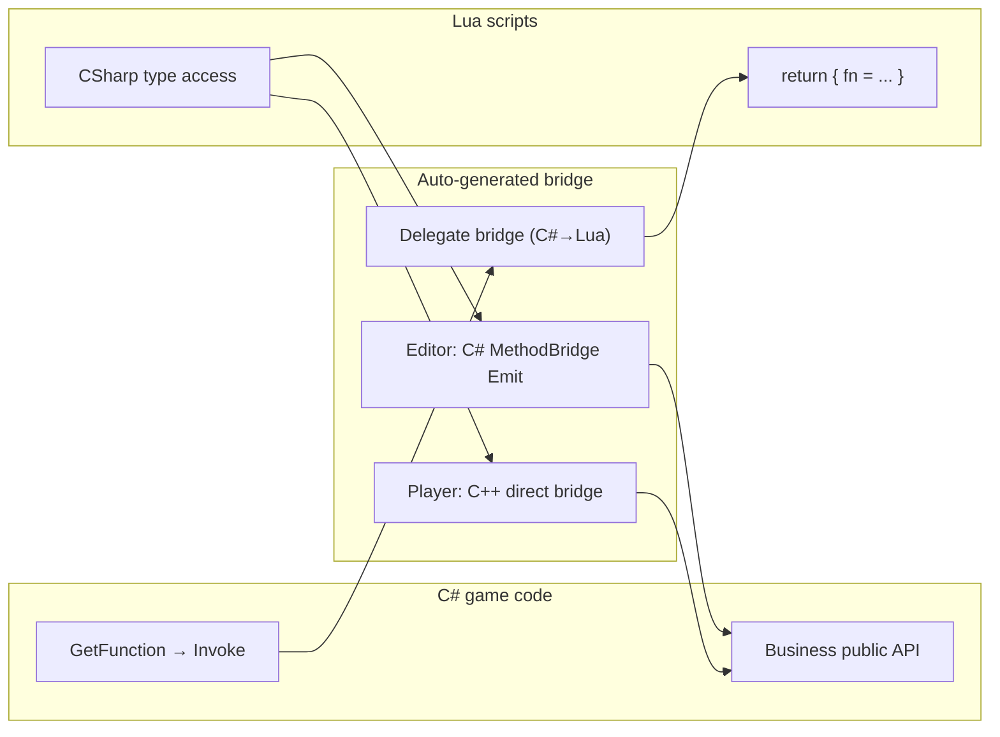
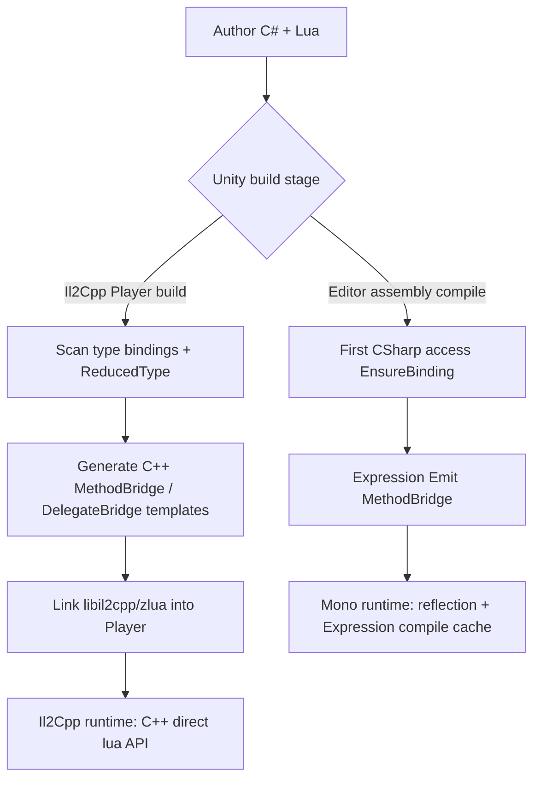

# Design overview

:::tip Who should read this
**Evaluators, new adopters, and readers who need to understand “why it’s designed this way.”** For day-to-day APIs see [Guides](/docs/guides/install/); implementation details are in the [Spec](/docs/spec/00-OVERVIEW/).
:::

ZLua treats Lua as another form of **Native**: like P/Invoke, declarative APIs unify bidirectional interop; on Il2Cpp it generates **C++ stubs** (`ZLua/Generate/All`), **not** xLua-style C# Wrap.

## P/Invoke vs ZLua

| C# interop | Role | ZLua counterpart |
|-----------|------|-----------|
| **P/Invoke** | C# calls native functions | **`GetFunction<T>`** — C# calls Lua |
| **MonoPInvokeCallback** | native callbacks into C# | **`[MonoLuaCallback]`** — only `int (IntPtr L)` native callbacks |
| **MarshalAs** | Override default Marshal | **`[LuaMarshalAs]`** — C# ↔ Lua Marshal override |

## Core principles

| Principle | Notes |
|------|------|
| **Unified bidirectional calls** | C#→Lua: `GetFunction<T>`; Lua→C#: lazy `CSharp` registration, syntax close to C# |
| **Auto-gen (Lua→C#)** | Editor Emit / Il2Cpp Generate C++ stubs; C#→Lua has no per-call codegen |
| **Deep integration** | One `LuaAppDomain.Initialize` sets up CLR + `lua_State` + `zlua` lib; clear after hot reload via `Reset` |
| **C++ direct bridge** | Player reads field offsets directly, methods via `methodPointer` — no huge C# Wrap |
| **No wrapper bloat** | Same signatures share bridge functions instead of one Wrap per member |

## Auto-gen pipeline (Lua→C#)

| Stage | Mono (Editor) | Il2Cpp (Player) |
|------|---------------|-----------------|
| C#→Lua | `GetFunction` + Delegate bridge | Same (native path) |
| Lua→C# members | First access `EnsureBinding` + Emit | EnsureBinding + C++ stubs (Generate) |
| Developer experience | **No C# Wrap** | **No C# Wrap**; must Generate stubs |

## Path differences vs xLua (summary)

| Dimension | Typical xLua path | ZLua |
|------|---------------|------|
| Type exposure | Generate C# Wrap / CodeEmit | `CSharp` root table + three metatable tables |
| C#→Lua | `LuaEnv.DoString` / DelegateBridge | `GetFunction<T>` + `Invoke` |
| Player performance | Wrap + many LuaDLL calls | C++ direct bridge + signature reuse (see [PERFORMANCE](/docs/compare/PERFORMANCE/)) |

See [Comparison](/docs/compare/), [Il2Cpp impl](/docs/impl/IL2CPP/).

## Which doc to read when

| Your question | Read |
|----------|----------|
| How does C# call Lua? | [C# calling Lua Guide](/docs/guides/csharp-calling-lua/) |
| How does Lua access C# types? | [Lua calling C#](/docs/guides/lua-calling-csharp/) |
| How are parameters passed? | [Marshal model overview](/docs/concepts/marshal-overview/) |
| Editor vs Player differences? | [Dual runtime](/docs/concepts/dual-runtime/) |
| Full design semantics? | [Design Spec](/docs/spec/00-OVERVIEW/) |

## Related

- [Design Spec](/docs/spec/00-OVERVIEW/)
- [Dual runtime architecture](/docs/concepts/dual-runtime/)
- [Il2Cpp architecture](/docs/impl/IL2CPP/)
