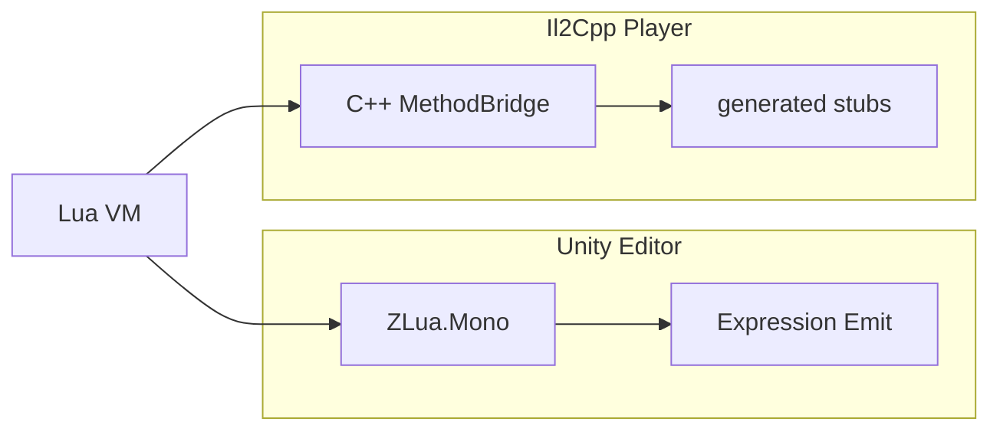

# Dual runtime architecture

- **Player (Il2Cpp)** — authoritative implementation: embedded Lua, C++ direct bridge, signature stub reuse (needs `ZLua/Generate/All`)
- **Editor (Mono)** — Expression Emit; directories aligned with Il2Cpp; **Lua-visible semantics** match Player

Shared attributes (`LuaMarshalAsAttribute`, `LuaAliasAttribute`, etc.) and `LuaAppDomain` live in `ZLua.Common`.

:::info Status
**Mono and Il2Cpp are both done.** Develop day-to-day in the Editor; ship and measure performance on Il2Cpp Player. See [Project status](/docs/getting-started/project-status/).
:::

## Related

- [Spec overview](/docs/spec/00-OVERVIEW/)
- [Il2Cpp impl](/docs/impl/IL2CPP/)
- [Mono impl](/docs/impl/MONO/)
- [Editor vs Player](/docs/guides/editor-vs-player/)
