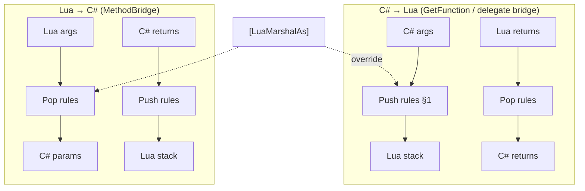

# Marshal model overview

:::tip Who should read this
**Developers who need to understand how parameters convert between C# and Lua, and when to use `[LuaMarshalAs]` / Opaque.** For lookup tables see the [Marshal cheat sheet](/docs/reference/marshal-cheatsheet/); for `ref/out` practice see the [Guide](/docs/guides/ref-out-in/).
:::

ZLua keeps **Lua-visible Marshal semantics** the same on Mono and Il2Cpp; Il2Cpp emphasizes zero GC and fast generated-code paths.

## Bidirectional call paths

## Default rules summary

| Category | C# → Lua | Lua → C# |
|------|----------|----------|
| Primitives / enum | integer / number / boolean | same |
| string | string | string |
| class | ClassUserData | userdata / nil |
| struct | ByValUserData or OpaqueValue | StructUserData / `Type(...)` (tables not accepted by default) |
| delegate | DelegateUserData | **function** or userdata |
| array | ArrayUserData | ArrayUserData |

Full table: [Marshal cheat sheet](/docs/reference/marshal-cheatsheet/).

## ref / out / in (Lua → C#)

Lua **does not distinguish** ref/out/in; all are treated with ref semantics:

| Lua arg | Behavior |
|----------|------|
| Same-type ByValUserData (e.g. `Point2D(...)`) / compatible Opaque | **True ref** — C# writes back |
| Bare number / string / table | **Copied** into a temp slot — **no** write-back to local |

**Delegates from GetFunction** and the **delegate bridge** default-Push `ref`/`out`/`in` as **OpaqueValue** (see [OPAQUE](/docs/spec/marshal/04-OPAQUE/)); `params` remains unsupported.

## `[LuaMarshalAs]` overrides

| LuaMarshalType | Typical use |
|----------------|----------|
| **UserData** | Force boxed userdata (primitives, enum, string) |
| **Bytes** | `byte[]` ↔ Lua string |
| **OpaqueLightUserData** | Temporary struct handle on C#→Lua stack → `zlua.to_user_data` |

Legal combinations: [LuaMarshalAs reference](/docs/reference/csharp/lua-marshal-as/).

## Booklet index (what to read when)

| Type | Spec |
|------|------|
| Overview & default table | [Marshal Spec](/docs/spec/marshal/01-OVERVIEW/) |
| byref / Opaque | [BYREF](/docs/spec/marshal/03-BYREF/), [OPAQUE](/docs/spec/marshal/04-OPAQUE/) |
| struct | [STRUCT](/docs/spec/marshal/05-STRUCT/) |
| class / references | [CLASS](/docs/spec/marshal/06-CLASS/) |
| Delegate / callbacks | [FUNCTION](/docs/spec/marshal/09-FUNCTION/) |
| Day-to-day lookup | [Marshal cheat sheet](/docs/reference/marshal-cheatsheet/) |

## Related

- [Marshal cheat sheet](/docs/reference/marshal-cheatsheet/)
- [enum / struct Guide](/docs/guides/value-types/)
- [Functions & Delegates](/docs/guides/functions/)
