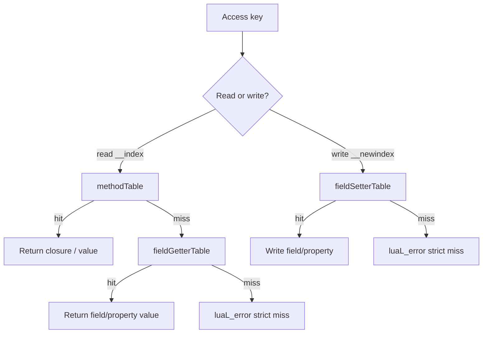
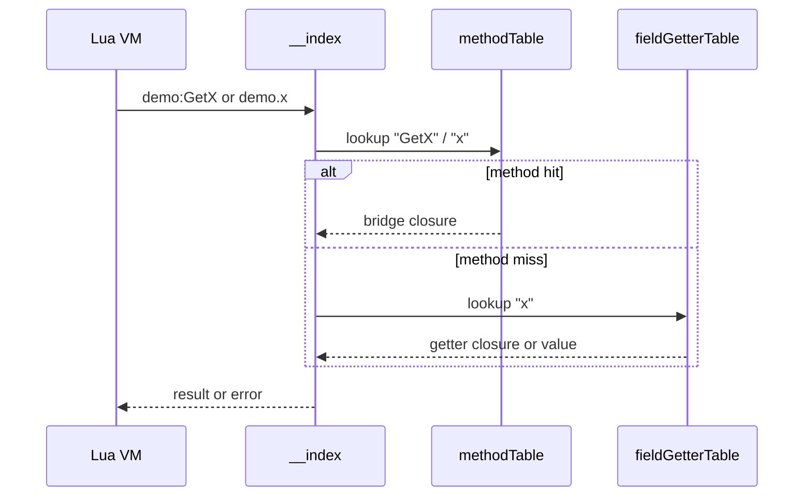

# Metatable model

:::tip Who should read this
**Developers who need to understand how `obj:Member` looks up tables underneath, and why “member not found” errors happen.** Day-to-day usage: [Fields & properties](/docs/guides/lua-calling-csharp/), [Method overloads](/docs/guides/overloads/).
:::

Lua accesses C# static and instance members via **`__index` / `__newindex`**. ZLua uses **three-table dispatch + strict miss**: unregistered members call `luaL_error` immediately — **no** fallback to C# reflection.

## Three-table dispatch

Each static or instance domain keeps three tables:

| Table | Read (`__index`) | Write (`__newindex`) |
|----|----------------|-------------------|
| **methodTable** | Methods, dispatch, aliases, `add_`/`remove_` | — |
| **fieldGetterTable** | Fields, no-arg property reads | — |
| **fieldSetterTable** | — | Fields, no-arg property writes |



:::note Write path
`__newindex` does **not** consult methodTable; assigning an unknown key errors immediately.
:::

## Lookup sequence (instance read)



## Strict miss examples

All of the following **error immediately** — no reflection lookup of private or unregistered parent members:

```lua
local demo = CSharp.AC.Demo()
demo.nonExistentField = 1   -- error: member not found
demo:PrivateMethod()        -- error (private not registered)
```

**Vs dispatch:** with multiple overloads, `demo:Run(x)` on methodTable may be a **single dispatch closure** that internally picks a bridge — still a methodTable hit.

## Overloads in the three tables

| Case | methodTable["Run"] |
|------|-------------------|
| Single public overload | Direct bridge closure |
| Multiple overloads | dispatch closure (runtime dispatch) |
| `[LuaAlias("run_i32")]` | Extra key `run_i32` → single bridge closure |

Signature strings are **not** Lua keys on methodTable; `demo[sig](demo, ...)` is forbidden.

## Platform implementations

| Runtime | `__index` / `__newindex` implementation |
|--------|-------------------------------|
| Mono (Editor) | Lua function; C# looks up the three tables |
| Il2Cpp (Player) | C closures `DispatchIndex` / `DispatchNewIndex` |

**Lua-visible semantics match**; Il2Cpp may inline field-offset reads while keeping the same dispatch order.

## When to read the Spec

| Question | Doc |
|------|------|
| Dispatch algorithm | [Method overload Spec](/docs/spec/04-METHOD-OVERLOAD/) |
| Property / Event | [Type system Spec](/docs/spec/02-TYPE-SYSTEM/); Events use `add_`/`remove_` |
| Full obj_indexer spec | [Metatable index Spec](/docs/spec/metatable/) |
| Future VM fast path | [VM index Spec](/docs/spec/metatable/02-INDEX/) |

## Related

- [Type system overview](/docs/concepts/type-system-overview/)
- [CSharp root table reference](/docs/reference/lua/csharp-root/)
- [Metatable index Spec](/docs/spec/metatable/)
