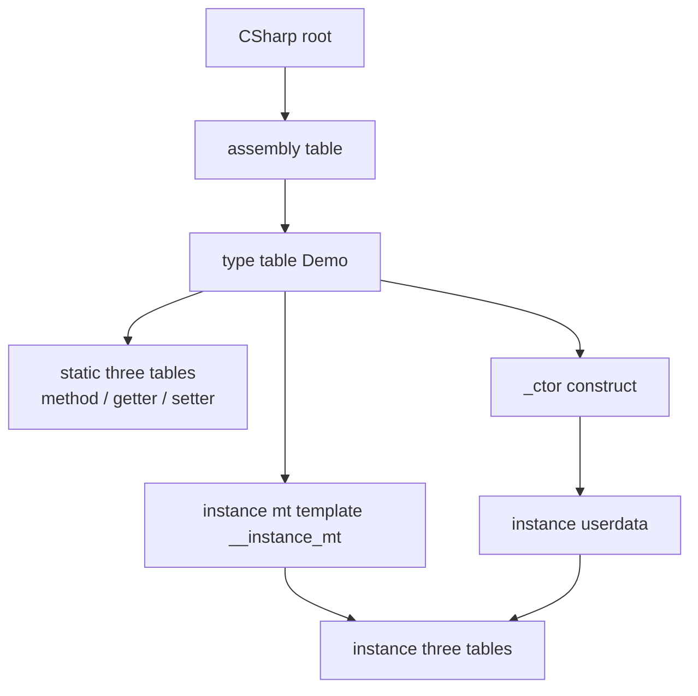
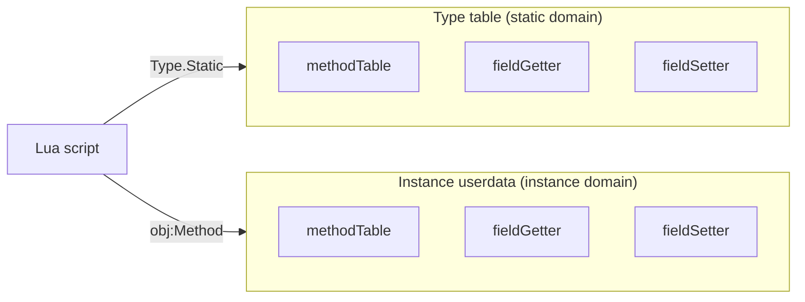
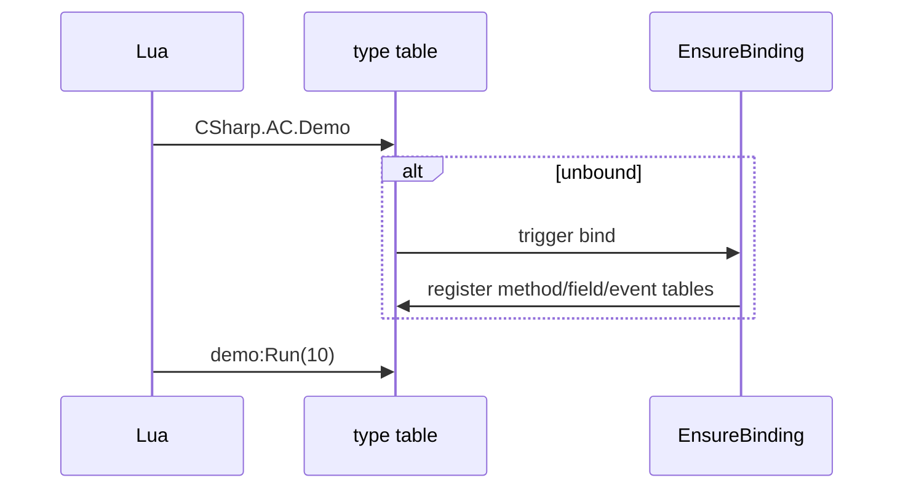

# Type system overview

:::tip Who should read this
**Developers already accessing C# from Lua who need to understand the `CSharp` table structure and static/instance isolation.** Intro syntax: [Lua accessing C# basics](/docs/guides/lua-calling-csharp/); API lookup: [CSharp root table reference](/docs/reference/lua/csharp-root/).
:::

## Design goals

| Goal | Notes |
|------|------|
| Unified entry | All types lazy-load through the **`CSharp`** root table |
| Semantics close to C# | `Type()` construct, `obj:Method()`, `Type.Static()` |
| Static/instance isolation | Static and instance members use **separate** metadata tables |
| Public only | Lua can only access public members |
| Optimizable | Il2Cpp fields / no-arg properties can take fast paths |

## CSharp table structure

```
CSharp                          -- global root table
  └─ {assemblyName}             -- assembly table (e.g. Assembly-CSharp)
       └─ {typeFullName}        -- type table (bracket key when namespaced)
            ├─ static methodTable / fieldGetter / fieldSetter
            ├─ _ctor / __call   -- construct
            └─ __instance_mt    -- points at instance metatable template
```



**Assembly alias (Demo convention):**

```lua
CSharp['AC'] = CSharp['Assembly-CSharp']
local demo = CSharp.AC.Demo()
```

## Static/instance isolation

Static and instance members **must not be mixed**:

| Operation | Correct | Wrong |
|------|------|------|
| Static method | `CSharp.AC.Demo.Add(1, 2)` | `demo.Add(1, 2)` |
| Instance method | `demo:GetX()` | `CSharp.AC.Demo.GetX()` |
| Static field | `CSharp.AC.Demo.s_x = 1` | `demo.s_x = 1` |

:::info Exception
Static and instance use separate tables; generally no mixing. To precisely name a static overload, use the full-signature key on the type table, e.g. `Demo['Add(System.Int32,System.Int32)'](1, 2)`.
:::



## Lazy load & EnsureBinding

On first access to a type, the runtime scans public members and fills the three tables:



Il2Cpp: Generate stubs + lazy bind; Mono: Expression Emit + lazy bind.

## Namespaces & generics (summary)

| Scenario | Syntax |
|------|------|
| No namespace | `CSharp.AC.Demo` |
| With namespace | `CSharp.AC['MyGame.UI.Panel']` |
| Open generic | `CSharp.mscorlib['System.Collections.Generic.List`1']` |
| Closed generic | `zlua.make_generic_type(ListDef, zlua.types.int32)` |

Details: [Generics & arrays Guide](/docs/guides/generics/).

## When to read the Spec

| Question | Doc |
|------|------|
| How are members dispatched? | [Metatable model](/docs/concepts/metatable-model/) |
| Overloads & aliases? | [Method overload Spec](/docs/spec/04-METHOD-OVERLOAD/) |
| Arrays / inheritance? | [Type system Spec](/docs/spec/02-TYPE-SYSTEM/) |

## Related

- [CSharp root table reference](/docs/reference/lua/csharp-root/)
- [Metatable model](/docs/concepts/metatable-model/)
- [Type system Spec](/docs/spec/02-TYPE-SYSTEM/)
