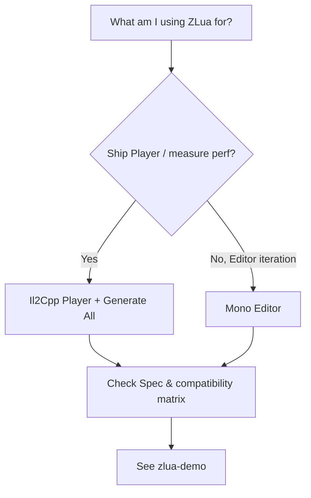

# Project status & roadmap

## Current status

:::info Dual runtime
All Unity / Lua combinations listed in the [compatibility matrix](/docs/getting-started/compatibility/) are covered; Mono and Il2Cpp dual runtimes are done.

| Runtime | Environment | Status |
|--------|------|------|
| **Il2Cpp** | Player shipping | **Done** (spec and implementation follow Il2Cpp `zlua/`) |
| **Mono** | Unity Editor | **Done** (**Lua-visible semantics** match Il2Cpp) |

Authoritative contract: this repo’s **`docs/spec/`** (sole semantic standard); on conflict resolve **spec → Il2Cpp source → impl**. See [Spec overview](/docs/spec/00-OVERVIEW/).
:::

:::tip Development tips
- **Day-to-day**: iterate scripts and features in Editor (Mono).
- **Ship / performance**: treat **Il2Cpp Player** as truth; before builds run **`ZLua/Generate/All`** (C++ stubs — **not** xLua-style C# Wrap).
:::

## Where should I develop / what should I test?

| Scenario | Suggestion |
|------|------|
| New project prototype | Editor Mono + [zlua-demo](https://github.com/focus-creative-games/zlua-demo); run Generate before Player |
| Validate Player | Il2Cpp; semantics follow the [Spec](/docs/spec/00-OVERVIEW/) |
| Perf vs xLua | **Il2Cpp Player**; see [Performance](/docs/compare/PERFORMANCE/) |
| Full API semantics | [Spec docs](/docs/spec/00-OVERVIEW/) |

## Il2Cpp (Player)

Player-side C++ direct bridge, signature stub reuse, `GetFunction` Delegate bridge, lazy binding, and Marshal paths are landed. Implementation: [Il2Cpp impl](/docs/impl/IL2CPP/); codegen: [Stubs](/docs/impl/codegen/STUBS-IL2CPP/).

**Note:** “No C# Wrap whitelist” ≠ “no codegen at all”. Il2Cpp still needs **`ZLua/Generate/All`** for **C++ MethodBridge** and other Lua→C# stubs; **C#→Lua has no extra stubs**.

## Mono (Editor)

Shares the same **Lua-visible semantics** (spec) as Il2Cpp; implementation is Expression Emit with directories aligned to Il2Cpp modules. See [Mono impl](/docs/impl/MONO/).

Key points:

- No event-specific metatable; use ordinary `add_Xxx` / `remove_Xxx` methods
- Bridge: per-member Expression Emit (vs Il2Cpp ReducedType stubs)
- Editor does **not** need Generate C++ stubs; Generate when shipping Player

## Capability boundaries (summary)

| Topic | Notes |
|------|------|
| Event | No `{ get, set, fire }`; `obj:add_EventName(fn)` |
| Generate | No per-type C# Wrap; Il2Cpp has C++ stub Generate |
| Opaque / ByVal / ByObj | See [Struct Marshal](/docs/spec/marshal/05-STRUCT/) |
| Dual-end differences | Different implementation paths; semantics follow the spec |

Full matrix: [Compatibility](/docs/getting-started/compatibility/).

## Version plans

### Near term

- [ ] Keep updating performance / GC / size measurements in [compare](/docs/compare/)
- [ ] Keep correcting Spec and user Guides
- [ ] Migration Guides and community feedback

### Later

- Luau
- More platform and device measurements
- Richer migration Guides (see [Migration](/docs/guides/migration/))

## Next steps

- [Compatibility matrix](/docs/getting-started/compatibility/)
- [Roadmap](/docs/community/roadmap/)
- [Editor vs Player](/docs/guides/editor-vs-player/)
- [Contributing](/docs/community/contributing/)
