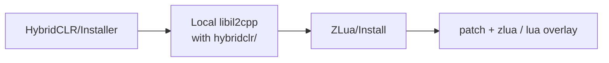

# Using HybridCLR with ZLua

ZLua is natively compatible with [HybridCLR](https://github.com/focus-creative-games/hybridclr) **v9.0.0+**: on the Il2Cpp Player you can use HybridCLR hot update together with ZLua’s Lua↔C# interop. This guide covers the **dual-package** workflow—install order, runtime loading, and configuration limits.

If you are not using HybridCLR, follow the normal [Install & Lua version](/docs/guides/install/) path.

## What you need to do

1. Add both the HybridCLR and ZLua UPM packages (minimum versions below)
2. Run **`HybridCLR/Installer` first**, then **`ZLua/Install`** (order is mandatory)
3. `Assembly.Load` (or the HybridCLR equivalent) hot-update assemblies **before** Lua touches those types
4. On hot-update assemblies, configure `[LuaAlias]` / `[LuaMarshalAs]` / `[LuaExtension]` **only** via code Attributes; XML has **no effect**

## 1. Install packages

Add both dependencies in `Packages/manifest.json`:

| Package | Minimum version | Notes |
|---------|-----------------|-------|
| `com.code-philosophy.hybridclr` | **v9.0.0+** | HybridCLR hot-update runtime and Editor tools |
| `com.code-philosophy.zlua` | **1.0.0+** | ZLua (including patches / overlays on local `libil2cpp`) |

Example (replace versions with the tags or Git refs you actually use):

```json
{
  "dependencies": {
    "com.code-philosophy.hybridclr": "9.0.0",
    "com.code-philosophy.zlua": "1.0.0"
  }
}
```

Git URLs / version tags for each repo also work. HybridCLR project setup follows the [HybridCLR documentation](https://www.hybridclr.cn/); general ZLua steps are in [Install & Lua version](/docs/guides/install/).

:::tip Version requirements
Combinations below HybridCLR **v9.0.0** or ZLua **1.0.0** are **outside** the scope of this guide. After upgrading either package, re-run the Installers in §2.
:::

## 2. Installer order (mandatory)

The local Il2Cpp tree is built in two stacked steps; **do not reverse the order**:



| Step | Menu | Role |
|------|------|------|
| 1 | **`HybridCLR/Installer`** | Install HybridCLR’s C++ runtime (`il2cpp_plus` + `hybridclr/`, etc.) into the project’s local `libil2cpp` |
| 2 | **`ZLua/Install`** (or `ZLua/Install...`) | Patch the **already present** local tree and overlay `zlua` / the selected Lua sources |

**Why:** ZLua Install **patches local `libil2cpp` sources**. That tree must already exist from HybridCLR Installer. Running ZLua first, or with no HybridCLR local tree, leaves nothing valid to patch and the combo fails.

:::danger Wrong order
Running `ZLua/Install` before `HybridCLR/Installer`, or installing only one of them, can break Player builds and hot-update / Lua bridging. After changing Unity versions or reinstalling local Il2Cpp, still re-run **HybridCLR → ZLua**.
:::

### Suggested checks

1. HybridCLR Installer succeeds; local `libil2cpp` contains `hybridclr/`
2. Then run `ZLua/Install` successfully; Lua version in Settings is correct
3. Before shipping, run **`ZLua/Generate/All`** per [Build pipeline](/docs/guides/build/) (plus any HybridCLR Generate / AOT metadata steps your project needs)

## 3. In code: load hot-update assemblies first

Types Lua reaches via `CSharp[...]` / type tables must already be loaded in the AppDomain. For HybridCLR hot-update DLLs, finish loading **before** the first Lua (or C# path that triggers `EnsureBinding`) touch:

```csharp
using System.Reflection;

// Load dll bytes per your project (StreamingAssets / hot-update folder, etc.)
byte[] dllBytes = LoadHotUpdateDllBytes("HotUpdate.dll");
Assembly.Load(dllBytes);

// Only afterwards:
// - Lua: local T = CSharp['HotUpdate']['MyGame.HotType']
// - or C# that binds types from that assembly
```

HybridCLR’s own load helpers are fine if your project standardizes on them (e.g. `RuntimeApi.LoadMetadataForAOTAssembly` / a custom `Assembly.Load` wrapper); the rule is the same: **do not** access types from Lua before the assembly is loaded.

Typical startup order:

1. HybridCLR AOT metadata supplement (if required)
2. `Assembly.Load` hot-update assemblies
3. `LuaAppDomain.Initialize` (may run earlier, but **hot-update types must be accessed only after Load**)
4. Then Lua / `GetFunction` paths that touch hot-update types

## 4. Caveat: Alias / MarshalAs / Extension on hot-update assemblies

| Mechanism | Hot-update assemblies | Non–hot-update (AOT / precompiled) assemblies |
|-----------|----------------------|-----------------------------------------------|
| `[LuaAlias]` | ✅ Code Attribute only | Attribute or Alias XML |
| `[LuaMarshalAs]` | ✅ Code Attribute only | Attribute or MarshalAs XML |
| `[LuaExtension]` | ✅ Code Attribute only | Attribute or Extension XML |

For **hot-update assemblies**:

- Configure **only** via CustomAttributes in C# source
- Do **not** expect Settings `luaAliasXmlPaths` / `marshalAsXmlPaths` / `luaExtensionXmlPaths` to cover hot-update DLLs
- Even if XML points at hot-update types, it **will not take effect**

```csharp
using ZLua;

// Inside a hot-update assembly: Attributes only
public class HotService
{
    [LuaAlias("tick_i32")]
    public void Tick(int frame) { }

    public void Send(
        [LuaMarshalAs(LuaMarshalType.Bytes)] byte[] payload) { }
}

[LuaExtension(typeof(HotTransformExt))]
public class HotView { }
```

Details:

- [LuaAlias](/docs/guides/lua-alias/)
- [LuaMarshalAs](/docs/guides/lua-marshal-as/)
- [Extension methods](/docs/guides/extension-methods/)

## 5. Common issues

| Symptom | Fix |
|---------|-----|
| ZLua Install cannot find / patch local `libil2cpp` | Did you run **`HybridCLR/Installer` first**? |
| Hot update works, but Lua cannot see hot-update types | **`Assembly.Load` before access**; assembly / type names match `CSharp[...]` |
| XML alias / Marshal on hot-update types has no effect | Expected; use in-code `[LuaAlias]` / `[LuaMarshalAs]` / `[LuaExtension]` |
| Broken after Unity upgrade or local Il2Cpp reinstall | Re-run §2: HybridCLR Installer → ZLua Install → Generate |

## Learning path

| | |
|---|---|
| **Previous** | [Install & Lua version](/docs/guides/install/) |
| **Next** | [Init & minimal interop](/docs/guides/hello-interop/) |

## Related

- [Install & Lua version](/docs/guides/install/)
- [Build pipeline](/docs/guides/build/)
- [LuaAlias](/docs/guides/lua-alias/)
- [LuaMarshalAs](/docs/guides/lua-marshal-as/)
- [Extension methods](/docs/guides/extension-methods/)
- [Multi-version · HybridCLR base](/docs/spec/11-MULTI-VERSION/)
- [Introduction](/docs/intro/) — HybridCLR compatibility
