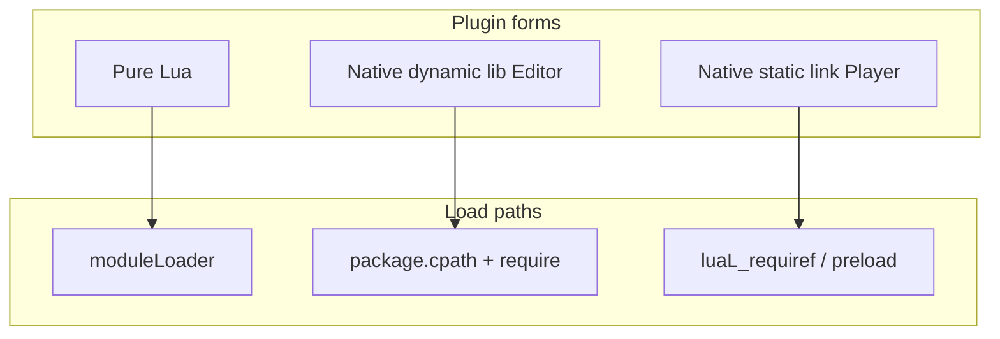
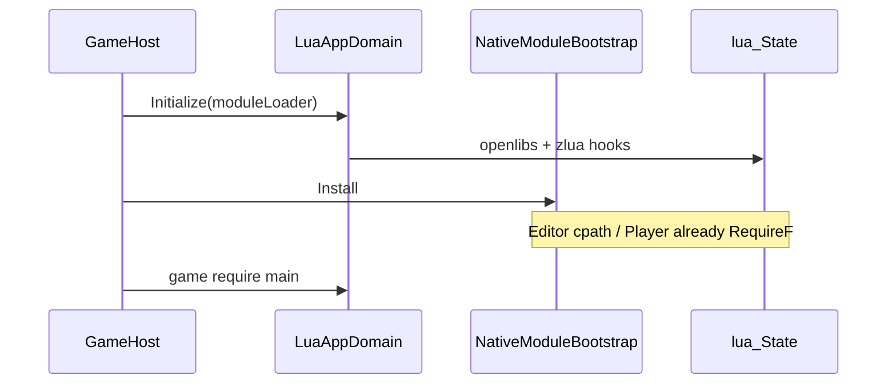

# Third-party native modules

zlua does **not** ship third-party C libraries such as luasocket or lua-cjson. Integration matches the VM itself: **dynamic load in Editor, static register in Player**. Game code still uses `require("cjson")` / `require("socket")`; the underlying form is transparent to callers.

Authoritative details: [Build · Third-party native modules](/docs/spec/build/05-NATIVE-MODULES/). C-module precedent: [EmmyLua debugger](/docs/guides/debugger/) (`package.cpath` + `require('emmy_core')`).

> Prefer “zero native” first: pure Lua implementations can go through `moduleLoader` only — see form A below.

## Three forms

| Form | When | How it loads |
|------|------|----------|
| **A. Pure Lua** | Pure Lua json, protocol shells, utilities | `Initialize(moduleLoader)` returns source |
| **B. Native · Editor** | Local debug / logic | `package.cpath` + `require` → `luaopen_*` |
| **C. Native · Player** | Android / iOS / Windows / WebGL, etc. | Static link + `luaL_requiref` / `package.preload` |



## Principles

1. **Same ABI**: compile for the Settings `luaVersionId` series (`lua55` / `luajit21`, etc.), consistent with [Multi-version](/docs/spec/11-MULTI-VERSION/).
2. **Editor dynamic, Player static**: do not assume “drop a dll into Plugins and it works on all platforms”.
3. **PluginImporter all off**: do not enable C-module binaries as Unity native plugins, or you risk **double-loading** with Lua `require` (same EmmyLua convention).
4. **Not in the zlua core package**: keep concrete libraries in the game project; zlua only reserves optional thin hooks (see Spec).

## Form A: Pure Lua

Put sources in the project (e.g. `Assets/Lua/ThirdParty/`) and return strings by name from `moduleLoader`:

```csharp
LuaAppDomain.Initialize(name =>
{
    // 含 "cjson" 纯 Lua 实现、socket.lua 外壳等
    return LoadLuaText(name);
});
```

Same on all platforms, no ABI. Consider forms B/C for large JSON / real TCP, etc.

## Form B: Editor (like EmmyLua)

### Directory convention

```text
Assets/Plugins/zlua-native-modules/   # 或非 Plugins 扫描路径
  lua55/
    windows/cjson.dll                 # 导出 luaopen_cjson
    windows/socket_core.dll           # 导出 luaopen_socket_core
    macos/cjson.dylib
  luajit21/
    ...
```

PluginImporter for each binary: **Disabled on all platforms**.

### Initialization

**After** `LuaAppDomain.Initialize` and **before** game scripts, inject like EmmyLua (avoid appending `cpath` twice):

```lua
package.cpath = package.cpath .. ";" .. absDir .. "/?." .. ext  -- dll / dylib / so
local cjson = require("cjson")
```

C# can assemble the path with `DoString`; see package `EmmyLuaDebugger.BuildInitChunk`.

### Build constraints

- **Dynamically link** the same-series Editor VM (e.g. `Plugins/lua/lua55/lua55.dll`); **do not** statically link Lua into the plugin (dual VM).
- Match Editor architecture (usually Windows x64).

## Form C: Il2Cpp Player (static register)

1. Include plugin `.c` / prebuilt `.a` in the same link unit as the Player (PUC compiled with `libil2cpp`, or platform static libs; iOS often `__Internal`).
2. Register **after** `luaL_openlibs`:

```cpp
luaL_requiref(L, "cjson", luaopen_cjson, 1);
lua_pop(L, 1);
// luasocket：先 preload socket.core 等，再经 moduleLoader 加载纯 Lua 外壳
```

3. Game code still `require("cjson")`.

**Do not** rely on `package.cpath` dynamic load on Player (unavailable or very limited on iOS / WebGL; also awkward with Android’s single-link model).

## Unified project wrapper

```text
MyGame.ZLuaNativeModules
  NativeModuleBootstrap.cs   # Editor: cpath；Player: 通常空（已 RequireF）
  native/                    # 源码与各平台构建脚本
  lua/                       # 纯 Lua 外壳（socket.lua 等）
```



## Examples: cjson / socket

| Library | Editor | Player | Notes |
|----|--------|--------|------|
| **lua-cjson** | `cjson.dll` + `require("cjson")` | `luaopen_cjson` + `luaL_requiref` | Build separately for Lua 5.3+ integer / LuaJIT |
| **luasocket** | `socket.core` dylib + official pure Lua shell | Static-register core + same shell | Main-thread blocking, mobile network policy; or bridge C# `TcpClient` to Lua |
| **Pure Lua json** | `moduleLoader` only | Same | Default fallback |

## Common mistakes

| Symptom | Cause |
|------|------|
| Crash / corruption after switching series | Plugin not **rebuilt** for the new `luaVersionId` |
| Editor double-load anomalies | PluginImporter enabled by mistake |
| Missing symbols on Player | Not statically linked or package not rebuilt |
| `require` fails but dll is present | Module name mismatches `luaopen_*` (e.g. `socket.core` ↔ `luaopen_socket_core`) |
| Plugin also linked its own Lua | Dual `lua_State` / dual runtime |

## Learning path

| | |
|---|---|
| **Previous** | [Common zlua APIs](/docs/guides/zlua-lib/) |
| **Next** | [Migration](/docs/guides/migration/) |

## Related

- [Build · Third-party native modules](/docs/spec/build/05-NATIVE-MODULES/)
- [EmmyLua debugger](/docs/guides/debugger/) · [Spec 04](/docs/spec/build/04-EMMYLUA-DEBUGGER/)
- [Editor vs Player](/docs/guides/editor-vs-player/)
- [Multi-version](/docs/spec/11-MULTI-VERSION/) · [Official Lua build](/docs/spec/build/01-OFFICIAL-LUA/)
