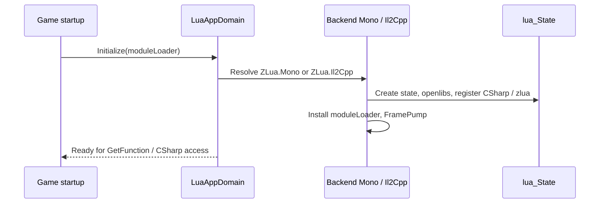

# LuaAppDomain

`LuaAppDomain` is ZLua's **only public host entry**: initialize Lua, and use **`GetFunction`** to obtain a Delegate for a Lua function by module and name.

Canonical example: [zlua-demo Bootstrap.cs](https://github.com/focus-creative-games/zlua-demo/blob/main/Assets/Bootstrap.cs)

## API

```csharp
namespace ZLua
{
    public static class LuaAppDomain
    {
        public static void Initialize(Func<string, object> moduleLoader);

        public static T GetFunction<T>(string luaModule, string luaMethodName)
            where T : MulticastDelegate;
    }
}
```

Authoritative details: [spec/01-HOST-API.md](/docs/spec/01-HOST-API/).

---

### `Initialize(moduleLoader)`

| Parameter | Description |
|-----------|-------------|
| `moduleLoader` | `Func<string, object>`; returns Lua source as **string** or **byte[]** by module name |

```csharp
[RuntimeInitializeOnLoadMethod(RuntimeInitializeLoadType.BeforeSceneLoad)]
private static void InitZLuaOnStartup()
{
    LuaAppDomain.Initialize(LoadLuaModule);
}
```

`LoadLuaModule` handles Editor (`LuaScripts/*.lua`) vs Player (`StreamingAssets/*.lua.txt`) path differences; see [installation guide](/docs/getting-started/installation/).

---

### `GetFunction<T>(luaModule, luaMethodName)`

Resolve a Lua `function` by module and method name, bind it to delegate type `T`, and return it.

```csharp
var add = LuaAppDomain.GetFunction<Func<int, int, int>>("app", "add");
int sum = add(10, 20);

var onTick = LuaAppDomain.GetFunction<Action<float>>("game", "OnTick");
onTick(0.016f);
```

| Rule | Description |
|------|-------------|
| `T` | Must be a concrete `MulticastDelegate` type (e.g. `Action<>` / `Func<>`) |
| `luaModule` / `luaMethodName` | Must match `LoadLuaModule` module name and Lua `return { ... }` key |
| Caching | **Caller's responsibility** (on hot paths, store in a field / local before invoking) |
| Marshal | `Invoke` on the returned delegate follows the [Marshal cheatsheet](/docs/reference/marshal-cheatsheet/); `[LuaMarshalAs]` may apply |

Missing module, key that is not a function, or failure to bind as `T` → throws a C# exception.

---

## Initialization Flow



## Dual-Runtime Forwarding

`LuaAppDomain` itself lives in `ZLua.Common`; real logic is implemented by the backend assembly:

| Environment | Assembly | Implementation type |
|-------------|----------|---------------------|
| Unity Editor | `ZLua.Mono` | `LuaMonoAppDomain` |
| Il2Cpp Player | `ZLua.Il2Cpp` | `LuaIl2CppAppDomain` |

`Application.isEditor` chooses which backend to load; the **public API stays the same**.

## Lifetime and FramePump

After init, `LuaFramePump` is registered and, in the Unity frame loop, handles:

- Deferred release of ref / userdata (`ProcessPendingRefReleases`)
- Pending cleanup coordinated with Lua GC

Usually **no** manual calls are needed.

## Relationship to `LuaEnv`

| Type | Visibility | Description |
|------|------------|-------------|
| `LuaAppDomain` | **public** | Sole entry for game code |
| `LuaEnv` | public (Mono module) | Wrapper for underlying `lua_State`; created by the backend. **Do not** `new LuaEnv()` in business code |

Standard integration path: `LuaAppDomain.Initialize` → `GetFunction` / `CSharp` access.

## Module Loading Convention

The return value of `moduleLoader("app")` is loaded with `require` semantics. The **module** argument to `GetFunction(..., "app", ...)` must match.

| Environment | Path |
|-------------|------|
| Editor | `{ProjectRoot}/LuaScripts/app.lua` |
| Player | `StreamingAssets/LuaScripts/app.lua.txt` |

## Common Errors

| Symptom | Fix |
|---------|-----|
| `Lua module loader is not configured` | `Initialize` not called, or loader is null |
| `require` / GetFunction fails | Check module name, file path, `.lua.txt` suffix, `return` table keys |
| No Lua scripts in Player | Confirm Sync script ran; StreamingAssets contains target files |
| Marshal / bind failure | Cross-check [Marshal cheatsheet](/docs/reference/marshal-cheatsheet/) and `T` signature |

## Related

- [C# calling Lua guide](/docs/guides/csharp-calling-lua/)
- [Function and Delegate](/docs/guides/functions/)
- [Lua module loading](/docs/guides/csharp-calling-lua/)
- [Design spec](/docs/spec/00-OVERVIEW/)
- [Source LuaAppDomain.cs](https://github.com/focus-creative-games/zlua/blob/main/Runtime/Common/LuaAppDomain.cs)
