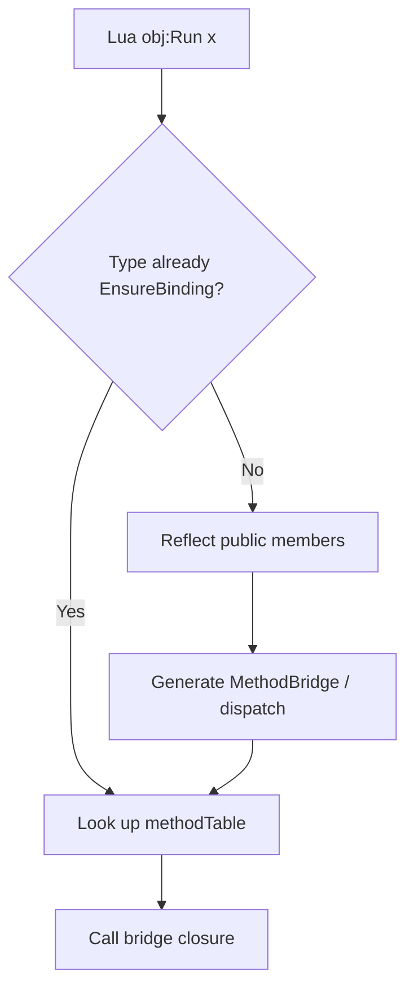

# MonoLuaCallback

In ZLua docs, the **`[LuaCallback]`** concept is implemented as **`MonoLuaCallbackAttribute`** (analogous to Unity's `MonoPInvokeCallback`): marks a **C# function pointer callable directly from native / Lua**.

```csharp
using ZLua;

[MonoLuaCallback(typeof(LuaCSFunction))]
private static int MyNativeEntry(IntPtr L)
{
    // Only int (IntPtr L) signature is allowed
    return 0;
}
```

:::info Usually not needed manually
When Lua calls C# members, bridge functions are **registered automatically on first call**. You **do not** need `[MonoLuaCallback]` on every C# method. Use it only when handing a **C# function pointer** to the Lua C API (e.g. `lua_pushcfunction`).
:::

## Attribute Definition

```csharp
[AttributeUsage(AttributeTargets.Method)]
public sealed class MonoLuaCallbackAttribute : Attribute
{
    public Type DelegateType { get; }
    public MonoLuaCallbackAttribute(Type delegateType);
}
```

| Parameter | Description |
|-----------|-------------|
| `delegateType` | Usually `typeof(LuaCSFunction)`, i.e. `int (IntPtr L)` |

## Signature Limits

Lua C API callbacks **only support**:

```csharp
delegate int LuaCSFunction(IntPtr L);
```

Therefore MonoLuaCallback **cannot** be used for:

- Exposing arbitrary C# method signatures directly to Lua (use MethodBridge)
- Business APIs with ref/out or multiple parameters

## Use Cases

| Scenario | Needed? |
|----------|---------|
| `obj:Method()` / `Type.Static()` | ❌ Auto-bridged |
| Lua function → C# delegate parameter | ❌ Implicit marshal; see [callback guide](/docs/guides/functions/) |
| ZLua internal `__zlua_*` native callback registration | ✅ Framework-internal |
| Extending native modules, custom `lua_pushcfunction` | ✅ Advanced |

## Relation to Auto-Registration for Lua → C#



Auto-registered bridges may **themselves** carry `[MonoLuaCallback]`; transparent to game code.

## Il2Cpp Notes

On Player, native bridges are C++-generated; game C# **rarely** needs MonoLuaCallback. When extending Il2Cpp plugins, follow the same `int (lua_State* L)` constraint as Mono.

## Related

- [Function and Delegate guide](/docs/guides/functions/)
- [Function Marshal spec](/docs/spec/marshal/09-FUNCTION/)
- [Design spec](/docs/spec/00-OVERVIEW/)
