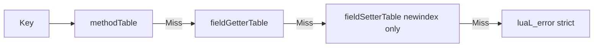
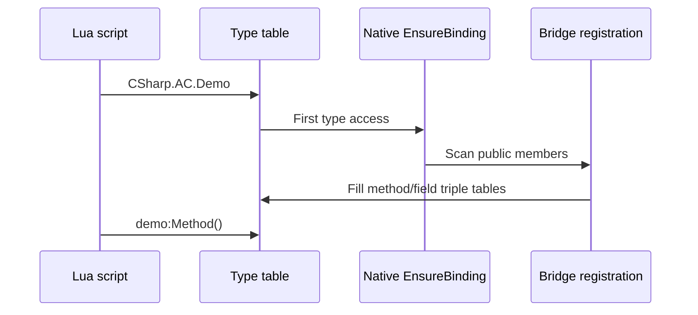

# CSharp Root Table

The global **`CSharp`** table is the **sole entry** for Lua to access all managed types. Assemblies and types are **lazy-loaded**: metatables and member bridges register on first access.

## Access Syntax

```lua
CSharp                           -- root table
CSharp['Assembly-CSharp']        -- assembly (simple name, no .dll)
CSharp.AC.Demo                   -- no-namespace type (set alias first: CSharp['AC'] = CSharp['Assembly-CSharp'])
CSharp.AC['MyGame.UI.Panel']     -- namespaced type (brackets required)
```

| Level | `__index` behavior |
|-------|--------------------|
| `CSharp` | Lazy-load assembly table |
| `{assembly}` | Lazy-load type table |
| `{type}` | Static member table + `_ctor` / `__call` |

Short alias (Demo convention, not required by the framework):

```lua
CSharp['AC'] = CSharp['Assembly-CSharp']
```

## Type Table Capabilities

| Operation | Syntax | Description |
|-----------|--------|-------------|
| Construct instance | `CSharp.AC.Demo()` | Calls `_ctor` / `__call` |
| Static field | `CSharp.AC.Demo.s_x = 10` | Via fieldGetter / fieldSetter |
| Static method | `CSharp.AC.Demo.Add(3, 5)` | methodTable |
| Static property | `Type.prop` | Same syntax as fields (no args) |
| enum constant | `CSharp.AC['MyGame.Color'].Red` | integer/number constant field |

## Instance Userdata

```lua
local demo = CSharp.AC.Demo()
demo.x = 10
demo:GetX()
demo:Run(10)
```

Instance members dispatch via the **instance metatable (IMT)**, isolated from the type table's **statics**: do not use `obj.StaticMethod()` to reach static members.

## Three-Table Dispatch (Strict Miss)

Member lookup order:



| Table | Read (`__index`) | Write (`__newindex`) |
|-------|------------------|----------------------|
| methodTable | Methods, dispatch, aliases | — |
| fieldGetterTable | Fields, parameterless properties | — |
| fieldSetterTable | — | Fields, parameterless properties |

**No reflection fallback**: unregistered members raise a **Lua error** immediately, so API misuse surfaces early.

## Lazy-Load Flow



Il2Cpp Player pre-generates bindings at codegen; Mono Editor reflects + caches at runtime.

## Common Error Messages

| Message (example) | Cause |
|-------------------|-------|
| `type not found` / assembly nil | Wrong assembly name, type not public, or Player omits the assembly |
| `member 'X' not found` | Member not public, typo, or Il2Cpp bridge not generated |
| Dot access fails for namespaced type | Use `CSharp.asm['Ns.Type']` bracket form |
| `invalid userdata` | Instance released or type mismatch |

Troubleshooting: [troubleshooting](/docs/guides/troubleshooting/).

## Mono / Il2Cpp Differences (Lua-Visible Semantics Match)

| Item | Mono | Il2Cpp |
|------|------|--------|
| Lazy load | ✅ Reflect EnsureBinding | ✅ Generate stub + runtime bind |
| Field / property direct read | ✅ | ✅ |
| Overload dispatch / full-signature keys | ✅ | ✅ |
| Generics | ✅ | ✅ |
| Event (`add_` / `remove_`) | ✅ | ✅ |

## Related

- [Lua calling C# basics](/docs/guides/lua-calling-csharp/)
- [Metatable model](/docs/concepts/metatable-model/)
- [Type system spec](/docs/spec/02-TYPE-SYSTEM/)
- [Type system overview](/docs/concepts/type-system-overview/)
