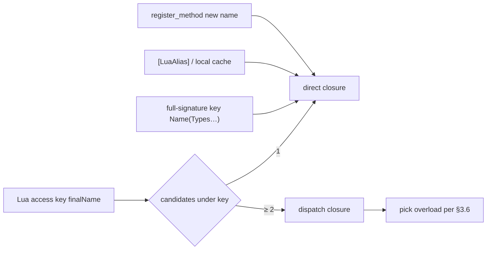

---
sidebar_position: 4
title: "Method overloads"
---

# 04 — Method overloads

> How C# method overloads are resolved and invoked from Lua. Applies to **Il2Cpp (Player)** and **Mono (Editor)**.
> Inheritance and Bind rules: [02-TYPE-SYSTEM.md](/docs/spec/02-TYPE-SYSTEM/) §5; `zlua` API: [05-LIB.md](/docs/spec/05-LIB/).

---

## 1. Problem and goals

C# allows same-named methods overloaded by parameter types/arity; Lua has no static types, so `obj:Run(x)` cannot pick an overload at compile time.

| Goal | Notes |
|------|-------|
| Usability | `obj:Run(10)` should work in common cases |
| Precision | On name collisions, Bind auto-hangs **full-signature keys**; scripts may also use `[LuaAlias]` / `register_method` for short names |
| Performance | Hot paths prefer single-candidate direct (full-signature key, alias, or locally cached closure); avoid repeated dispatch |
| Consistency | Mono and Il2Cpp select the same overload; error text is consistent |

---

## 2. Three-layer mechanism (priority)



1. **Group by final name** (§3, §5): at bind time each method enters a group under its **final Lua name** (C# default name, `[LuaAlias]` / XML alias); **multiple candidates under one name are allowed** (bind-time alias mechanism only).
2. **Single candidate → direct; multiple → dispatch** (§3.6).
3. **On multi-candidate same name, also hang full-signature keys** (§3.7): each colliding overload also registers a **direct** key `MethodName(ParamTypeFullNames…)` (**excluding** return type) so scripts can name an overload precisely **without** `register_method` first.
4. **Runtime** (§6): `register_method` may only hang onto a final name that **does not yet exist** (§6.1), attaching an existing direct closure (often from a full-signature key or `[LuaAlias]`) as a **short name** for `obj:alias(...)` colon calls.

---

## 3. Default names and dispatch

### 3.1 Registration rules (group by final name)

Within the same type, same `is_static` domain, and same instance shape (ByVal / ByObj), collect each method’s **final Lua name set** (§5), then aggregate by name:

| Candidates under that final name | Metatable key binding |
|----------------------------------|------------------------|
| 1 | That candidate’s **direct method closure** |
| ≥ 2 | **dispatch closure** (call-time pick per §3.6) |

Sources may be:

- Multiple C# same-name overloads (same default name); or
- `[LuaAlias]` / XML hanging different methods on the **same final name** (colliding with default names or other aliases is allowed); or
- **C# extensions** (injected into IMT per [13-EXTENSION-METHODS](/docs/spec/13-EXTENSION-METHODS/)) and real instance methods with the **same final name** → **merged competition** (no “instance beats extension”); full-signature keys and matching both use formals **after** dropping `this`.

> **Except `zlua.register_method`:** runtime registration **forbids** an already-existing final name (see §6.1), so that API cannot enlarge an existing overload group.

Static and instance live in separate tables (`staticMap` vs `byvalInstanceMap` / `byobjInstanceMap`). C# may have both `static void Foo()` and `void Foo()`; they do not interfere.

### 3.2 Candidate order

Dispatch walks candidates and ranks **applicable** overloads by **§3.6 better function member**; it must **not** pick `ImplicitBoxing` merely because metadata declaration order is earlier and skip a better `Identity` overload.

Candidate walk order (used only for **tie-break**):

1. **Codegen declaration order** (order in Il2Cpp / Mono generated metadata)
2. Reflection fallback: deterministic sort (e.g. full-signature lexicographic)

### 3.3 Parameter matching

When the **Lua stack slot count** is acceptable, walk CLR formals from the stack cursor and decide bindability (`UnpackedValues` may occupy multiple slots; see table and [marshal/02-MARSHAL-AS.md](/docs/spec/marshal/02-MARSHAL-AS/) §5.6). Rules align with [marshal/](/docs/spec/marshal/) `ReadValue` / `TryPop`, including but not limited to:

| Lua arg | C# formal | Rule |
|---------|-----------|------|
| `integer` | `int` / `long`, etc. | Within target type range |
| `number` (non-integer) | `int` | **No match** |
| `number` | `float` / `double` | Allowed |
| `string` | `string` | Allowed |
| `nil` | reference type / `Nullable<T>` | Allowed |
| `nil` | value type (non-Nullable) | No match |
| userdata | reference type | Runtime type assignable |
| primitive / `string` | **`object`** | Allowed; `ImplicitBoxing` or `ImplicitReference` |
| ByVal value type | **`object` / implemented interface** | `ImplicitBoxing` when implicit box is possible |
| primitive | **`class` / `interface` (not `object`)** | **No match** |
| multi-arg + `params T[]` | `params` | **Single stack slot**; same as szarray (table / userdata / `nil`); **no** multi-slot implicit collect |
| `UnpackedValues` formal | consecutive N slots | That CLR formal occupies **N** Lua arg slots (`N = Members.Length`); matching accumulates stack slots; see [marshal/02-MARSHAL-AS.md](/docs/spec/marshal/02-MARSHAL-AS/) §5.6 |

**Optional / default parameters:** if Lua supplies fewer args than formals, remaining formals with C# defaults may still match.

**Constructors:** `Type(...)` / `SMT.__call` use the same dispatch logic as instance methods.

### 3.4 Performance notes

Each dispatch call walks candidates and recomputes matches — a **slow path**. If a hot path needs a fixed overload, use:

- That overload’s **full-signature key** (§3.7, already direct); or
- A final name with **only one candidate** (e.g. a unique `[LuaAlias("run_i32")]`); or
- `register_method` short name then colon call; or
- **Locally cache** a direct closure in script (e.g. `local run = demo['Run(System.Int32)']`).

### 3.5 Failure errors

On no matching overload, `luaL_error` listing candidate signatures, e.g.:

```
no overload for Demo.Run matching (number); candidates: Run(System.Int32), Run(System.String)
```

Candidate names in the message match §3.7 full-signature keys so scripts can rewrite accordingly.

### 3.6 Implicit conversion kinds and best overload

Overload dispatch must match **C# better function member**.

#### 3.6.1 Design principles

1. **`ConversionKind` describes only C# implicit conversion categories**, not Lua userdata payload shape.
2. **Ranking rules match C#**.
3. **Mono / Il2Cpp** must select the same C# overload for the same Lua args.

#### 3.6.2 `ConversionKind`

| Kind | C# counterpart | Meaning |
|------|----------------|---------|
| `Identity` | identity conversion | Same type |
| `ImplicitNumeric` | implicit numeric | Widening only |
| `ImplicitEnum` | implicit enum | integer → enum |
| `NullLiteral` | null literal | `nil` → reference / Nullable |
| `ImplicitReference` | implicit reference | subclass→base; `string`→`object` |
| `ImplicitBoxing` | implicit boxing | value type→`object` / interface |
| `None` | — | No match |

Kind preference chain:

`Identity` ≻ `ImplicitNumeric` ≻ `ImplicitEnum` ≻ `NullLiteral` ≻ `ImplicitReference` ≻ `ImplicitBoxing`

#### 3.6.3 Better function member

1. Per formal compute `GetConversionKind`; any `None` → not applicable.
2. M beats N: some parameter i where M is better, and no j where N is better.
3. No strictly better → §3.2 declaration-order tie-break.

**Examples:**

| Lua call | Result |
|----------|--------|
| `Run(10)`, `Run(int)` vs `Run(object)` | Pick `Run(int)` (Identity ≻ Boxing) |
| `SetValue(10, 0)`, `SetValue(object,int)` vs `SetValue(object,long)` | Pick `(object,int)` (p1 Identity ≻ Numeric) |

#### 3.6.4 Implicit Box at invoke

Only when Kind is `ImplicitBoxing`, `Object::Box` inside `TryPop` of the **already selected** overload. **Forbidden** to Box inside the `GetConversionKind` loop.

### 3.7 Same-name collisions: full-signature keys (automatic at Bind)

When a final name (usually the C# default method name) has **≥ 2 candidates**, besides binding that name to a **dispatch closure**, also register one **direct** metatable key per candidate:

```text
<MethodName>(<Type0.FullName>,<Type1.FullName>,…)
```

| Rule | Notes |
|------|-------|
| When | **Only** when that final name has a name collision (≥ 2 candidates); single-candidate methods are **not** required to hang a full-signature key |
| Method name | C# `MethodInfo.Name` (same as default final name; not a `[LuaAlias]` short name) |
| Parameter list | Same signature string as §4.1: parentheses + comma-separated **`Type.FullName`**; **no** return type; byref / array / generic spelling matches metadata |
| Bound value | That candidate’s **direct method closure** (same as single-overload direct) |
| Static / instance | Same domain as the method; written into the corresponding `staticMap` or instance map |

**Example:** `Foo` has `int Run(int)` and `int Run(string)`:

| Metatable key | Binding |
|---------------|---------|
| `Run` | dispatch (runtime pick per §3.6) |
| `Run(System.Int32)` | direct → `Run(int)` |
| `Run(System.String)` | direct → `Run(string)` |

```lua
local demo = CSharp.AC.Foo()

demo:Run(5)                              -- dispatch → Run(int)
demo:Run("hi")                           -- dispatch → Run(string)

-- No register_method needed; precise name (dot + explicit self)
demo['Run(System.Int32)'](demo, 5)
demo['Run(System.String)'](demo, "hi")
```

> **Colon syntax:** keys containing `(` / `)` cannot be written as `demo:Run(System.Int32)(...)`; use bracket keys + dot call. For short-name colon calls like `demo:run_i32(5)`, use `[LuaAlias]` or `register_method` (§5, §6).

For multi-overload constructors, full-signature keys live on the type-table side (implementation conventions paired with `_ctor` / `__call` dispatch); parameter-list format is the same as this section.

---

## 4. Signature string rules

### 4.1 `zlua.signature`

```lua
local sig = __zlua_create_signature(zlua.types.int32)
-- sig == "(System.Int32)"

local sig0 = __zlua_create_signature()
-- sig0 == "()"
```

**Conventions:**

- Arguments are C# types: type tables, `zlua.types.*`, or mscorlib strings (same typeArg rules as [05-LIB.md](/docs/spec/05-LIB/))
- **Does not include** the method name (caller concatenates; see §3.7)
- Format: parenthesized, comma-separated **`Type.FullName`** list
- Generic / array formats match codegen metadata

Native callback: `__zlua_create_signature` (`ZLuaLib.cpp`). Projects should wrap it as `zlua.signature(...)` in a local `zlualib` extension.

### 4.2 Full-signature key = method name + §4.1

```
"Run" + "(System.Int32)"  →  Lua metatable key "Run(System.Int32)"
```

That key is **exposed** as a `methodTable` `__index` string key when there are **multiple same-name candidates** (§3.7).
**Forbidden** to treat **only** the parameter parentheses (e.g. `"(System.Int32)"`) as a method key; the method name is required.

---

## 5. Alias mechanism (`[LuaAlias]`)

### 5.1 Model: rename registration + group by final name

`[LuaAlias]` / XML assigns the method a **sole final Lua name**, **replacing** (not appending) the C# default `MethodInfo.Name`. With an alias, the method is **no longer** registered under the default name.

For each public method, the **final Lua name** is (highest priority first):

| Source | Condition |
|--------|-----------|
| `[LuaAlias("…")]` | Attribute present and non-empty → that string |
| XML `Method/@alias` | No Attribute; XML has a rule → that string |
| C# default `MethodInfo.Name` | Neither of the above |

Then within the same binding domain:

```
Aggregate candidates by finalName → count 1 → direct; ≥ 2 → dispatch (§3.6)
```

Therefore:

- Aliases **may** collide with other methods’ default names or aliases (collision merges into one overload group);
- **Not allowed:** “hang both alias and keep this method’s default name” — alias means rename;
- Calling that colliding key uses the same **function overload rules** as ordinary C# overloads.

### 5.2 Collisions allowed (examples)

```csharp
public class Demo
{
    public void Run(int value) { }
    public void Run(string value) { }   // same default name → "Run" naturally groups

    public void Foo(int x) { }

    [LuaAlias("Foo")]                   // Allowed: collides with existing Foo → merges into "Foo"; this method no longer hangs "Bar"
    public void Bar(string s) { }

    [LuaAlias("print")]
    public void LogA(int x) { }

    [LuaAlias("print")]                 // Allowed: aliases collide → "print" groups
    public void LogB(string s) { }

    [LuaAlias("run_i32")]               // Only candidate under this final name → usually direct; no longer hangs default "Run"
    public void Run(long value) { }
}
```

```lua
local d = CSharp.AC.Demo()

d:Run(10)         -- "Run" group (int/string; excludes long) → dispatch
d:Foo("hi")       -- "Foo" group has Foo(int) and Bar(string) → dispatch → Bar(string)
d:print(1)        -- "print" group → dispatch
d:run_i32(10)     -- "run_i32" single candidate → direct → Run(long)
-- d:Bar("x")     -- unavailable: Bar renamed to Foo
```

### 5.3 C# Attribute

```csharp
[LuaAlias("run_i32")]
public void Run(int value) { ... }
```

- Defined in `ZLua.Common`.
- vs XML: on the same method **Attribute wins over XML** (Attribute present → Attribute is the final name, ignore that XML slot; XML only if no Attribute). Both are **rename**, not “default name + alias” dual hang.

### 5.4 XML configuration (independent of MarshalAs)

`[LuaAlias]` and `[LuaMarshalAs]` have **different goals** (final Lua name vs parameter/return/member Marshal); they rarely intersect. XML may **share similar `Assembly` / `Type` / `Method` locating style**, but must:

| Constraint | Notes |
|------------|-------|
| **Separate path list** | Editor Settings field **`luaAliasXmlPaths`** (**alongside** `marshalAsXmlPaths`, configured separately) |
| **Separate root element** | **`ZLuaAlias`**; must **not** use `ZLuaMarshalAs` |
| **Separate files** | Alias and MarshalAs are **different files** (may share `Assembly`/`Type`/`Method` locating style) |

```xml
<?xml version="1.0" encoding="utf-8"?>
<ZLuaAlias version="1">
  <Assembly name="Assembly-CSharp">
    <Type fullName="Demo">
      <Method name="Run" signature="(System.Int32)" alias="run_i32"/>
    </Type>
  </Assembly>
</ZLuaAlias>
```

| Element / attribute | Meaning |
|---------------------|---------|
| `version` | Required; currently only `"1"`. Unknown version → **fail** |
| `Assembly/@name` | `Assembly.GetName().Name` (same as MarshalAs XML) |
| `Type/@fullName` | CLR full name (nested `Outer+Inner`; open generic as ``Foo`1`` mount container) |
| `Method/@name` | CLR `MethodInfo.Name` |
| `Method/@signature` | Parameter type list in parentheses: `()` / `(T1,T2)`; byref suffix `&`; array `T[]`; **no** return type (same Method locate convention as MarshalAs) |
| `Method/@alias` | **Required**; non-empty; the method’s **sole final Lua name** (§5.1, replaces default) |

**Allowed content:** only `Assembly` → `Type` → `Method` with `@alias`.
**Forbidden:** `MarshalAs` / `Param` / `Return` / `Field` / `Property` children, or Method missing `@alias` → **fail**.

| Other constraints | Notes |
|-------------------|-------|
| Rename | With `@alias`, do **not** also register under `MethodInfo.Name` |
| vs Attribute | If the same method has Attribute, Attribute wins (§5.3); that XML entry may be recorded unused (optional diagnostics) |
| Platforms | Mono parses `luaAliasXmlPaths` at runtime; Il2Cpp **Generate**s a static alias table; Player does **not** read XML (load/Generate modes align with [marshal/02-MARSHAL-AS.md](/docs/spec/marshal/02-MARSHAL-AS/) §9.6–§9.7, but **separate** registry / artifacts) |
| Duplicates | After merging all alias XML, multiple `@alias` for the same `(assembly, type, methodName, signature)` → **fail** (later files must not override). Different methods colliding on the same final name are **allowed** (merge into overload group, §5.1) |

### 5.5 Static / instance

- Instance final names → `byvalInstanceMap` / `byobjInstanceMap` (same domain as the closure)
- Static final names → `staticMap`

Grouping must **not** cross static/instance or ByVal/ByObj.

### 5.6 Same name as field / property

If a final method name collides with a field / parameterless property, `__index` still prefers **methodTable** (see [metatable/02-INDEX.md](/docs/spec/metatable/02-INDEX/)). This is a different layer from method–method overload grouping.

---

## 6. Runtime API

When naming a specific overload explicitly, preference order:

1. **Full-signature key** (§3.7, automatic at Bind; no API needed)
2. Bind-time **`[LuaAlias]`** short name
3. Take a direct closure from a full-signature key / alias, then **`register_method`** a custom short name (for colon calls)

`zlua.signature(...)` (§4.1) builds / checks the parameter-parentheses part; it is **not** a standalone metatable key.

### 6.1 `zlua.register_method`

**Must match `ZLuaLib.cpp` / `zlualib.lua`: two-parameter form.**

```lua
zlua.register_method(aliasName, methodOrClosure) → void
```

**Purpose:** hang an existing **direct** closure onto a short name that **does not yet exist**. After success, instance methods can use **colon** calls (no bracket key + explicit `self`).

```lua
local demo = CSharp.AC.Demo()

-- 1) Full-signature key: no register needed, but requires dot + self
demo['Run(System.Int32)'](demo, 5)

-- 2) Take direct closure, hang short name
local run_i32 = demo['Run(System.Int32)']
zlua.register_method("run_i32", run_i32)

-- 3) Thereafter any instance of that type may colon-call
demo:run_i32(5)
```

```lua
local Demo = CSharp.AC.Demo
local calc = Demo()

-- Or obtain a direct closure from a single-candidate [LuaAlias] key
local run = calc.run_i32
zlua.register_method("run_custom_i32", run)
calc:run_custom_i32(20)

local add = Demo.add_i32
zlua.register_method("add_custom_i32", add)
assert(Demo.add_custom_i32(3, 5) == 8)
```

| Parameter | Notes |
|-----------|-------|
| `aliasName` | Non-empty string; written as a **new** final Lua name into the method table |
| `methodOrClosure` | **direct method closure** (single candidate; `MetaBinding::IsDirectMethodClosure`, etc.) |

**Write target (inferred from embedded `TypeBinding` in the closure):**

| Closure domain | Written to |
|----------------|------------|
| Static method | `binding->staticMap` + static method index table |
| Instance ByVal | `binding->byvalInstanceMap` |
| Instance ByObj | `binding->byobjInstanceMap` |

**Relation to existing keys (simplified overload management):**

To avoid rewriting existing overload groups at runtime, `register_method` **disallows** `aliasName` that **already exists** in the target method table (corresponding static/instance map / `methodTable`) — whether that key is currently:

- a single **direct** method; or
- a **dispatch** overload group; or
- a full-signature key or any other occupied method slot.

| Case | Behavior |
|------|----------|
| `aliasName` **absent** | Write **direct** closure (sole candidate under that name) |
| `aliasName` **already present** (direct or dispatch, etc.) | **`luaL_error`**; no overwrite, no merge |
| Passing a **dispatch** closure | **`luaL_error`** (only accept direct closures resolvable to a single candidate) |

Difference from §5 `[LuaAlias]`: aliases at **Bind time** may collide and form overloads; `register_method` at **runtime** only “hangs on an empty slot” and does **not** merge overloads.

Difference from §3.7: full-signature keys already provide precise Bind-time entries; `register_method` solves **readable short names + colon syntax**, not “the only way to name an overload”.

**Errors:**

| Condition | Behavior |
|-----------|----------|
| Arg count ≠ 2 | `luaL_error` |
| Not recognizable as a legal direct method closure | `luaL_error` |
| `aliasName` already occupied on the metatable method side | `luaL_error` |

Native: `__zlua_register_method` (implemented on Il2Cpp).

> **Signature note:** only two parameters `(aliasName, closure)`; target table comes from the closure’s binding domain — **no** need to pass a type table or instance.

### 6.2 `zlua.types`

Preset mscorlib type-name strings; see [05-LIB.md](/docs/spec/05-LIB/) §4.2.

---

## 7. Calling-convention summary

| Scenario | Syntax |
|----------|--------|
| Default dispatch | `demo:Run(10)` |
| Precise overload (full-signature key, §3.7) | `demo['Run(System.Int32)'](demo, 10)` |
| `[LuaAlias]` short name | `demo:run_i32(20)` |
| After `register_method` | `demo:run_custom_i32(20)` |
| Static | `Demo.Add(3, 5)` / `Demo['Add(System.Int32,System.Int32)'](3, 5)` |
| ~~Parameter parentheses alone as key~~ | ~~`demo['(System.Int32)'](...)`~~ **forbidden** |

Instance methods: full-signature keys use **dot** with explicit `self`; short aliases (`[LuaAlias]` / `register_method`) may use **colon**.

---

## 8. Mono / Il2Cpp consistency

| Item | Requirement |
|------|-------------|
| Group by final name + dispatch §3 / §5 | Same |
| Full-signature keys on multi-candidate §3.7 | Same |
| Aliases may collide with default / other aliases | Same |
| Signature format §4.1 | Same |
| dispatch §3.3, §3.6 | Same |
| Selected overload | Same args → same C# overload |
| `register_method` two args; **reject occupied names** | Same |
| Error text | Identical or equivalent |

---

## 9. Full example

```csharp
public class Demo
{
    public void Run(int value) { }

    [LuaAlias("run_str")]   // rename to "run_str"; no longer hangs default "Run"
    public void Run(string value) { }

    public void Foo(int x) { }

    [LuaAlias("Foo")]       // collides with default Foo → "Foo" group has Foo(int)+Bar(string); Bar no longer hangs "Bar"
    public void Bar(string s) { }

    public static int Add(int a, int b) => a + b;

    [LuaAlias("add_i32")]
    public static int Add(int x) => x;
}
```

```lua
local demo = CSharp.AC.Demo()

demo:Run(10)        -- "Run" multi-candidate → dispatch → Run(int)
demo:Run("ab")      -- dispatch → Run(string)
demo['Run(System.Int32)'](demo, 10)   -- full-signature key → direct; no register_method
demo:run_str("x")   -- single-candidate alias → direct

demo:Foo("hi")      -- "Foo" has Foo(int) and Bar(string) → dispatch → Bar(string)

local run_i32 = demo['Run(System.Int32)']
zlua.register_method("run_cached", run_i32)   -- must be an unused new name
demo:run_cached(20)                           -- short name + colon

local add = CSharp.AC.Demo.add_i32
zlua.register_method("add_one", add)           -- OK: new name
-- zlua.register_method("Add", add)            -- error: default name / overload group already exists
assert.equal(CSharp.AC.Demo.add_one(7), 7)
```

---

## 10. Implementation touchpoints (reference)

| Module | Role |
|--------|------|
| `ValueMarshaling` / Mono equivalent | `ConversionKind`, `GetConversionKind`, `TryPop` |
| `FindMatchingMethod` | applicable + better member |
| `MetaBinding` | dispatch, direct closure, `register_method` |
| `ZLuaLib.cpp` | `__zlua_create_signature`, `__zlua_register_method` |
| Codegen | `[LuaAlias]` written into metadata |

C# Extension injection into IMT and merged competition: [13-EXTENSION-METHODS](/docs/spec/13-EXTENSION-METHODS/).
