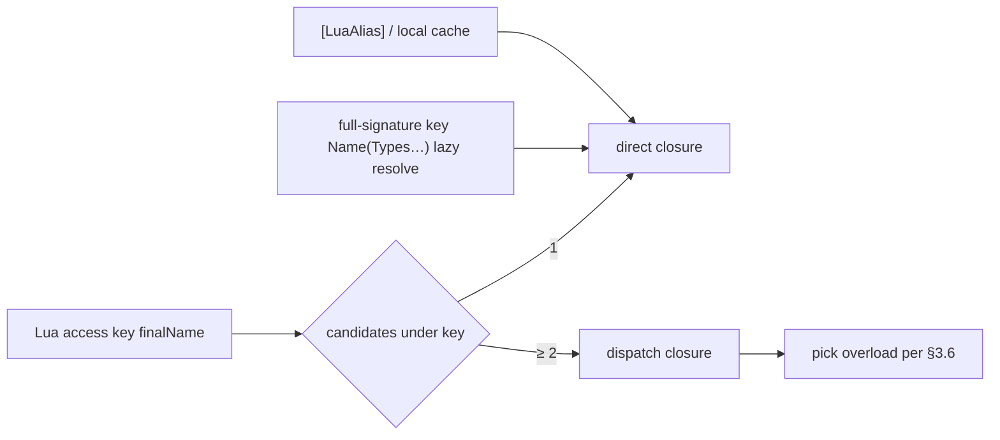

---
sidebar_position: 4
title: "Method overloads"
---

# 04 — Method overloads

> How C# method overloads are resolved and invoked from Lua. Applies to **Il2Cpp (Player)** and **Mono (Editor)**.
> Inheritance and Bind rules: [02-TYPE-SYSTEM.md](/docs/spec/02-TYPE-SYSTEM/) §5; `zlua` API: [05-LIB.md](/docs/spec/05-LIB/).

---

## 1. Problem and goals

C# allows same-named methods overloaded by parameter types/arity; Lua has no static types, so `obj:Run(x)` cannot pick an overload at compile time.

| Goal | Notes |
|------|-------|
| Usability | `obj:Run(10)` should work in common cases |
| Precision | To name a specific overload, use a **full-signature key** (lazy resolution on miss, §3.7); or a short name via `[LuaAlias]` |
| Performance | Hot paths prefer single-candidate direct (alias, or locally cached closure); avoid repeated dispatch |
| Consistency | Mono and Il2Cpp select the same overload; error text is consistent |

---

## 2. Three-layer mechanism (priority)



1. **Group by final name** (§3, §5): at bind time each method enters a group under its **final Lua name** (C# default name, `[LuaAlias]` / XML alias); **multiple candidates under one name are allowed** (bind-time alias mechanism only).
2. **Single candidate → direct; multiple → dispatch** (§3.6).
3. **Full-signature keys resolved lazily on demand** (§3.7): Bind does **not** pre-hang `MethodName(ParamTypeFullNames…)`; on `__index` miss when the key contains `(`, look up by signature on the type hierarchy and cache.
4. **Metatable short names frozen after Bind**: no runtime API to hang names; short-name colon calls use Bind-time `[LuaAlias]` / XML only. Full-signature key caching is lazy write on the miss path and does not change short-name overload groups.

---

## 3. Default names and dispatch

### 3.1 Registration rules (group by final name)

Within the same type, same `is_static` domain, and same instance shape (ByVal / ByObj), collect each method’s **final Lua name set** (§5), then aggregate by name:

| Candidates under that final name | Metatable key binding |
|----------------------------------|------------------------|
| 1 | That candidate’s **direct method closure** |
| ≥ 2 | **dispatch closure** (call-time pick per §3.6) |

Sources may be:

- Multiple C# same-name overloads (same default name); or
- `[LuaAlias]` / XML hanging different methods on the **same final name** (colliding with default names or other aliases is allowed); or
- **C# extensions** (injected into IMT per [13-EXTENSION-METHODS](/docs/spec/13-EXTENSION-METHODS/)) and real instance methods with the **same final name** → **merged competition** (no “instance beats extension”); full-signature keys and matching both use formals **after** dropping `this`.

Static and instance live in separate tables (`staticMap` vs `byvalInstanceMap` / `byobjInstanceMap`). C# may have both `static void Foo()` and `void Foo()`; they do not interfere.

### 3.2 Candidate order

Dispatch walks candidates and ranks **applicable** overloads by **§3.6 better function member**; it must **not** pick `ImplicitBoxing` merely because metadata declaration order is earlier and skip a better `Identity` overload.

Candidate walk order (used only for **tie-break**):

1. **Codegen declaration order** (order in Il2Cpp / Mono generated metadata)
2. Reflection fallback: deterministic sort (e.g. full-signature lexicographic)

### 3.3 Parameter matching

When the **Lua stack slot count** is acceptable, walk CLR formals from the stack cursor and decide bindability (`UnpackedValues` may occupy multiple slots; see table and [marshal/02-MARSHAL-AS.md](/docs/spec/marshal/02-MARSHAL-AS/) §5.6). Rules align with [marshal/](/docs/spec/marshal/) `ReadValue` / `TryPop`, including but not limited to:

| Lua arg | C# formal | Rule |
|---------|-----------|------|
| `integer` | `int` / `long`, etc. | Within target type range |
| `number` (non-integer) | `int` | **No match** |
| `number` | `float` / `double` | Allowed |
| `string` | `string` | Allowed |
| `nil` | reference type / `Nullable<T>` | Allowed |
| `nil` | value type (non-Nullable) | No match |
| userdata | reference type | Runtime type assignable |
| primitive / `string` | **`object`** | Allowed; `ImplicitBoxing` or `ImplicitReference` |
| ByVal value type | **`object` / implemented interface** | `ImplicitBoxing` when implicit box is possible |
| primitive | **`class` / `interface` (not `object`)** | **No match** |
| multi-arg + `params T[]` | `params` | **Expandable**: after fixed prefix, **0–N** Lua slots match element type `T` and pack into `T[]`; or **one** matching `T[]` ByObjUserData passed whole. Details below and [marshal/02-MARSHAL-AS.md](/docs/spec/marshal/02-MARSHAL-AS/) §7 |
| `UnpackedValues` formal | consecutive N slots | That CLR formal occupies **N** Lua arg slots (`N = Members.Length`); matching accumulates stack slots; see [marshal/02-MARSHAL-AS.md](/docs/spec/marshal/02-MARSHAL-AS/) §5.6 |

**Optional / default parameters (C# optional):**

| Rule | Notes |
|------|-------|
| Scope | Methods and constructors; trailing contiguous optional segment of formals with CLR `HasDefault` (and a materializable default) |
| Arg count | Allow `minLuaArity ≤ argCount ≤ luaArity` (`minLuaArity` = full Lua slot count − sum of omittable trailing slots; include an omittable `params` slot when present) |
| Matching | Present stack slots score normally per §3.3 / §3.6; missing trailing formals count as “using default” and consume no Lua slots |
| Fill timing | Materialize and cache defaults at Bind; write missing formals at **invoke** (hot path does not parse metadata) |
| Ranking | When conversion kind / score ties, the candidate with smaller **`optionalUsed`** wins (fewer defaults); still tied → see §3.6.3 (includes `params` expand penalties) |
| Unsupported | Skipping required formals in the middle; relying on other C# compiler sugar without `HasDefault` |

```csharp
void Foo(int x, int y = 5);
void G(int x);
void G(int x, int y = 5);
```

| Lua | Result |
|-----|--------|
| `Foo(1)` | Applicable; `y` uses default |
| `Foo()` | Not applicable (`x` has no default) |
| `G(1)` | Pick `G(int)` (`optionalUsed=0` ≻ expanded-default `G(int,int)`) |
| `G(1, 4)` | Pick `G(int, int)` |

**`params T[]` (C# variable arguments):**

Aligned with C#: either **expand** 0–N values of `T`, or pass an **existing `T[]`**. Lua rules (Marshal details: [marshal/02-MARSHAL-AS.md](/docs/spec/marshal/02-MARSHAL-AS/) §7):

| Rule | Notes |
|------|------|
| Scope | Trailing one-dimensional `T[]` formals with CLR `ParamArrayAttribute` on methods and constructors |
| Arg count | `minLuaArity ≤ argCount` (omit `params` → empty `T[0]`); **no** fixed upper bound (implementations may cap overload arity buckets and route overflow through a params path) |
| Expand | After the fixed prefix matches, **all remaining** Lua slots match element type `T` one-by-one and pack into a new `T[]` |
| Whole pass | **Only** when the `params` position has **exactly one** argument that is **ByObjUserData assignable to `T[]`** (existing managed array); pass that reference (like C# `Foo(existingArray)`) |
| **Forbidden** | **table** as whole `T[]`; **`nil` as whole `null` `T[]`** |
| `nil` semantics | On the expand path, `nil` binds per element rules (reference / `Nullable` → **null element**; non-Nullable value type → no match). Omitting `params` args → **`T[0]`**, **not** a `null` array |
| Ranking | After conversion score and `optionalUsed` tie: **not expanded** (whole userdata) beats **expanded**; then **non-`params`** candidates beat **`params`** ones (C# fixed-arity preference) |
| Unsupported | `params` on **GetFunction / delegate bridge** (see [marshal/09-FUNCTION.md](/docs/spec/marshal/09-FUNCTION/)) |

```csharp
static int Sum(params int[] values);
static string Pick(int x);
static string Pick(params int[] values);
static int Add(int a, int b);
static int Add(params int[] values);
static int CountNulls(params string[] values);
```

| Lua | Result |
|-----|------|
| `Sum(1, 2, 3)` | Expand → `int[]{1,2,3}` |
| `Sum()` | Empty `int[0]` |
| `Sum(arr)` (`arr` is `int[]` userdata) | Whole pass of that array |
| `Sum({1,2,3})` | **No match** (table is not whole `T[]`; table is not `int`) |
| `CountNulls(nil)` | Expand → `string[]{ null }` (**not** a `null` array) |
| `Pick(7)` | Pick `Pick(int)` (fixed arity over params expand) |
| `Pick(1, 2)` | Pick `Pick(params int[])` |
| `Add(3, 4)` | Pick `Add(int,int)` |
| `Add(1, 2, 3)` | Pick `Add(params int[])` |

**Constructors:** `Type(...)` / `SMT.__call` use the same dispatch logic as instance methods (including default parameters and `params`).

### 3.4 Performance notes

Each dispatch call walks candidates and recomputes matches — a **slow path**. If a hot path needs a fixed overload, use:

- A final name with **only one candidate** (e.g. a unique `[LuaAlias("run_i32")]`); or
- A **full-signature key** (§3.7, cached as direct after first miss); or
- **Locally cache** a direct closure obtained in script.

### 3.5 Failure errors

On no matching overload, `luaL_error` listing candidate signatures, e.g.:

```
no overload for Demo.Run matching (number); candidates: Run(System.Int32), Run(System.String)
```

Candidate names in the message match §3.7 full-signature keys so scripts can rewrite accordingly.

### 3.6 Implicit conversion kinds and best overload

Overload dispatch must match **C# better function member**.

#### 3.6.1 Design principles

1. **`ConversionKind` describes only C# implicit conversion categories**, not Lua userdata payload shape.
2. **Ranking rules match C#**.
3. **Mono / Il2Cpp** must select the same C# overload for the same Lua args.

#### 3.6.2 `ConversionKind`

| Kind | C# counterpart | Meaning |
|------|----------------|---------|
| `Identity` | identity conversion | Same type |
| `ImplicitNumeric` | implicit numeric | Widening only |
| `ImplicitEnum` | implicit enum | integer → enum |
| `NullLiteral` | null literal | `nil` → reference / Nullable |
| `ImplicitReference` | implicit reference | subclass→base; `string`→`object` |
| `ImplicitBoxing` | implicit boxing | value type→`object` / interface |
| `None` | — | No match |

Kind preference chain:

`Identity` ≻ `ImplicitNumeric` ≻ `ImplicitEnum` ≻ `NullLiteral` ≻ `ImplicitReference` ≻ `ImplicitBoxing`

#### 3.6.3 Better function member

1. Per formal compute `GetConversionKind`; any `None` → not applicable.
2. M beats N: some parameter i where M is better, and no j where N is better.
3. Conversion scores still tie: compare **default-parameter count used** this match (`optionalUsed`); fewer is better (see §3.3).
4. Still tied: compare **`paramsExpanded`** (whether this match expanded `params` across multiple slots); **not expanded** (0, including whole `T[]` userdata or omit → empty array) beats **expanded** (1).
5. Still tied: compare **`paramsKind`** (whether the candidate has a `params` formal); **non-params** (0) beats **params** (1) (fixed-arity preference).
6. Still no strictly better → Ambiguous or declaration-order tie-break (implementations that treat Ambiguous as authoritative must stay consistent).

**Examples:**

| Lua call | Result |
|----------|--------|
| `Run(10)`, `Run(int)` vs `Run(object)` | Pick `Run(int)` (Identity ≻ Boxing) |
| `SetValue(10, 0)`, `SetValue(object,int)` vs `SetValue(object,long)` | Pick `(object,int)` (p1 Identity ≻ Numeric) |
| `Pick(7)`, `Pick(int)` vs `Pick(params int[])` | Pick `Pick(int)` (fixed arity; `paramsKind` / not-expanded preference) |
| `Add(3, 4)`, `Add(int,int)` vs `Add(params int[])` | Pick `Add(int,int)` |

#### 3.6.4 Implicit Box at invoke

Only when Kind is `ImplicitBoxing`, `Object::Box` inside `TryPop` of the **already selected** overload. **Forbidden** to Box inside the `GetConversionKind` loop.

### 3.7 Full-signature keys (lazy resolution)

**Do not** pre-hang full-signature keys on `methodTable` / method map at Bind (avoids waste for keys most scripts never touch, and avoids “only hang when overloads exist” so removing an overload suddenly breaks signature access).

#### 3.7.1 Key format

```text
<MethodName>(<Type0.FullName>,<Type1.FullName>,…)
```

| Rule | Notes |
|------|-------|
| Method name | C# **`MethodInfo.Name`** (CLR name; **not** a `[LuaAlias]` short name) |
| Parameter list | Same as §4.1: parentheses + comma-separated type full names; **no** return type; byref / array / open-generic formal spelling matches metadata |
| Extension methods | Signature **excludes** the `this` formal (matches Lua call-side args) |
| Scope | **Any** public instance/static **method** (including single-candidate; methods renamed by `[LuaAlias]` may still use CLR name in the key) |
| **Excluded** | **Instance constructors** and **static constructors (`.cctor`)** — neither participates in full-signature lazy resolution; construction still uses type-table `__call` / existing ctor dispatch only |

#### 3.7.2 `__index` miss path

When accessing type/instance metatable members, if `methodTable` (and field tables) miss, and the key is a string **containing `(`**:

1. Walk public methods on the current type and **base chain** (static/instance domain matches the metatable; skip property `get_`/`set_` accessors; **skip** instance and static constructors).
2. Compare each method’s §3.7.1 key to the requested key; **return the first match**.
3. Build that candidate’s **direct** (or open-generic GTAP) closure, write it to the corresponding `methodTable` **and** method map (cache), then return.
4. No match → same as other misses, `member not found`.

| Item | Notes |
|------|-------|
| ByVal / ByObj | Cache on the side that triggered the miss; `isByVal` matches that side |
| vs short names | Does not change existing short-name direct/dispatch; only adds signature-key entries |

```lua
local demo = CSharp.AC.Foo()

demo:Run(5)                              -- short-name dispatch (if "Run" still hangs)
-- full-signature key: first miss → lazy resolve and cache
demo['Run(System.Int32)'](demo, 5)
demo['Run(System.String)'](demo, "hi")
-- single-candidate too: demo['GetValue()'](demo)
```

> **Colon syntax:** keys containing `(` / `)` cannot be written as `demo:Run(System.Int32)(...)`; use bracket keys + dot call. Short-name colon calls use Bind-time `[LuaAlias]` / XML (§5).

### 3.8 Open-generic call prefix (GTAP)

Besides [05-LIB.md](/docs/spec/05-LIB/) §9 `inflate`, open generic methods (method-level type parameters) may be closed **at the call site** with a **type prefix** (**GTAP** = Generic Type Argument Prefix).

#### 3.8.1 Shape

```text
instance: obj:Method(type1, …, typeN, arg1, …)
static:   Type.Method(type1, …, typeN, arg1, …)
```

| Item | Rules |
|------|-------|
| `type1…typeN` | **N** consecutive **`System.Type` ByObj userdata** (`zlua.typeof`); **N** = generic formal count of that open method |
| `arg…` | Ordinary args of the closed signature (may be zero) |
| Forbidden as prefix | Type tables, type-name strings, `zlua.types.*` (use `typeof` or `inflate`) |

#### 3.8.2 Priority vs ordinary overloads

When a short name has both **open generic** and **non-generic** candidates (e.g. `GetComponent<T>()` and `GetComponent(Type)`):

1. If the arg prefix satisfies §3.8.1 and remaining args are applicable to the **closed** open-generic signature → **prefer the open-generic path** (inflate + invoke); do **not** feed the prefix `System.Type`s as ordinary `Type` formals to a non-generic overload.
2. Otherwise select among non-generic (and already closed) candidates per §3.6.

#### 3.8.3 Implementation notes

- Both open-generic direct closures and dispatch groups that include open generics must support GTAP.
- Implicit inflate shares **intern** with `zlua.inflate`; keys include at least `(closedMethod, isStatic, isByVal)` (`isByVal` from the metatable side that triggered the call).
- Does **not** change §3.6 `ConversionKind`; GTAP is a **prefix strip + candidate filter** step before better-member.

---

## 4. Signature string rules

### 4.1 `zlua.signature`

```lua
local sig = __zlua_create_signature(zlua.types.int32)
-- sig == "(System.Int32)"

local sig0 = __zlua_create_signature()
-- sig0 == "()"
```

**Conventions:**

- Arguments are C# types: type tables, `zlua.types.*`, or mscorlib strings (same typeArg rules as [05-LIB.md](/docs/spec/05-LIB/))
- **Does not include** the method name (caller concatenates; see §3.7)
- Format: parenthesized, comma-separated **`Type.FullName`** list
- Generic / array formats match codegen metadata

Native callback: `__zlua_create_signature` (`ZLuaLib.cpp`). Projects should wrap it as `zlua.signature(...)` in a local `zlualib` extension.

### 4.2 Full-signature key = method name + §4.1

```
"Run" + "(System.Int32)"  →  Lua metatable key "Run(System.Int32)"
```

That key is resolved via the §3.7 miss path and cached as a `methodTable` string key.
**Forbidden** to treat **only** the parameter parentheses (e.g. `"(System.Int32)"`) as a method key; the method name is required.

---

## 5. Alias mechanism (`[LuaAlias]`)

### 5.1 Model: rename registration + group by final name

`[LuaAlias]` / XML assigns the method a **sole final Lua name**, **replacing** (not appending) the C# default `MethodInfo.Name`. With an alias, the method is **no longer** registered under the default name.

For each public method, the **final Lua name** is (highest priority first):

| Source | Condition |
|--------|-----------|
| `[LuaAlias("…")]` | Attribute present and non-empty → that string |
| XML `Method/@alias` | No Attribute; XML has a rule → that string |
| C# default `MethodInfo.Name` | Neither of the above |

Then within the same binding domain:

```
Aggregate candidates by finalName → count 1 → direct; ≥ 2 → dispatch (§3.6)
```

Therefore:

- Aliases **may** collide with other methods’ default names or aliases (collision merges into one overload group);
- **Not allowed:** “hang both alias and keep this method’s default name” — alias means rename;
- Calling that colliding key uses the same **function overload rules** as ordinary C# overloads.

### 5.2 Collisions allowed (examples)

```csharp
public class Demo
{
    public void Run(int value) { }
    public void Run(string value) { }   // same default name → "Run" naturally groups

    public void Foo(int x) { }

    [LuaAlias("Foo")]                   // Allowed: collides with existing Foo → merges into "Foo"; this method no longer hangs "Bar"
    public void Bar(string s) { }

    [LuaAlias("print")]
    public void LogA(int x) { }

    [LuaAlias("print")]                 // Allowed: aliases collide → "print" groups
    public void LogB(string s) { }

    [LuaAlias("run_i32")]               // Only candidate under this final name → usually direct; no longer hangs default "Run"
    public void Run(long value) { }
}
```

```lua
local d = CSharp.AC.Demo()

d:Run(10)         -- "Run" group (int/string; excludes long) → dispatch
d:Foo("hi")       -- "Foo" group has Foo(int) and Bar(string) → dispatch → Bar(string)
d:print(1)        -- "print" group → dispatch
d:run_i32(10)     -- "run_i32" single candidate → direct → Run(long)
-- d:Bar("x")     -- unavailable: Bar renamed to Foo
```

### 5.3 C# Attribute

```csharp
[LuaAlias("run_i32")]
public void Run(int value) { ... }
```

- Defined in `ZLua.Common`.
- vs XML: on the same method **Attribute wins over XML** (Attribute present → Attribute is the final name, ignore that XML slot; XML only if no Attribute). Both are **rename**, not “default name + alias” dual hang.

### 5.4 XML configuration (independent of MarshalAs)

`[LuaAlias]` and `[LuaMarshalAs]` have **different goals** (final Lua name vs parameter/return/member Marshal); they rarely intersect. XML may **share similar `Assembly` / `Type` / `Method` locating style**, but must:

> **Scope:** XML is **only** for **non–hot-update** assemblies (precompiled / AOT DLLs). **Hot-update assemblies** (including HybridCLR hot-update DLLs) support **only** in-code `[LuaAlias]`; configuring alias rules for them via XML is **not** supported.

| Constraint | Notes |
|------------|-------|
| **Separate path list** | Editor Settings field **`luaAliasXmlPaths`** (**alongside** `marshalAsXmlPaths`, configured separately) |
| **Separate root element** | **`ZLuaAlias`**; must **not** use `ZLuaMarshalAs` |
| **Separate files** | Alias and MarshalAs are **different files** (may share `Assembly`/`Type`/`Method` locating style) |

```xml
<?xml version="1.0" encoding="utf-8"?>
<ZLuaAlias version="1">
  <Assembly name="Assembly-CSharp">
    <Type fullName="Demo">
      <Method name="Run" signature="(System.Int32)" alias="run_i32"/>
    </Type>
  </Assembly>
</ZLuaAlias>
```

| Element / attribute | Meaning |
|---------------------|---------|
| `version` | Required; currently only `"1"`. Unknown version → **fail** |
| `Assembly/@name` | `Assembly.GetName().Name` (same as MarshalAs XML) |
| `Type/@fullName` | CLR full name (nested `Outer+Inner`; open generic as ``Foo`1`` mount container) |
| `Method/@name` | CLR `MethodInfo.Name` |
| `Method/@signature` | Parameter type list in parentheses: `()` / `(T1,T2)`; byref suffix `&`; array `T[]`; **no** return type (same Method locate convention as MarshalAs) |
| `Method/@alias` | **Required**; non-empty; the method’s **sole final Lua name** (§5.1, replaces default) |

**Allowed content:** only `Assembly` → `Type` → `Method` with `@alias`.
**Forbidden:** `MarshalAs` / `Param` / `Return` / `Field` / `Property` children, or Method missing `@alias` → **fail**.

| Other constraints | Notes |
|-------------------|-------|
| Rename | With `@alias`, do **not** also register under `MethodInfo.Name` |
| vs Attribute | If the same method has Attribute, Attribute wins (§5.3); that XML entry may be recorded unused (optional diagnostics) |
| Platforms | Mono parses `luaAliasXmlPaths` at runtime; Il2Cpp **Generate**s a static alias table; Player does **not** read XML (load/Generate modes align with [marshal/02-MARSHAL-AS.md](/docs/spec/marshal/02-MARSHAL-AS/) §9.6–§9.7, but **separate** registry / artifacts) |
| Duplicates | After merging all alias XML, multiple `@alias` for the same `(assembly, type, methodName, signature)` → **fail** (later files must not override). Different methods colliding on the same final name are **allowed** (merge into overload group, §5.1) |

### 5.5 Static / instance

- Instance final names → `byvalInstanceMap` / `byobjInstanceMap` (same domain as the closure)
- Static final names → `staticMap`

Grouping must **not** cross static/instance or ByVal/ByObj.

### 5.6 Same name as field / property

If a final method name collides with a field / parameterless property, `__index` still prefers **methodTable** (see [metatable/02-INDEX.md](/docs/spec/metatable/02-INDEX/)). This is a different layer from method–method overload grouping.

---

## 6. Helper API

When naming a specific overload explicitly, preference order:

1. Bind-time **`[LuaAlias]`** / XML short name
2. **Full-signature key** (§3.7, lazy resolution)
3. **Locally cache** a direct closure obtained in script

`zlua.signature(...)` (§4.1) builds / checks the parameter-parentheses part; it is **not** a standalone metatable key.

**No** runtime `zlua.register_method`: metatable short names are frozen after Bind; the same CLR method maps to different bridges under ByVal / ByObj, so “take and re-hang” loses context. Short-name colon calls rely on Bind-time aliases only.

Closing open generic methods: [05-LIB.md](/docs/spec/05-LIB/) §9 (`inflate` / GTAP).

### 6.1 `zlua.types`

Preset mscorlib type-name strings; see [05-LIB.md](/docs/spec/05-LIB/) §4.2.

---

## 7. Calling-convention summary

| Scenario | Syntax |
|----------|--------|
| Default dispatch | `demo:Run(10)` |
| Precise overload (full-signature key, §3.7) | `demo['Run(System.Int32)'](demo, 10)` |
| `[LuaAlias]` short name | `demo:run_i32(20)` |
| Locally cached direct | `local run = demo['Run(System.Int32)']; run(demo, 20)` |
| Static | `Demo.Add(3, 5)` / `Demo['Add(System.Int32,System.Int32)'](3, 5)` |
| ~~Parameter parentheses alone as key~~ | ~~`demo['(System.Int32)'](...)`~~ **forbidden** |

Instance methods: full-signature keys use **dot** with explicit `self`; short aliases (`[LuaAlias]`) may use **colon**.

---

## 8. Mono / Il2Cpp consistency

| Item | Requirement |
|------|-------------|
| Group by final name + dispatch §3 / §5 | Same |
| Full-signature keys for multi-candidate names §3.7 | Same |
| Aliases may collide with default / other aliases | Same |
| Signature format §4.1 | Same |
| dispatch §3.3, §3.6 | Same |
| GTAP §3.8 (prefix + priority vs non-generic) | Same |
| Full-signature lazy resolution §3.7 | Same |
| `inflate` / GTAP intern keys include `isStatic` / `isByVal` | Same |
| Selected overload | Same args → same C# overload |
| Metatable short names frozen after Bind (no runtime short-name hang) | Same |
| Error text | Identical or equivalent |

---

## 9. Full example

```csharp
public class Demo
{
    public void Run(int value) { }

    [LuaAlias("run_str")]   // rename to "run_str"; no longer hangs default "Run"
    public void Run(string value) { }

    public void Foo(int x) { }

    [LuaAlias("Foo")]       // collides with default Foo → "Foo" group has Foo(int)+Bar(string); Bar no longer hangs "Bar"
    public void Bar(string s) { }

    public static int Add(int a, int b) => a + b;

    [LuaAlias("add_i32")]
    public static int Add(int x) => x;
}
```

```lua
local demo = CSharp.AC.Demo()

demo:Run(10)        -- "Run" multi-candidate → dispatch → Run(int)
demo:Run("ab")      -- dispatch → Run(string)
demo['Run(System.Int32)'](demo, 10)   -- full-signature key → direct
demo:run_str("x")   -- single-candidate alias → direct

demo:Foo("hi")      -- "Foo" has Foo(int) and Bar(string) → dispatch → Bar(string)

local run_i32 = demo['Run(System.Int32)']
run_i32(demo, 20)                             -- locally cached direct

assert.equal(CSharp.AC.Demo.add_i32(7), 7)    -- [LuaAlias] short name
```

---

## 10. Implementation touchpoints (reference)

| Module | Role |
|--------|------|
| `ValueMarshaling` / Mono equivalent | `ConversionKind`, `GetConversionKind`, `TryPop` |
| `FindMatchingMethod` | applicable + better member |
| `MetaBinding` | dispatch, direct closure, `inflate` lookup |
| `ZLuaLib.cpp` | `__zlua_create_signature`, `__zlua_inflate` |
| Codegen | `[LuaAlias]` written into metadata |

C# Extension injection into IMT and merged competition: [13-EXTENSION-METHODS](/docs/spec/13-EXTENSION-METHODS/).
