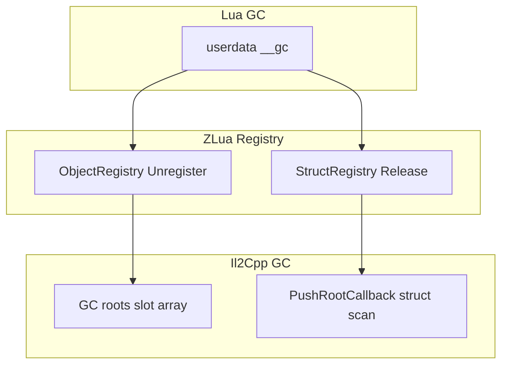

---
sidebar_position: 6
title: "Lifetime and GC"
---

# 10 — Lifetime, GC, and exception boundaries

> `ObjectRegistry`, struct-related registries, Opaque validity, single `lua_State`, and C#↔Lua exception translation.
> Opaque details → [marshal/04-OPAQUE.md](/docs/spec/marshal/04-OPAQUE/); Registry implementation → [impl/marshal/REGISTRIES.md](/docs/impl/marshal/REGISTRIES/).

---

## 1. Design principles

| Principle | Notes |
|-----------|-------|
| **Lua semantics first** | Managed object lifetime must align with Lua userdata / ref lifetime |
| **Il2Cpp GC integration** | ByObj slot arrays register as **GC roots**; non-blittable structs must scan struct memory |
| **Opaque is temporary** | Valid only within a synchronous C#→Lua call frame; **persistence forbidden** |
| **Single primary state** | Default one `lua_State`; ref release is batched via the frame pump |
| **Predictable exceptions** | C# exceptions ↔ Lua errors convert uniformly at the boundary |

Mono and Il2Cpp **behave the same externally**; internals may differ (GCHandle vs Il2CppObject*).

---

## 2. `ObjectRegistry` (ByObj userdata)

### 2.1 Responsibilities

Manages **ByObj** userdata for **class / string / array / delegate / boxed enum**, etc.:

| Mechanism | Notes |
|-----------|-------|
| **Slot table** | Each Push’d managed object gets a `slotIndex` into `_registeredObjects[]` |
| **GC root** | Slot array registered via `GarbageCollector::RegisterRoot` so Il2Cpp GC cannot collect while Lua still holds the userdata |
| **Weak-value cache** | `(Il2CppObject*, viewKlass)` → registry ref; avoid duplicate Push for the same identity+façade |
| **`__gc`** | Lua GC collects userdata → `UnregisterObject(slot)` + remove cache entry |

### 2.2 Push / Pop

```cpp
ObjectRegistry::Push(L, obj, viewKlass, metatableRefIndex);
Il2CppObject* o = ObjectRegistry::Pop(L, idx);
```

- **viewKlass**: declared-type façade (see [marshal/06-CLASS.md](/docs/spec/marshal/06-CLASS/)); cache key includes `(obj, viewKlass)`
- **Pop**: validates `UserDataKind::ByObj`; `nil` → `nullptr`

### 2.3 Lifetime

```
C# returns object → Push → userdata (slot registered + root keeps alive)
  → While Lua holds it: slot non-empty; object not collected by Il2Cpp alone
  → userdata __gc → UnregisterObject → slot cleared
  → If no other C# refs: object may be Il2Cpp GC’d
```

**Note:** releasing userdata does **not** guarantee immediate C# finalizers; it only drops ZLua’s root keep-alive.

### 2.4 Shutdown

`ObjectRegistry::Shutdown(L)`:

1. Clear C++ `(obj, view)` map
2. `luaL_unref` the weak-value cache table

Must run before `lua_close`, with no unfinished cross-boundary calls.

---

## 3. Struct and value-type registries

### 3.1 ByVal userdata

struct instance userdata payload is a **value copy** (or pinned box). `__gc` releases the native copy / GCHandle; does **not** use `ObjectRegistry` slots (unless boxed as ByObj).

### 3.2 `NotBlittableStructRegistry` (Il2Cpp)

ByVal userdata for non-blittable structs:

| Item | Notes |
|------|-------|
| Storage | struct copy inside userdata |
| GC | `RegisterPushRootCallback` scans **in-memory** reference fields of the struct |
| `__gc` | `Release(index)` symmetric with the Registry |

Blittable structs default to the **StructHandle (opaque)** path with no userdata `__gc`; see [marshal/05-STRUCT.md](/docs/spec/marshal/05-STRUCT/).

### 3.3 Mono equivalent

Mono uses `GCHandle` / boxed equivalents with the **same Lua-visible semantics** (userdata release → unpin / free copy).

---

## 4. OpaqueValue lifetime

### 4.1 Validity domain

| Item | Rule |
|------|------|
| Produced by | C#→Lua: `GetFunction` delegate invoke, delegate callbacks, by-val ref / struct annotated `[LuaMarshalAs(OpaqueValue)]` |
| Shape | **lightuserdata** handle (generation + index) |
| Valid | **Only** while the producing C#→Lua call has **not yet returned** |
| Invalid after | C# returns; or `OpaqueParameterScope` generation advances |

### 4.2 Forbidden

- Storing into globals, table fields, upvalues for later `pcall` or async use
- `:` / `.` member access on opaque
- Assuming a handle still points at valid memory across frames

After invalidation, `get_opaquevalue` / `set_opaquevalue` / Pop as an argument → **`invalid opaque parameter handle`**.

### 4.3 vs Registry

| | OpaqueValue | ByObj / StructUserData |
|---|-------------|------------------------|
| Registration | Not in ObjectRegistry | Registry + `__gc` |
| Lifetime | Call frame | Lua userdata lifetime |
| metatable | **None** | Yes (ByVal/ByObj) |

---

## 5. Delegate and Lua function refs

### 5.1 Lua → C# delegate

When creating delegate userdata (ByObj) implicitly or via `zlua.to_delegate`:

- native holds a **Lua registry ref** (`luaL_ref`) to the script function
- C# holding the delegate keeps the script function alive
- Lua GC of delegate userdata queues **deferred `luaL_unref`** (avoid unref directly on the C# stack)

### 5.2 C# → Lua (LuaMethod)

After a C# delegate is pushed to Lua it may be called as `d(...)` (`IMT.__call`). If C# no longer holds the delegate, associated Lua refs release on finalization / Dispose paths.

### 5.3 Frame pump

`LuaAppDomain.ProcessPendingRefReleases()` (driven by `LuaFramePump`) drains the deferred unref queue. Must run on the **Unity main thread, same thread as Lua calls**.

---

## 6. Single `lua_State` and threading

### 6.1 Default model

The ZLua host defaults to **one primary `lua_State`**:

- `CSharp` root, Registry caches, and module loader all bind to that state
- **No** lock-free concurrent multi-thread access to the same `L`

### 6.2 Call threads

| Scenario | Requirement |
|----------|-------------|
| Unity main thread calling Lua | Supported by default |
| Background thread calling Lua | Host **must** synchronize explicitly; undefined if not serialized |
| C# `GetFunction` / delegate bridge / Lua→C# | Same thread that initialized `L`, or a controlled queue |

### 6.3 Coroutines

Lua coroutines may run within the **same** `lua_State`; Opaque handles must **not** escape the producing C# call stack into other coroutines asynchronously (still subject to §4).

---

## 7. Initialize and Shutdown order

### 7.1 Initialize (conceptual)

```
1. luaL_newstate / open standard libraries
2. ZLuaLib::RegisterGlobals
3. dostring zlualib.lua
4. ObjectRegistry::Initialize
5. TypeRegistry / MetaTableCache / Opaque scope init
6. Create CSharp root table
7. Install module loader
8. (Il2Cpp) RegisterPushRootCallback for struct roots
```

### 7.2 Shutdown (conceptual)

```
1. Drain pending ref releases
2. Tear down unfinished C#↔Lua calls (host responsibility)
3. ObjectRegistry::Shutdown
4. Struct registry shutdown
5. TypeRegistry / other registry cleanup
6. lua_close
```

On Player domain reload, full Shutdown is required to avoid registry leaks and stale roots.

---

## 8. Exception boundary

### 8.1 C# calling Lua

| Event | Behavior |
|-------|----------|
| Lua `error(msg)` | Caught; throw managed exception (type per implementation) |
| Unbalanced Lua stack | native assert / exception; no leak |
| C# exception crossing native | **Forbidden**; boundary layer translates or aborts |

**`GetFunction` delegate invoke** maintains **OpaqueParameterScope** around invoke so exception paths also invalidate opaque handles.

### 8.2 Lua calling C#

| Event | Behavior |
|-------|----------|
| C# throws | `luaL_error` equivalent; message includes type / method context (Mono / Il2Cpp identical or equivalent) |
| Script | `pcall` catches string / error object |

**Editor Mono (all Lua families):** must not call `lua_error` inside a managed reverse-P/Invoke frame. Use the **native callback gate**: managed pushes the error and returns a sentinel; native calls `lua_error` after managed returns. Spec: [build/03-MONO-LUAJIT-CALLBACK-GATE.md](/docs/spec/build/03-MONO-LUAJIT-CALLBACK-GATE/).
Il2Cpp does not use that gate; it also obeys the engineering rule “no C++ destructor dependence when `lua_error`ing”. Callback `Debug.Log` stack-capture issues are covered by implementation `LuaPrintBuffer` (deferred flush).

### 8.3 Error messages

Bind failure, marshal failure, no matching overload, invalid opaque, etc.: Mono and Il2Cpp **must** give equivalent wording for the same condition (prefix differences allowed; meaning the same).

---

## 9. GC interaction summary



| Object kind | Lua collection triggers | Managed collection |
|-------------|-------------------------|--------------------|
| ByObj class | userdata `__gc` | Collectable after root drop |
| ByVal blittable | userdata `__gc` or scope end | Stack / copy released |
| ByVal non-blittable | userdata `__gc` | Scan + free copy |
| Opaque | scope end (not userdata GC) | No root involved |

---

## 10. Related docs

| Doc | Content |
|-----|---------|
| [01-HOST-API.md](/docs/spec/01-HOST-API/) | `GetFunction`, exceptions |
| [marshal/04-OPAQUE.md](/docs/spec/marshal/04-OPAQUE/) | Opaque API |
| [marshal/06-CLASS.md](/docs/spec/marshal/06-CLASS/) | ByObj, view |
| [marshal/05-STRUCT.md](/docs/spec/marshal/05-STRUCT/) | struct GC |
| [marshal/09-FUNCTION.md](/docs/spec/marshal/09-FUNCTION/) | delegate ref |
| [compare/GC.md](/docs/compare/GC/) | Comparison with other approaches |
