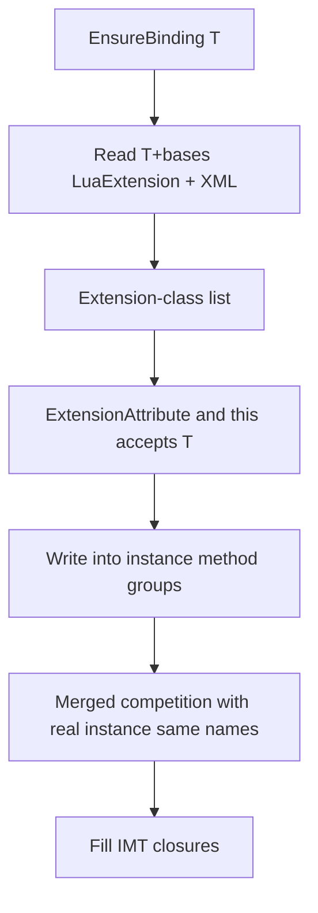

# 13 — C# extension methods

> How C# **extension methods** are exposed on the extended type’s Lua **instance** methodTable (colon calls).
> Applies to **Il2Cpp (Player)** and **Mono (Editor)**.
> Member Bind → [metatable/03-BINDING](/docs/spec/metatable/03-BINDING/); overloads → [04-METHOD-OVERLOAD](/docs/spec/04-METHOD-OVERLOAD/); aliases → same doc §5.
> User guide: [Extension methods](/docs/guides/extension-methods/).

---

## 1. Goals and non-goals

### 1.1 Goals

| Item | Convention |
|------|------------|
| Lua UX | `obj:ExtFoo(...)` calls configured-visible C# extensions |
| Discovery model | **Extended type → list of extension classes**; Bind reflects only those extension classes |
| Attribute | **`[LuaExtension]` on the extended type** (may list multiple extension classes) |
| Call semantics | **static-as-instance**: enter IMT; `self` → CLR parameter 0 |
| Same name | **Merged competition** with real instance methods (no “instance first”) |

### 1.2 Non-goals

| Item | Stance |
|------|--------|
| Globally scanning all `ExtensionAttribute` | **No** |
| Putting `[LuaExtension]` on the extension class then reverse-looking up the extended type | **No** (would require scanning whole assemblies for discovery) |
| Calling only as static methods on the extension class SMT as “extensions supported” | **Insufficient**; must be IMT + colon |
| Il2Cpp Player reading XML at runtime | **No** (same as LuaAlias / MarshalAs) |
| Extension XML for hot-update assemblies | **No** (hot-update assemblies support only in-code `[LuaExtension]`) |
| Open generic extension methods (unclosed) | **Unsupported** |

### 1.3 Locked decisions summary

| Item | Decision |
|------|----------|
| Config key | Extended type; value is extension-class list (not a scattered method list) |
| Method filter | `ExtensionAttribute` + `public static` + first parameter assignable from the target type (including inheritance) |
| Attribute site | **Only** the extended type |
| Overloads | **Merged competition** |

---

## 2. Configuration sources (discovering extension-class lists)

When Binding type **T**, the extension-class list = **Attribute union ∪ XML union** (see §2.3).

### 2.1 `[LuaExtension]` (on the extended type)

```csharp
using ZLua;

[LuaExtension(typeof(MyClassExt), typeof(MyClassTweenExt))]
public class MyClass { }

// Cannot edit third-party type sources: do not try to annotate the extension class; use §2.2 XML
```

| Item | Convention |
|------|------------|
| Target | **Type** (class / struct / interface and other Bindable types) |
| Arguments | One or more `System.Type`, each an **extension class** (usually `static`) |
| `AllowMultiple` | **Allowed**; type lists from multiple Attributes are **unioned** |
| Inheritance metadata | When Binding **T**, **walk the `BaseType` chain** and collect `[LuaExtension]` on T and bases (no need to scan unrelated types) |
| Interfaces | Methods enter **T**’s instance tables only when extension classes are configured for interface type **U** and the T being Bound matches `this U` (see §3); do **not** auto-inject extension-class lists merely because “T implements some interface” without configuration on T/bases |

**Forbidden** to use `[LuaExtension]` on the extension class as a discovery mechanism.

### 2.2 XML (`luaExtensionXmlPaths` / `ZLuaExtensions`)

> **Scope:** XML is **only** for extended types in **non–hot-update** assemblies (precompiled / AOT DLLs, e.g. engine / third-party packages). Types in **hot-update assemblies** (including HybridCLR hot-update DLLs) support **only** in-code `[LuaExtension]`; configuring their extension-class lists via XML is **not** supported.

Separate files and Settings fields from LuaAlias:

| | Extension | Alias |
|--|-----------|-------|
| Settings | **`luaExtensionXmlPaths`** | `luaAliasXmlPaths` |
| Root element | **`ZLuaExtensions`** | `ZLuaAlias` |

```xml
<?xml version="1.0" encoding="utf-8"?>
<ZLuaExtensions version="1">
  <Assembly name="UnityEngine.CoreModule">
    <Type fullName="UnityEngine.Transform">
      <Extension assembly="Assembly-CSharp" fullName="MyGame.TransformExt"/>
      <Extension assembly="Assembly-CSharp" fullName="MyGame.TransformTweenExt"/>
    </Type>
  </Assembly>
</ZLuaExtensions>
```

| Attribute | Notes |
|-----------|-------|
| `Assembly/@name` | Short name of the assembly containing the **extended type** |
| `Type/@fullName` | CLR full name of the extended type |
| `Extension/@assembly` | Short name of the assembly containing the extension class |
| `Extension/@fullName` | CLR full name of the extension class |

This file **only** allows the structure above; do not write `Method` / `MarshalAs` / `alias`, etc.

### 2.3 Merge and platforms

| Item | Convention |
|------|------------|
| Same extended type | Attribute list ∪ XML list (**union**; unlike Alias’s “single-method rename override”) |
| Mono | `Initialize` loads `luaExtensionXmlPaths`; resolve at Bind |
| Il2Cpp | **Generate** writes a static table (like AliasCodegen); **Player does not read XML**; re-Generate after XML changes |
| Extension class unresolvable | Generate **hard-fails**; Mono Initialize/Bind **errors** (**no** silent drop) |

---

## 3. Collecting extension methods at Bind time

In `EnsureBinding(T)`, after collecting the type’s own (and inheritance-flattened) real instance methods:

1. Obtain the extension-class list per §2 (dedupe).
2. For each extension class, take `public static` methods that **all** satisfy:
   - Have `System.Runtime.CompilerServices.ExtensionAttribute`;
   - At least one parameter; call the first parameter type `P0`, which must be **assignable from `T`** (`P0.IsAssignableFrom(T)` or Il2Cpp equivalent), so `this Base` works for `Derived`;
   - **Not** an open generic method (unclosed generic extensions **unsupported**).
3. Passing methods join as **instance-domain** candidates into `byobjInstanceMap`; if `T` is a struct, **also** write `byvalInstanceMap` (same dual-shape as [03-BINDING](/docs/spec/metatable/03-BINDING/) §5).
4. Final Lua names still follow `[LuaAlias]` / Alias XML / `MethodInfo.Name` (extensions may also be renamed).
5. Group with real instance methods by final name → §5 merged competition.



Extension classes with no methods matching `this`: allowed (empty contribution); implementations may Warning.
No `ExtensionAttribute` or not static: ignore.
Already-`EnsureBinding`’d T does **not** auto-rebind because assemblies load later (same as Alias).

---

## 4. static-as-instance

On the CLR, extensions are **static**; on Lua they must appear as **instance methods**.

| Item | Rule |
|------|------|
| Table | **Only** instance `methodTable` (IMT); this mechanism does **not** hang extension methods on the extended type’s SMT |
| Call | **Static** `Call` / equivalent Invoke; stack slot **1** = receiver → CLR parameter **0**; remaining args from slot **2** align with formals after `this` |
| `luaArity` | = CLR formal count **minus 1** (drop `this`) |
| Full-signature key | `MethodName(ParamTypeFullNames…)` includes **only** parameter type full names **after** `this`, aligned with real instance method keys (see [04](/docs/spec/04-METHOD-OVERLOAD/) §3.7) |
| Mono / Il2Cpp | Emit and MethodBridge must both recognize the “extension candidate” flag |

**Forbidden:**

- Generating via the ordinary **static** path (no receiver / requiring scripts to pass `this` explicitly);
- Generating via the ordinary **instance** path (virtual/instance `this` resolution against the extension method’s declaring type).

---

## 5. Overloads: merged competition

- If an extension and a real instance method share the **same final Lua name**, they enter the **same** overload group (same `is_static=false` domain, same ByVal/ByObj shape).
- Single candidate → direct; multiple → dispatch; on collision also hang full-signature keys — same rules as [04-METHOD-OVERLOAD](/docs/spec/04-METHOD-OVERLOAD/) §3.
- Do **not** insert a “instance method beats extension” tie-break.
- Equal-score tie-break still uses §3.2 (codegen / declaration order, etc.).
- When the same effective Lua signature is ambiguous or wrong: disambiguate with a full-signature key or `[LuaAlias]`.

When matching: an extension candidate’s CLR formal sequence used for scoring is the sequence **after dropping `this`**, aligned with Lua arg slots the same way as real instance methods.

---

## 6. Script-visible behavior (examples)

```csharp
public static class MyClassExt
{
    public static void ResetLocal(this MyClass self)
    {
        // ...
    }
}

// When you can edit sources: Attribute on the extended type; this parameter type must match
[LuaExtension(typeof(MyClassExt))]
public class MyClass { }

// When you cannot edit sources, use XML, e.g. Type=UnityEngine.Transform → Extension=TransformExt
// (the extension method must be this Transform, matching the extended type in XML)
```

```lua
local obj = MyClass()
obj:ResetLocal()   -- IMT; equivalent to MyClassExt.ResetLocal(obj)
```

Extension methods do **not** appear merely because they exist in the project; if not configured for that extended type (or base Attribute / XML), Lua **`__index` miss → error** (`zlua: member not found: …`), same as any other unregistered member.

---

## 7. Implementation hints (non-normative filenames)

| Side | Hints |
|------|-------|
| Common | `LuaExtensionAttribute`; `LuaExtensionXmlLoader` / `Registry`; Settings `luaExtensionXmlPaths` |
| Mono | `MetaBinding` collects extensions into instance groups; `MethodEmitter` static-as-instance |
| Il2Cpp | `MetaBinding` + `Invoke*` extension path; `ExtensionCodegen` → generated table (like `AliasCodegen`) |

---

## 8. Related docs

- [Member binding](/docs/spec/metatable/03-BINDING/)
- [Method overloads](/docs/spec/04-METHOD-OVERLOAD/)
- [LuaAlias](/docs/guides/lua-alias/) · [Overload spec §5](/docs/spec/04-METHOD-OVERLOAD/)
- [Extension methods guide](/docs/guides/extension-methods/)
