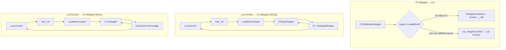
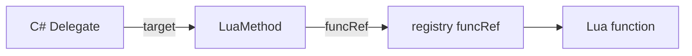

---
sidebar_position: 15
title: "Delegate / Function Marshal"
---

# Delegate / Function Marshal

> **Normative:** Bidirectional Marshal between C# `Delegate` and Lua functions.
> **Related:** class ByObj basics → [`06-CLASS.md`](/docs/spec/marshal/06-CLASS/); `GetFunction` → [`../01-HOST-API.md`](/docs/spec/01-HOST-API/); C#→Lua byref → [`04-OPAQUE.md`](/docs/spec/marshal/04-OPAQUE/); Lua→C# byref → [`03-BYREF.md`](/docs/spec/marshal/03-BYREF/); `to_delegate` → [`../05-LIB.md`](/docs/spec/05-LIB/).

**Platform principle:** Mono and Il2Cpp share the same **Lua-visible semantics**; implementation paths may differ (Il2Cpp: build-time C++ bridge; Mono: runtime Expression Emit).

**No Event-specific subtable:** ZLua has **no** Event special Marshal; subscribe/unsubscribe use ordinary methods `add_*` / `remove_*` (see [`../02-TYPE-SYSTEM.md`](/docs/spec/02-TYPE-SYSTEM/).

## 1. Problem and goals

| Direction | Need |
|-----------|------|
| **C# delegate → Lua** | **Default** treat as ordinary class (DelegateUserData); can `Invoke` / `d(...)`. If the delegate **was marshaled from a Lua function** (`target` is `LuaMethod`), re-Push must restore the **Lua function** (§3) |
| **Lua function → C# delegate** | When Lua calls a C# method with a delegate parameter, **implicitly** marshal the Lua function to that delegate type |

| Goal | Notes |
|------|-------|
| Seamless | Like ordinary args: Lua passes function; conversion happens in the **method-call marshal layer** |
| Performance | Player zero reflection; reuse bridges by **Invoke signature**; Editor caches Emit by signature |
| Unified | C#→Lua via **GetFunction / delegate bridge** shares push/pcall/pop rules |
| Safety | `funcRef` lifetime bound to delegate; forbid dangling calls |
| Controllable | Un-codegen'd Il2Cpp signatures error clearly at runtime; **Mono signatures that cannot Emit raise clear `NotSupportedException` (forbid silent degrade to reflection/`Method.Invoke` hot path)** |

## 2. Overall architecture



**Core components:**

| Component | Role |
|-----------|------|
| `LuaMethod` | **Closed target** for Lua→C# delegates; holds `funcRef` (registry ref) |
| `DelegateBridges` (Il2Cpp) | Build-time C++ bridges registered by `Invoke` signature |
| `DynamicBridgeFactory` (Mono) | Runtime **Expression-compiled** bridges by `Invoke` signature, **cached by signature** |
| `LuaDelegateBinder` | Create delegate: `LuaMethod` + bridge |
| `ReadDelegate` | Lua function on stack → delegate; parallel to method `ReadValue` |
| `LuaCallInvoker` | `funcRef` + push + `pcall` + pop; shared by `GetFunction` binding and delegate bridges |

## 3. C# delegate → Lua

### 3.1 Split rules (required reading)

When Pushing a **delegate instance** onto the Lua stack, split by whether **`target` is `LuaMethod`**:

| Decision | C# → Lua shape | Notes |
|----------|----------------|-------|
| **`target` is `LuaMethod`** | **Lua function** | `lua_rawgeti(REGISTRY, luaMethod.funcRef)`; script gets the **original Lua closure** |
| **Other** (native C# multicast, ordinary object target, etc.) | **DelegateUserData** | Same as ordinary class: `Invoke` + `IMT.__call` |

```text
PushDelegate(d):
  if d == null → push nil; return
  if IsLuaBoundDelegate(d):          // target is LuaMethod (closed)
      PushRef(d.LuaMethod.funcRef)  // → Lua function
      return
  PushByObjUserData(d)              // → DelegateUserData
```

| Item | Rules |
|------|-------|
| **Recognition** | Both platforms: `target is LuaMethod` (or equivalent flag) |
| **Multicast** | Function path only when the **entire invocation list can restore to a single Lua source**; otherwise ByObjUserData, keep C# multicast semantics |
| **Round-trip** | Lua `function` → C# delegate → Push again: **same** `funcRef` → function |
| **`[LuaMarshalAs(UserData)]`** | Does **not** override the split: Lua callback sources still Push **function** |
| **`null`** | **`nil`** |

**Rationale:** When a script-supplied Lua function is retrieved again after a C# hop, it should still be a function, not “C# userdata wrapping the same callback”.

### 3.2 Carrying shape (non–Lua-callback-source)

**Applies only to the DelegateUserData branch of §3.1.**

- Delegate instance is **ordinary managed-object userdata** (Il2Cpp: `ObjectRegistry`; Mono: GCHandle).
- **Type table** same as ordinary class (including closed generic delegates).
- **Static members** via `SMT`; **instance members** (including `Invoke`) via `IMT`; **no** need to generate a separate bridge merely to pass a native delegate.

### 3.3 Lua call styles

**Always prefer** `d(a, b)` / `handler(...)`: consistent with “Lua function retrieved via C# is still a function”; works for both branches.

| Style | Applies to |
|-------|------------|
| `d(a, b)` | **function** and **DelegateUserData** (latter via `IMT.__call` → `Invoke`) |
| `d:Invoke(a, b)` | **Only** DelegateUserData; **invalid** on function; docs and business code **do not recommend** |

```lua
local handler = someObj.Handler   -- may be native delegate or round-tripped function
handler(42)

-- Round-trip: Lua→C#→Lua yields function
obj:RegisterCallback(function(v) end)
local f = obj.Callback
print(type(f))   -- "function"
f(1)
```

### 3.4 Instance metatable `__call`

For **`MulticastDelegate` subclasses**, the instance metatable also registers `__call` (**only DelegateUserData**; function branch has no metatable):

```
Stack layout: [delegate_ud, arg1, arg2, ...]
→ collect args
→ MulticastDelegate.Invoke
→ PushReturn
```

| Item | Rules |
|------|-------|
| **Multicast** | Keep C# multicast semantics |
| **`null`** | C# `null` → `nil`; calling on `nil` errors |
| **Open delegate** | open delegate with `target == null`: MVP **unsupported** |
| **Direction** | ByObjUserData does **not** go through §4 bridge again; Lua-bound callbacks already became function on Push per §3.1 |

## 4. Lua function → C# delegate

### 4.1 Main path: implicit marshal of method parameters (default)

**Usually no need** to create a delegate explicitly:

```lua
-- C#: void RegisterCallback(Action<int> onValue)
obj:RegisterCallback(function(v) print(v) end)
```

Flow:

```text
1. Resolve Nth parameter type as delegateType from MethodInfo
2. Stack slot is Lua function (or nil → null delegate)
3. ReadDelegate(L, index, delegateType)
     → luaL_ref → funcRef
     → LuaDelegateBinder.Create(delegateType, funcRef)
4. Fill generated Delegate into C# call args
5. After method returns: if C# does not retain the delegate long-term, GC reclaims LuaMethod and unrefs (§7)
```

| Lua argument | C# delegate parameter |
|--------------|------------------------|
| `function ... end` | `LuaDelegateBinder.Create(parameterType, funcRef)` |
| **`nil`** | **`null`** |
| delegate userdata | Pass through |
| Other types | **Error** |

**Type source:** **C# method's declared parameter type**; Lua need **not** pass the delegate type again.

### 4.2 Shared convention: `LuaMethod` + closed delegate

**All** Lua→C# delegates have **`target` = a `LuaMethod` instance**; do **not** forge an arbitrary C# object's member method as target.

| Field | Value |
|-------|-------|
| delegate `target` | `LuaMethod` (closed) |
| delegate entry | Platform bridge (§4.3 / §4.4) |

### 4.3 Il2Cpp: build-time C++ `DelegateBridges`

For each needed delegate **`Invoke` signature**, build-time generates a C++ closed-delegate entry (same scan lineage as `MethodBridges`):

```cpp
// Example: System.Func<int, int>
static int32_t Bridge_Func_int32__int32(Il2CppObject* target, int32_t a)
{
    const LuaMethod* m = reinterpret_cast<LuaMethod*>(target);
    lua_State* L = LuaEnv::GetState();
    const int top = lua_gettop(L);

    lua_rawgeti(L, LUA_REGISTRYINDEX, m->funcRef);
    Marshaling::PushDefault<int32_t>(L, a);
    Marshaling::LuaPCall(L, 1, 1);
    const int32_t ret = Marshaling::PopDefault<int32_t>(L, -1);
    lua_settop(L, top);
    return ret;
}
```

- **void return** (`Action`, etc.): `LuaPCall(..., 0)`, no pop.
- **`ref` / `out` / `in` on `Invoke`:** **Supported**; C#→Lua (bridge calling script) defaults to **OpaqueValue** ([`04-OPAQUE.md`](/docs/spec/marshal/04-OPAQUE/).
- **Non-default `[LuaMarshalAs]`:** Same resolution as ordinary methods / **GetFunction-obtained delegate calls**.

**Unregistered signature:** Runtime table miss → clear error prompting Codegen again.

### 4.4 Mono: Expression Emit bridge (failures must be explicit)

Mono does **not** pregenerate `LuaDelegateShims`; at runtime, compile bridges with **Expression trees** from `delegateType.GetMethod("Invoke")` (factory cached by `Invoke` signature).

| Item | Notes |
|------|-------|
| **Emit timing** | First encounter of an `Invoke` signature |
| **Cache** | Same signature emitted once |
| **marshal** | push/pop same rules as `LuaCallInvoker` |
| **Unsupported signatures** | Unmarshalable params / returns → **`NotSupportedException`** (**forbid** silent `Method.Invoke` / `object[]` hot path) |
| **`ref`/`out`/`in`** | **Supported** (not rejected for containing byref) |

**Forbidden:** `Delegate.CreateDelegate` on `DynamicMethod` (may SIGSEGV under Unity Mono); use `Expression.Lambda(...).Compile()`.

**Mono rewrite principle:** If an `Invoke` signature cannot Expression Emit, **fail clearly at bind or first use**; do not invent a temporary slow path that might leak into Player.

### 4.5 Optional: explicit `zlua.to_delegate`

Only when you need to **construct a delegate first, then pass** (**non-default path**):

```lua
local d = zlua.to_delegate(function(a) return a end, closedFuncIntIntType)
obj:RegisterCallback(d)
```

| Parameter | Notes |
|-----------|-------|
| `func` | Lua function |
| `delegateTypeTable` | **Closed** delegate type table |

Implementation calls the same `LuaDelegateBinder.Create`; returns **delegate userdata**.

**Native:** `__zlua_to_delegate`

## 5. GetFunction and delegate bridge

| | Closed delegate from `GetFunction<T>` | Other C#→Lua closed delegates |
|--|--------------------------------------|-------------------------------|
| **Call direction** | **C# → Lua** (bound by module + method) | **C# → Lua** (e.g. after Lua→C# implicit marshal, then call back) |
| Bind timing | First `GetFunction`: `require` module + `luaL_ref` → `funcRef` | Implicit marshal or `to_delegate` `luaL_ref` |
| Entry | `LuaAppDomain.GetFunction<T>` → `T.Invoke` | closed delegate bridge |
| **Marshal** | push / `pcall` / pop | **Same set** (`LuaCallInvoker`) |
| **`ref`/`out`/`in` (C#→Lua)** | Default **OpaqueValue** | Default **OpaqueValue** ([`04-OPAQUE.md`](/docs/spec/marshal/04-OPAQUE/)) |
| **`params`** | **Unsupported** | **Unsupported** |
| Cache | **Caller's responsibility** | Decided by holder |

**Shared implementation:** `LuaCallInvoker` (Mono) / `InvokeFromRegistry` (Il2Cpp) shared by `GetFunction` bind path, `DelegateBridges`, and `DynamicBridgeFactory`.

**Not a C#→Lua delegate bridge:** Implicit marshal of delegate **parameters** when Lua calls C# (§4.1) goes **MethodBridge → ReadDelegate**.

## 6. Lifetime and GC



| Event | Behavior |
|-------|----------|
| Implicit marshal / `to_delegate` | `funcRef = luaL_ref(REGISTRY)`; delegate holds `LuaMethod` |
| Delegate GC'd by C# | `LuaMethod` finalizer / `Dispose` → queue `luaL_unref` |
| Lua function has no other refs | Registry ref still holds until delegate releases |
| Call while delegate alive | Normal `pcall` |
| Call after `funcRef` invalid | Error |

**Mono note:** `luaL_unref` must run on the **main thread** holding `lua_State`; `~LuaMethod` / `Dispose` only `AddPendingRef`; `LuaEnv.ProcessPendingRefReleases()` batch-releases on the main thread.

**C# delegate → Lua:**

- **Lua callback source** (§3.1): Push **function**; do **not** create a new registry ref
- **Native C# delegate:** ByObjUserData released by `__gc` / GCHandle; does **not** pin a Lua function

## 7. Mono (Editor) vs Il2Cpp (Player)

| Item | Il2Cpp (Player) | Mono (Editor) |
|------|-----------------|---------------|
| **C# delegate → Lua** | §3.1 split | **Same** |
| **Lua→C# bridge** | Build-time C++ `DelegateBridges.cpp` | Runtime **Expression Emit** (cached by signature) |
| **Delegate bind** | `SetClosedDelegateInvoke` | `Expression.Lambda(...).Compile()` |
| **Codegen** | Required (§8) | **No** pregenerated delegate shims |
| **Unsupported signature** | Runtime table miss + Codegen hint | **`NotSupportedException` (explicit fail)** |
| **Lua-visible semantics** | Authoritative | **Must match Il2Cpp** |

## 8. Codegen and signature table (Il2Cpp)

> **Mono does not use this section**; Editor uses `DynamicBridgeFactory` at runtime.

### 8.1 Generation scope

Shared or same-lineage scan with `MethodBridges.cpp`:

- All public methods with **delegate parameters** (derive `Invoke` signature from `MethodInfo`)
- Optional delegate whitelist in build config

Output: `generated/DelegateBridges.h/cpp`.

### 8.2 Signature key

Based on the delegate type's **`Invoke` method**:

```text
void(System.Int32)                 → Action<int>
System.Int32(System.Int32)         → Func<int,int>
```

Mono Emit cache keys **align** with the above.

### 8.3 Unregistered signature (Il2Cpp)

```text
unsupported delegate signature for Lua callback: System.Func<...>
```

Prompt to re-run ZLua Codegen.

## 9. Edge cases

| Scenario | MVP strategy |
|----------|--------------|
| `Action` / `Func<>` / custom delegates | Unify bridge resolution by **`Invoke` signature** |
| **C# delegate → Lua** | §3.1: Lua callback source → **function**; native C# → DelegateUserData + `__call` |
| **`ref`/`out`/`in` (Lua→C# calling delegate)** | See [`03-BYREF.md`](/docs/spec/marshal/03-BYREF/) |
| **`ref`/`out`/`in` (delegate bridge C#→Lua)** | **OpaqueValue**; see [`04-OPAQUE.md`](/docs/spec/marshal/04-OPAQUE/) |
| **`params` (GetFunction / delegate bridge)** | **Unsupported** |
| Open delegate | May be unsupported |
| Multicast Lua callbacks | Implicit / explicit create are all **unicast** |
| Covariance / contravariance | **Exact** delegate type match only |
| **`LuaMarshalAs`** | Il2Cpp: fully generate bridges; Mono: unsupported → **explicit error** |
| **Event** | **No** dedicated support; use ordinary `add_*` / `remove_*` methods |

## 10. Related docs

| Doc | Contents |
|-----|----------|
| [`06-CLASS.md`](/docs/spec/marshal/06-CLASS/) | DelegateUserData, façade |
| [`03-BYREF.md`](/docs/spec/marshal/03-BYREF/) | Lua→C# byref |
| [`04-OPAQUE.md`](/docs/spec/marshal/04-OPAQUE/) | C#→Lua byref / bridge callbacks |
| [`02-MARSHAL-AS.md`](/docs/spec/marshal/02-MARSHAL-AS/) | `[LuaMarshalAs]` legal sets |
| [`../01-HOST-API.md`](/docs/spec/01-HOST-API/) | `GetFunction` constraints |
| [`../02-TYPE-SYSTEM.md`](/docs/spec/02-TYPE-SYSTEM/) | Delegate type tables, `__call` |
| [`../05-LIB.md`](/docs/spec/05-LIB/) | `to_delegate` |
| [`../../impl/codegen/EMIT-MONO.md`](/docs/impl/codegen/EMIT-MONO/) | Mono Expression Emit |
